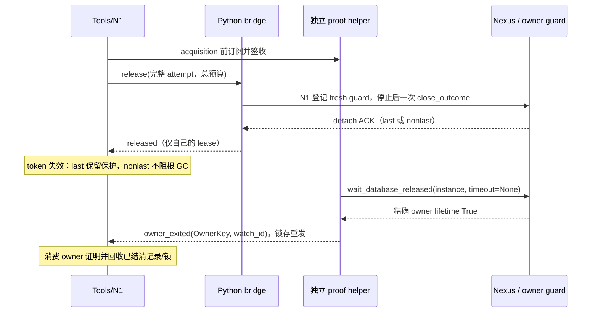

# Nexus 释放与打开协议：N7a-R 设计

状态：第一阶段 r4 设计修订，落实 U1–U6 与 r3 聚焦复审，待本轮增量复审；不代表实现、测试或 N7 验收通过。
日期：2026-10-17。设计基线：`feat/nexus-backend`，`f47dd2301b096f1c4b6643906f6e8976e8663469`。
设计输入提交：`460f0966cc6db174d49342a5536a1a54e046ebd8`（r3；前序设计为 ff81992、36ed13c）；产品与测试仍为上述 f47dd23。
第二阶段须另行派单；本阶段只提交本文件及主计划 N7 中的引用。

## 1. 依据、目标与保留边界

依据是 [主计划](nexus-backend.md) 第 5 节、N1–N7 交付约定、全部验收裁定和
[测试约定](../TESTING.md)，以及以下终审、设计评审与用户裁定：

- `/tmp/ida-nexus-run-20261015.98rmfb/n7a-final-audit/report.md` 全文，特别是状态机、不变量、F1–F10、简化方向与存疑项。
- `/tmp/ida-nexus-run-20261015.98rmfb/n7a-rereview8/report.md` 全文，特别是 R8-F1/R8-F2。
- `/tmp/ida-nexus-run-20261015.98rmfb/n7a-refactor/review-claude/report.md` 全文（P1-1/P1-2、P2-1–P2-12、§4–6）。
- `/tmp/ida-nexus-run-20261015.98rmfb/n7a-refactor/review-astra/report.md` 全文（D1–D5、§3–6）。
- r2 委托 `prompt-design-r2.md`（SHA256 `c7e195bef5f9f6ff187e48e7d8884adb1399a640caaab5bd1d14e5a3c570986a`）中的 U1–U4，已裁定结论见 §10.3；逐条回应见外部 `review-response-r2.md`。
- `/tmp/n7audit-repro.5EnFte/{harness/src/main.rs,stub_bridge.py,run.sh}`、两位 reviewer 的 `/tmp/n7rdr-repro.{wzQ1QG,GMAiQAHD}/` 及固定 Nexus 源码只读参考；不执行旧 run.sh，不改现场。
- r2 增量复审 `/tmp/ida-nexus-run-20261015.98rmfb/n7a-refactor/rereview-{claude,astra}/report.md` 全文，含 N1–N9、R2-F1/R2-F2 和两份 W1 建议。
- r3 委托 `prompt-design-r3.md`（SHA256 `c08a53c210781fca1b08ea8799783c491d29ccb2fbffb86287d3cf2f0f2c638a`）及 U5；逐条回应/行号见外部 `review-response-r3.md`。U1–U4 不重开。
- r4 委托 `prompt-design-r4.md`（SHA256 `24703a97ab9900da5a36fc8497b633b71315fac8c9a3d221bf33c911dbfb4025`）、U6 和 r3 两份复审 `rereview3-{astra,claude}/report.md` 全文；逐项回应见外部 `review-response-r4.md`。
- 真实隔离 VM 实验 `/tmp/nxboot.mvnMXj/{report.md,result.json,console-reboot.log}` 作为历史设计输入，结论与边界见 §3.4.2；本轮不重跑、不计产品验收。
- 固定 Nexus 0.13.4 加三个本地补丁，`handle.py` SHA256 `aa5d7ea42caaa922ef494d7d8a1406396537a4ea88d9e833825e08c8d279025e`；本轮只读其公开契约。

目标是把四个事实分开：调用方结果、一次命令的投递、自己的 lease 是否 detach、精确 owner 是否释放数据库。
每个事实有一个权威状态持有者，其余层只消费带身份的证据。现状的关键接缝是：

| 基线入口 | 已核对的行为 | 设计后责任 |
|---|---|---|
| `src/router/nexus_transport.rs` 的控制帧期限 | Release 默认 2000ms | detach 控制仍最多 2s；发送前准备改用 close 总预算，不承担保存/退出等待 |
| `nexus_bridge/lifecycle.py` | 最后 ACK 后在同期限等 lifetime，组内传播证明 | 一次性 detach；owner 证明独立观察 |
| `src/router/nexus_bridge.rs::apply_event` | `release_unconfirmed` 删 pending，之后未知事件可使整桥断开 | 命令终态与 owner 事件分流，单事件隔离 |
| `nexus_bridge/bridge.py` 的 open | wait_analysis 完成后才通告 opened | 取得 handle 即登记，准备完成才对外发布 |
| `nexus_bridge/open_recovery.py::Snapshot` | 最终文件直接复制，回滚共用 open 期限 | 完整 staging、逐文件原子发布、journal 恢复门禁 |
| 固定客户端 `handle.py::open` | resolve 后 attach；连接异常还会 resolve/attach 一次 | 公开结构化获取结果与精确 attach 边界，见第 5 节 |

以下已接受语义继续成立：不重放可能已生效的 release；没有相应证明不称已释放；保护无法确认不默认保存或 close。
r9 首次 Root 不可见且未修改时，不保存关闭；同 boot 仍在双证明后重开，U6 整机 boot-change 可独立结旧资源前提（§3.4.2），最多三次；中途丢失永久拒绝写回，保留 TEMP|KILL、savebase/closebase hook、显式 save 前校验。
崩溃恢复继续采用快照、允许 Nexus 内部恢复、事后隔离与还原，不改成禁止恢复。
新代际、跨 router flock、隔离区、宽限期、close 证明补丁、共享 lease 隔离和 N1 停止证明均保留。

不扩大已登记的保证：独立外部 opener 的 FD/注册/隔离路径窗口，guard 安装前 Nexus 恢复保存窗口，脚本或其他客户端直接保存、未订阅通知、受信任代码篡改、native 不可抢占均仍存在。独立 Nexus 客户端可在同一 owner 执行代码；这会使该 owner 不满足同 boot OS 资格，不能把此窗口当作允许无证据放锁的豁免。
不声称修复 IDA r9 根因；Linux、GUI、活动 debuggee 与专用输入的未验收范围不由本设计关闭。

## 2. 身份与唯一状态所有权

### 2.1 物理身份与 incarnation

`OwnerKey = (state_root_identity, record_id, pid, started_at, canonical_idb_path, backend)`。
state 根身份为公开 get_state_dir 解析结果及目录 device/inode；五个 instance 字段逐项匹配，不能按路径/PID 猜配。
它表示稳定的物理 owner；router、bridge、helper incarnation 与 watch_id 是独立的投递身份，**不属于 OwnerKey**。
换 bridge/router 或新建订阅不能改变物理身份，也不能使同路径新 owner 继承旧退出证明。
只持久化非敏感公共字段；不序列化 token，不私读注册内容，不用 record_id 拼造 instance。
必需的独立 proof helper 持有通过公开发现取得的真实公共 instance 对象，见 §3.2–3.3。

`LeaseKey` 是完整 `SessionLease`（client_id、lease_id、instance_id、generation、owner kind）。
`DeliveryAttempt` 是完整 target 加单调 sequence；owner-exit 不使用 release sequence。
同 owner 的所有 lease 可引用一个观察项，但每个物理 handle 保留自己的 ACK 与 detach 结果。

`AcquisitionId = (parent OpenIdentity, purpose, ordinal)`，purpose 明列 final、verification、initial-root-retry、auxiliary。
auxiliary 即使在父用户结果结束后获取，也引用持久保留的父身份与独立 ordinal，不复用用户 open 或旧 lease 身份。
至多三次 r9 尝试、verification 和断连清理都串行，按需最多两个同时存活资源槽，见 §5.1。
这些是 adapter IPC 身份，不是 Nexus 私有 lease_id，不新增用户参数。

`LaunchIdentity` 包含 parent/acquisition、launch suffix、Popen 身份及启动时刻、log_path、目标/state 根和预期 backend。
launcher PID/退出不等于实际 owner PID/退出；不能由启动观察到期推出没有写入者。
`RecoveryId` 是稳定 `CoordKey` 下的唯一事务编号。直接用户 IDB 的 CoordKey 由 Nexus identity_key 与父目录身份确定；受管代际由实际 store 根身份与不可复用 generation id 确定，原/隔离路径映射同一 CoordKey，见 §6.2。
`OSBirthIdentity` 记录 machine/volume/观察域、boot_id、pid、原生出生时间/精度、start_time_us、sid/pgid、平台方法及 eligibility_epoch；与 OwnerKey/LaunchIdentity 绑定，见 §3.4。同 boot 资格是目标侧唯一权威的单调持久状态，不是 helper 私有 bool。
`ResourceDisposition` 与 N1 历史结果正交：Live / RetiredByBootChange；`ExecutionLiveness` 可为 ImpossibleInCurrentBoot，不是历史 execution_stopped/成功证明。转移须精确绑定旧 boot 和旧资源，见 §3.4.2。
LaunchIdentity 的预分配 suffix 在 Popen 前已进入 spawn intent，实际 Popen 身份创建后立即交付；不能等 log_path 创建成功后才登记。

### 2.2 逐层状态、事件与转移

| 层 / 唯一持有的事实 | 状态 | 事件与转移 | 不再判断什么 |
|---|---|---|---|
| owner guard：是否允许保存/自动关闭写回 | Uninstalled → Healthy；Root 缺失 → PoisonedSafe；查询/标志/hook 不可确认 → ProtectionUnavailable | 每次 before/after、显式 save、fresh close_status、savebase/closebase 重新采样；Poisoned 不恢复 Healthy；只有实际设置并读回 TEMP\|KILL 才为 PoisonedSafe | 不判断 lease 是否释放、不共享 owner-exit 证明 |
| Nexus 服务端：lease 成员与 owner 生命周期 | Live → Detached；最后引用按 keepalive 进入 Draining → 数据库关闭 → lifetime 释放 | 公共 release 或 SSE EOF；detach ACK 可先于保存结束；GUI/其他引用继续存活 | 不改服务端、不新增协议 |
| 客户端 handle：公开调用边界及原始 detach outcome | Connected → CloseIssued → AckDetached / DetachUnknown；连接状态正交 | 调用前锁存一次性请求；有效 last/nonlast ACK 均记录 lease_released；异常保留原始字段；同 handle 不重复发请求 | 不让 status='uncertain' 掩盖已取得的最后 ACK，不把 EOF 当 owner 释放 |
| Python bridge：物理 handle 账本与调用阶段 | Acquired/Preparing → Ready 或 CleanupRequired → DetachIssued → Detached/Uncertain；BlockedBeforeSend 可退回 CleanupRequired | acquired 立即登记；ready 才交付；失败转清理；每个 handle 独立 guard 与一次 detach；保存拒绝累积 | 删除 release_group 证明传播；不自行推断 N1 phase，不用通用 public_started 猜所有命令 |
| 独立 proof helper：观察与公共证明 | Watching → Exited；异常为ObservationFailed/Abandoned | 公共True独立落proof；OS只提交candidate，目标写者按§3.4权威核验再分型发证 | 不发release，不把候选或旧eligibility当证明；U6与同boot分scope |
| Rust 事件泵：相关性与交付可靠性 | pending command / acquisition custody / owner subscription，三张分开的有界表 | 命令结果只结算对应 attempt；owner_exited 按 helper 身份、watch_id+OwnerKey 投递；重复命令幂等、未知命令丢弃；迟到 custody/stop/proof 仍消费各自责任 | 不持有第二套 lease 释放状态，不因未知消息 fail 整桥 |
| N1：逻辑会话、操作、投递及清理责任 | 会话新增 Preparing；Preparing → Active 或 ReleaseRequired → ReleaseRequested → Released；Disconnected 正交保留责任 | opened 登记；带 disposition 的 custody_ack 不代替内部 operation grant；open_ready 发布；失败转 ReleaseRequired；NotSent 恢复清理阶段；Uncertain 不重发；匹配 ACK 或 public_owner_lifetime 确认 detach；同 boot os_process_exit 只交 Tools 退出义务；U6 单独结当前资源/执行存活义务，不改历史 phase | 不把 Released 当 owner 已停止；调用方终态、execution_stopped 和投递状态继续分离 |
| Tools：对外记录、owner 保护与文件锁 | PreparingRecord → ActiveRecord → DetachedRetained → Retired；U6 可由旧资源直接 RetiredByBootChange；异常为 CleanupBlocked / OwnerObservationFailed / RecoveryBlocked | N1 Released 使 token 失效并退出活动列表；last/Uncertain 保留 owner 根 SH，nonlast 释放本次 lease guard；startup/recovery 有独立持有者与终态 | 不用 15s/120s 到时推断释放，不轮询第二套 owner 状态 |

Tools 的 owner 保留表是资源账本；N1 是会话状态的唯一权威。Python 的状态是原始 handle 调用事实，不能直接改 Tools。
Rust 与 Python 的短暂消息延迟由显式 InFlight/CustodyPending 表达，不能出现一边 Active、另一边已丢 handle 的稳定状态。



## 3. 两阶段释放与 owner 观察

### 3.1 阶段一：自己的 lease detach

一次逻辑 close 先用 §4 的发送前预算完成 fresh guard、自有分片清理与错误签收，之后才投递至多一次
close_outcome(wait_for_database=False)。detach 控制预算仍最多 2s，不等保存；保护不可确认时绝不发 detach。
根损坏但 TEMP|KILL 已确认时允许不保存 detach，同时将 saving refused 独立返回调用方。

| 原始证据 | N1 / 控制结果 | 后续责任 |
|---|---|---|
| 有效 nonlast ACK | Released / Confirmed | 本 lease guard 释放；只保留轻量 OwnerKey/诊断，不阻整根 GC |
| 有效 last ACK，shutdown_pending=True | Released / Confirmed | owner draining；Tools 保留该 owner 根 SH，最终保存不占控制预算 |
| 请求已可能发出，ACK 丢失/坏 JSON/传输失败 | ReleaseRequested + Uncertain | 不重发；公共 owner proof 可结 N1；同 boot U5 仅结 owner/file；U6 可结旧 lease/执行资源占用但保留历史 UnknownOutcome，不伪造 ACK/Released |
| close_outcome 尚未调用 | NotSent，退回 ReleaseRequired 或原 phase | 可新 attempt；内部 RPC 停止责任与保护失败仍独立存在 |
| public_owner_lifetime 先于 detach 结果 | 锁存 proof，仅结清同物理 owner 的旧 lease | 不伪造 ACK、不改变原投递、不丢保存错误 |

SSE 证据另分为 LocalStreamClosed（本地 shutdown/close 成功）、PeerEOF（读到 EOF）、StreamCloseFailed。
它们均不是 detach ACK 或 owner proof，不能将 Uncertain 改为 Released，不能借 heartbeat 到期宣告停止。
Claude 的真实 stub 实验在 heartbeat=0.5s 下约 1.34s 自动 detach，说明健康服务端最终会回收断流 lease；
默认 heartbeat 的 10–15s 只是预期观察尺度，调度、网络和服务异常下不作为硬证明或解锁计时器。
**Uncertain 不阻止附加同一健康 OwnerKey**：新请求在目标 gate 下公开发现并精确匹配同一 owner，
健康 attach 可继续，旧 Uncertain 责任单独保留。这样共享 GUI 长存也不会阻断同 owner 的新 opener。
只在服务端仍健康且 heartbeat/调度推进的故障模型下预期断流有界回收；没有 owner proof 时未知记录不伪收敛。
不同 OwnerKey 的新建须先结清旧 owner-held 条件及其余 gate 义务：公共 proof 或合格 U5 证据只各结其允许的范围；没有可信来源则 pending/blocked，而非等待固定秒数放行。

primary 与自有 auxiliary 各有独立 LeaseKey、AcquisitionId、N1 清理责任与 release attempt。
auxiliary 在创建前登记 cleanup-only；先推进所有可请求成员，每成员只发一个终态，删除组内 donor/二轮协调。
Tools 只聚合结果与保存错误：所有自有成员有 detach 证明才称本次自有引用释放完成。
primary ACK + auxiliary NotSent 时前者保持 Released，后者可在停止/保护条件满足后新 attempt；
不能把整体锁存为 Uncertain。已发送无证明的成员不重发，其余 NotSent 成员仍能独立推进。
辅助检查失败返回原错误并保留 handle；primary 成功不能掩盖它。

删除 release_unconfirmed；每 attempt 只有一个命令终态，后来的 owner 证明走独立通道。
N1 `owner_released(OwnerKey, proof)` 仅接受 public_owner_lifetime，核对 owner→lease 绑定，结清旧 lease，包括实际已退出的 NotSent/Disconnected 清理项；
原 ACK、投递和调用方确定结果保持，不能让 owner 退出把失败业务改成成功。U6 经独立 boot-change 资源结清路径进入 N1/Tools，不调用此公共 proof 接口伪装 Released。

### 3.2 必需 proof helper、持久证明与立即重开

proof helper 是协议的**必需组件**，由 Rust 管理，独立于业务 bridge，不执行业务/release/shutdown，不加载 IDA。
**每个 (router 管理域, state_root_identity) 一个 helper**：同一 router 涉及多根就各启一个并分别 admission；
同根不同 router 默认不共享 helper。固定 SDK 的 REGISTRY_DIR 在 import 时由环境决定，helper 启动前设置绝对 IDA_NEXUS_STATE_DIR，
握手返回实际 state 根/device/inode；订阅根不符拒绝，运行中不得改环境或模块全局“切根”。进程数按 router 的 state 根上限计费，各根 watcher 上限再计 owner 数。
Rust 在 resolved 阶段向对应 helper 发非敏感 OwnerKey；helper 公开 discover 取得真实 instance，逐字段核对并记录 §3.4 OS 身份。
`subscribe_ack(OwnerKey, helper_incarnation, watch_id)` 必须在**将要附加的新 owner**的 acquisition 继续之前签收。
helper 再发现时旧 draining owner 已 reap 不代表退出证据丢失，先用下述旧对象/证明交接路径；不为观察一个已退出旧 owner 强求新的 subscribe_ack。

U5 要求 bridge 的 owner-observation 表独立保留**原真实 instance 强引用**，last/nonlast ACK 或 handle 清理不丢它，
只用于同 state 根的公开 wait_database_released；不在 IPC/磁盘序列化 token，不重建 instance。
每不同 OwnerKey 一项，按对象条数与估算保留字节单独计费，不与物理 lease 槽混计；预算满在取得下一 owner 前 Busy，已有对象不驱逐。
只有匹配证明已持久化、Rust 已 durable 接管并给出 proof_custody_ack 后才释放该备用引用；若 owner 长存则明确占用，见 §3.5。
helper 持真实 instance 后每 OwnerKey 一个公共 wait 线程（不占 release/业务/stop 池），公共 True 才产生 public_owner_lifetime。

helper/Rust 使用私有 0700 运行目录、0600 Unix socket，核验同 uid/peer credentials、endpoint inode、版本与 helper incarnation。
**proof 固定持久位置**为 §6.2 的协调目录下 `proofs/<OwnerKeyHash>/<proof_id>.json`，不放 IPC/tmp 或会随 router 退出删除的目录。
每项包含 CoordKey、state_root_identity、OwnerKey/LaunchIdentity、evidence_type、producer、seq、OS 身份/条件（若适用）、eligibility_epoch/authority_hash 或 boot-change capability、内容校验和；0600/O_EXCL/O_NOFOLLOW，temp+fsync+rename+目录 fsync 后才可发事件。
协调目录的 `owners/<OwnerKeyHash>.json` 与各 recovery.json 都持久引用 proof 路径、id、hash；跨目标共享 owner 时先给每个未结目标落可独立验证的副本/引用再撤备用来源。
proof_id 全局唯一且包含 producer incarnation；proof_seq 仅在 producer 内单调，去重用 (physical OwnerKey, proof_id)，不能拿新 helper 从 1 开始的 seq 覆盖旧事实。
Rust 先入可靠 owner 表、由目标 journal 写入者 durable 接管再 ACK，缓存事件重发直到确认；新 watch_id 按物理身份继承原事实，不因 bridge/router 换代丢弃。
**ACK 不是删除许可**：仍被引用或用于失败/安全决策的最后 proof 不因 ACK、IPC 清理、root GC 或换 router 删除。健康常规记录仅在 §3.5 全部压缩前提满足后自动结算；失败/取证证据继续保留。
订阅、startup 交付与 ObservationAbandoned 同样写唯一不可变观察记录，由目标锁持有者归并 owners/journal；helper 不能并发 replace 权威 journal。
订阅 ACK 只待自身记录 durable，原目标锁持有者负责引用落盘；orphan 退出前引用仍指向该 producer 的固定记录目录，下一 gate 枚举并核验未归并记录。
public True→fsync 之间仍有故障窗口；写入失败留 ObservationFailed 和原对象，不假称 durable。持目标锁的线程不能等一个需要同锁才能写完的证明，锁规则见 §6.2。

last-ACK、Uncertain 以及 **bridge EOF 后无 ACK 的 Disconnected** retained 项持根 SH 并计不确定容量。
EOF 不改已确认的 nonlast ACK；该项只留轻量 OwnerKey/观察和 §3.4 所需记录，不持本 lease 根 SH，也不阻根 GC。
其他活动 lease、startup/recovery 自有 guard 仍保留。正常 open 的 content/open EX 在发布结束释放；目标 EX 更早在实际 attach/owner 登记后释放，见 §6.2。
失败 open 若无失败恢复意图、无 startup/文件写入且所有 operations 已 stopped，可在目标锁下把 content/open EX 转为 root SH+durable owner 责任，仅准随后精确同健康 owner attach。
真正 failed-owner-held 仍阻任何新 open，不能借此绕过事务 gate。保存错误墓碑不随 owner 证明先到而删除。
nonlast 释放本 lease guard 后 GC 仍需公共占用检查、隔离和宽限期；健康 payload 的回收与稳定协调区分离，见 §6.2。

跨 router 立即重开按以下有界规则执行：

1. 同 router：Tools 在新请求原预算内等待已知 last/draining owner 的退出，再在目标 gate 下重核后 open；未到预算不能只因正在 draining 直接 Busy。Uncertain 允许附加同一健康 owner，不准另建 owner。
2. 跨 router 的 SDK 原 open 仍最多执行原有的 resolve→attach、NexusConnectionError 后一次内部 resolve→attach。U1 outcome 交付每阶段的类型化 503/busy/lease_absent、首次真实 resolved instance 与 observation_ref，以及 `sdk_reconnect_used`；不能把它们藏在最终异常里。
3. **SDK 内部连接失败重试不消耗退出证明后的那一次重新 resolve 额度**。只有前段所有 attach 都类型化确定未取得 lease、或 custody 交付了真实资源并由 N1 结清后，才可进入独立 `post_exit_resolve_used=false` 阶段；任何可能成功而未知的 attach 不重放。
4. B 已取得原 instance/ref 而 helper 再发现落空时，按同 physical OwnerKey 顺序使用既有 helper 结果/持久 spool、B（或仍存活原 bridge）的原真实对象公共 wait；这些来源都不可用后才检查 §3.4 os_process_exit。没有任何可信来源才 UnknownOutcome/blocked；absence 本身不是证明。
5. 原对象的 public True 直接走同一 durable proof 接管路径，不需要为已退出旧 owner 重新 discover。原真实对象必须在其原 state 根进程中观察，不能送到另一根 helper 改环境使用。A 的 helper/spool 仅在已认证 locator/目标引用精确匹配时消费，不按 PID/路径猜配。
6. 退出证据已持久接管且新请求尚有预算时，设置 post_exit_resolve_used，**只重新 resolve 一次**；所得新 instance 在 attach 前必须由其根 helper 新签收，最终 attach 的结构化入口不再隐含触发另一层连接重试。故最多是原 SDK 两次 resolve 加证明后一次 resolve；全部是无 lease 的生命周期获取，不重放业务。
7. 预算全程不重置；有 lease/outcome 未知、证据源暂故障或新阶段无余量时保留精确责任与 stage 返回，不不断尝试；r9 三次双证明是独立受限编排，不借此加次数。

小库在与 f47dd23 同预算内 close→立即 reopen→读回修改应一次新请求成功；慢保存仅预算耗尽才 Busy。
需立即拷贝/备份的 caller 用 status 返回的非敏感 owner_observation_ref，在 status 等待路径指定 wait_owner_exit/自己的预算，exited 后才复制；
不新增 lease、不复用 close token，不把 owner 退出当保存成功。status 必须分型 public_owner_lifetime、同 boot os_process_exit、verified_boot_change_resource_retirement、manual_offline_recovery；分别显示历史结果与当前资源 disposition。

### 3.3 helper、startup 与跨进程责任的生命周期

启动顺序：Rust 统一 home/state → 对每根启 helper 并握手 → bridge 握手 → admission → helper 订阅签收 → acquisition/准备 grant。
helper 用 **setsid/start_new_session**，不继承 router 的终端、业务 pipe、父死亡信号或 group kill；标准流重定向私有日志，Unix socket 独立重连。
独立 session 避免终端 SIGHUP，但不承诺抵抗宿主 cgroup/进程树强杀、注销、断电或重启，均列 §10.3 共因故障。
helper 的 durable 注册在各协调目录写 helper_id、state 根、endpoint 身份与管理 router；status 按这些记录列 orphan helper、订阅数、OS 身份、最后连接与退出期限，不靠进程名扫描猜配。

router 断连后 helper 继续观察：所有订阅已得到 durable proof、startup 已结清/转交且无需保活责任时，落完引用后立即退出，不必等一个不存在的 router ACK。
仍有活 owner 而无 router 重连，**orphan_idle_timeout=300s** 后先将每项 ObservationAbandoned、原原因、最后真实观察、OS 身份和可恢复 locator durable 记录，释放内存 watcher 后正常退出；期限只结束 helper 观察，不能结清 owner/lease 或解除 gate。
其守护线程可随 helper 进程退出，不给 owner 发信号；有写盘/引用失败时 status 报退出受阻，不能删除唯一证据来满足空闲期限。
下一 router 按记录重新公开发现、原对象备用、持久 proof 或 OS 证据恢复；live 但无法发现且 OS 身份仍活则 blocked，绝不把 abandoned 当 exited。
正常关停先拒新 acquisition、停止 operations、清理自有 lease；bridge 可先停，helper 在结清/明确转交或上述 durable abandon 后最后退出，不能强关共享 owner。

孤儿接管先核对已有 helper/订阅并接续原容量，不因 router 重启重新算空闲额度；多 router、多根、连续重启与写盘退出受阻均按实际数量/字节列入 status，不声称全机进程数有固定上界。只有 StartupPending 而没有 OwnerKey 的订阅也适用同一 300s abandon/退出受阻规则。

**startup 观察权威**是 Rust startup 表，实际后台观察交给对应 state 根 helper，在 Popen **之前**先签收 launch suffix/target/spawn_intent，并记录本机作用域与当前 boot_id。
SDK 在创建直接 Popen 后立即回调交 pid、OS 出生身份和 sid/pgid；helper/Rust durable 签收后才等 ready/log_path，其失败保留 intent。
固定 POSIX spawner 直接启动 console script worker 且 start_new_session=True；不是以中间 shell/daemonize launcher 代替身份。
R0 必须核验该直接子进程与实际 worker exec-stable 关系；换平台/包装器不能证实时不靠其退出清 startup。
bridge EOF 后 helper 继续查精确 LaunchIdentity 的 OS 生命周期和按 target+suffix 的**公开发现**；找到精确 owner 后先订阅签收，再把 startup 保护无缝转给 owner。
实际启动进程/其合格 session 已退出可用 os_process_exit 结清 startup；只留下预分配 suffix 而无 OS 身份时，公开发现可补已出现实例，**未发现 suffix 不证明没启动**，同 boot 下仍 startup-unconfirmed，必要时离线维护。若 intent 已绑定可核验本机/本地卷及旧 boot，即使缺 Popen pid，U6 核验整机 boot 改变仍可按 §3.4.2 结旧启动资源义务。
router 已退出时 helper 把 startup/proof 事实写协调区，由下一 router 的 gate 消费；OS 释放旧 Rust flock，durable gate 不消失。

| 故障 | 证明与推进规则 |
|---|---|
| bridge 崩溃、owner 正在关闭 | helper 持真实 instance 独立等待并 durable proof；旧 bridge 不必重启，N1 只按各自证据转换 |
| helper 单故障、owner live | 新同根 helper 公开匹配并签收，或 bridge 原真实对象只读观察；原责任与 guard 保留 |
| helper 单故障、owner reap | 先持久public proof/原对象，公共来源丢失后分别核验同boot资格证据或U6 boot-change；各只结本scope允许的义务 |
| bridge 先失效、稍后 helper 失效 | 不要求同一瞬间；仍依同一来源优先序和 OS 门禁，失败则 W1 residual blocked |
| router failed-owner-held 重启 | 同目标 gate 读取 helper/owners/proofs，重连或消费 durable 证据；不复活旧 session/client/release 授权 |
| 多 state 根或根被替换 | 各根独立 helper；旧根对象不改绑新 REGISTRY_DIR，根 inode 变化报 ObservationFailed，OS 同机身份可补退出，不能用错误根下的 absence |

### 3.4 U5/U6：OS 证据与历史结果分离

生产实现仍计划为独立只读 `nexus_bridge/process_identity.py`（第二阶段新增并打包，不导入 tests/support），Rust 管理/消费，helper/bridge 共用；本轮不实现。
记录 `OSBirthIdentity`：本机/本地卷/host PID 与 time namespace 观察域、boot_id、pid、native_birth、start_time_us、birth_precision、sid/pgid、方法版本、OwnerKey/LaunchIdentity、eligibility_epoch 和捕获原因。
macOS 用 libproc proc_pidinfo(PROC_PIDTBSDINFO) 的 pbi_start_tvsec/tvusec（真正微秒）、getpgid/getsid，boot 用 kern.bootsessionuuid，并完整枚举 session/进程组。
Linux 用 `/proc/sys/kernel/random/boot_id`、`/proc/<pid>/stat` 的 start_ticks/session/pgrp 与 SC_CLK_TCK，保留原始 tick，再整数换算 start_time_us；**换算不提高 tick 分辨率**。身份精度/唯一性不满足时，同 boot OS 分支不支持/BLOCKED；不能用秒级 ps/lstart 代替。
R0 冻结并验证 host 观察域，不能把另一 PID/time namespace 的同 pid/不同 ticks 当 PID 复用。短读、EACCES/EPERM、未知 ABI、部分枚举、观察域不明一律 Unknown，不把读不到当退出。

签收时在公开 instance.pid 上读 birth→以原真实 instance 做 timeout=0 的公共 lifetime 检查→重读 birth。
公共 True 直接 durable public_owner_lifetime；False 加两次相同 birth **仍不足以证明 owner 归属**，须再核对 SDK 启动身份/已连续观察实例与实际进程关系；捕获恰逢退出/复用或归属不明时同 boot 资格为 false。
Popen 直接子进程从创建捕获 exec-stable 身份；suffix 只作关联，不替代出生身份。以下两个证据分支明确独立。

### 3.4.1 同 boot os_process_exit：执行前单调撤销资格（D1）

同 boot 证据只有公共观察来源/持久 public proof 都不可用后才考虑。原 PID 已不存在/僵尸/出生已变，只能证明原进程结束；还须旧 sid/pgid 完整无成员，并可证锁 FD 未经 fork/setsid/SCM_RIGHTS/显式继承逃逸。CLOEXEC 不阻 fork，也不阻显式传 FD。
默认 `eligibility=false`。`managed=true`、固定启动器、受信任代码或有限反例通过，都不能证明所有执行入口可控；接受独立 Nexus 客户端、GUI、未知插件/native 扩展而无法纳入下述撤销协议的 owner，**同 boot 分支默认不支持**。不改服务端、不偷偷限制原有外部客户端功能；R0 若无法证实入口闭合，就保留 false，U6 boot-change 分支不受此资格限制。

权威为由物理 owner canonical target 推导的固定协调区 `owners/<OwnerKeyHash>.eligibility.json`，跨 home/router/helper 共享一份；含完整 OwnerKey、boot/观察域、authority generation、单调 eligibility_epoch、allow/revoked、原因和已核验入口能力。多个目标引用同 owner 时只引用该权威，不复制可各自变真的 bool；映射不完整拒绝 OS 证明。
仅首次绑定的新物理 OwnerKey 可在 R0 入口/平台门禁全满足时 durable 建立 allow；同一 OwnerKey/boot 由 allow→revoked 后永不恢复。重新订阅、新 helper、重启 router、失败/取消均不能重置；新 owner 必须用新物理身份和新权威。
任何可能 fork/setsid/转移 FD 的操作（包括用户 run_script、未覆盖的内部/插件执行）在**授予执行权前**，先在根 SH→目标 EX 下写 revoked、递增 epoch，文件与目录 fsync，取得 durable revoke_ack，再释放锁并按 N1 epoch 复核后 grant。撤销写入失败或状态不明就不 grant；尚未执行时崩溃也保留 revoked。不得等 RPC 返回后撤销，也不因取消而恢复。

helper 只写带读到的 epoch/hash 的不可变 `OSObservationCandidate`，不是最终合格 proof，不持目标锁等待别的写者。最终发证由根 SH→目标 EX 的唯一 journal 写入者重新读取权威并验证当前仍 allow、候选 epoch/hash/boot 与当前一致，再 durable 生成 os_process_exit；消费时再次同锁复核并原子记录实际解除的义务。撤销与发证/消费在同一锁下串行，跨 helper 缓存 true 或已生成的旧 epoch proof 都不能绕过后来的 revoked。
资格检查/grant 不持 N1 短锁做 I/O；grant 再核 epoch/父状态。不要求 helper 为公共 lifetime proof 取得目标锁；其不可变写入继续独立，Rust 在持锁区直接归并。
独立客户端代码不可观察时不能只在“发现第三方之后”撤销来补救：整个可被该入口使用的进程类从一开始就 false。公开占用检查即使能发现继承 IDB 锁，也只是文件操作前的独立防线，不能替代前置资格协议。

合格同 boot 结果单独 durable 为 `evidence_type=os_process_exit, scope=same_boot`，含查询、birth、session/逃逸约束、authority generation/epoch/hash 与 R0 capability id。
它仅结 owner/startup 退出与相应 owner/file guard 条件；不充 SDK ACK/public_owner_lifetime、不补 N1 原结果或历史 execution_stopped，不重放 release。若另缺本 lease 公共双证明或内部停止条件，同 boot OS 证据不能代替，继续明确 blocked。
R0 必测真实 fork-without-exec/setsid/SCM_RIGHTS/可继承exec反例、执行前撤销落盘边界崩溃、B撤销而A持旧true、独立公开客户端代码、PID/namespace复用与读权限；无法排除锁逃逸或闭合入口时保持 blocked。另独立验证公开 occupancy probe 能否检出继承 IDB FD，不能用此测试通过开放资格。

### 3.4.2 U6：核验整机 boot-change 后结清旧资源（D5）

新证据名为 `verified_boot_change_resource_retirement`，属于 U5 OS 证据体系中的**整机 boot-change 独立 scope**，不与同 boot os_process_exit 混用。
成立条件是：持久记录已绑定同一宿主机/本地卷/host观察域与旧boot；当前 capability 可可靠确认仍是该宿主机/卷，且**整机内核 boot 确已不同**。普通 PID/session 消失、Paseo/bridge/router重启、容器或 PID/time namespace 重建都不成立；不靠 hostname、路径、pid、空值或一份可复制的 machine-id 猜同机。

`BootChangeCapability` 必含平台方法/版本、machine scope 与来源、稳定 volume identity、host namespace/虚拟化范围、旧/新boot及核验摘要。macOS R0 核验硬件 IOPlatformUUID、目标卷原生 UUID 与 bootsessionuuid 的绑定；Linux R0 核验非空硬件/firmware机器身份、挂载卷原生 UUID、host boot_id与观察域的来源。它们是候选来源，不自动获得能力；缺失/不唯一/可被当前范围克隆或回滚时标 UnsupportedBootScope 并 blocked。
虚拟化/克隆/快照恢复默认无此 capability，除非存在不随guest快照复制/回滚、能认证同一实例连续性的外部管理域证明；不能把guest DMI/machine-id或本地随机文件单独当防克隆证据。本地卷身份用原生稳定卷ID与对象fileid/manifest绑定，重启后原始 st_dev 编号变化只能在该绑定核验后重映射，不可按路径放宽。跨机器复制journal、VM克隆/恢复快照、远程文件系统/远程锁、身份或host观察域无法验证时拒绝本分支。

所有本地lease/startup/operation资源在取得或grant前须durable绑定捕获的machine/volume/host boot及创建incarnation；历史缺绑定项不能事后按路径猜归旧boot。
同机整机 boot 变化可证明旧boot owner、其内存 lease、全部本机继承FD和旧本机执行不再存活，不受旧session逃逸或同boot revoked影响。它证明“当前资源已不存在”，不证明历史close/save/执行成功。
按精确旧boot/OwnerKey/LeaseKey/LaunchIdentity及operation归属，durable记录 `ResourceDisposition=RetiredByBootChange`、`ExecutionLiveness=ImpossibleInCurrentBoot` 与原历史结果引用；N1原phase/UnknownOutcome、原ACK位、原execution_stopped/因果证明字段不改成Released/成功/已收到停止回执。诊断墓碑保留原错误与NeverReplay，旧token/operation不复活、不自动重放。
N1/Tools用上述正交资源状态从活admission/cleanup等待集、watcher/lease/owner/startup保留表及对应root SH中移除**仅属于旧boot的**资源；若原stop责任只是在等待该旧boot本机执行结束，也以ImpossibleInCurrentBoot结当前存活义务，不再永久占槽/阻gate。历史停止结果仍unknown，不能用于新boot执行。未绑定旧boot、远程执行或新boot资源不受影响。

恢复前提改为两条互斥路径：同 boot 按原本lease detach/公共owner双证明及N1停止规则；U6合格时，**旧lease已不存在、旧owner及旧执行不可能继续**可独立满足旧资源占用/停止存活前提，不再等待不可能产生的旧detach ACK/公共proof。这不是新增一次release，也不把未知获取重放；旧失败open不重启，后续新请求/单一恢复job只续文件事务。
资源结清不等于文件gate立刻全部解除：在实际根 SH→同一目标 EX 下再核journal完整、target/卷/组件身份与size/hash/mode，独立公开占用/组件探测确认没有新boot owner或外部持有者，才允许继续staging/还原；坏日志、来源不明、当前占用仍blocked。durable restored或无失败意图的安全归档后才解除剩余文件gate。旧boot证据绝不作用新owner/新请求、新会话操作或其他机器。
status/log/journal单列旧/新boot、capability、resource_disposition、current_execution_liveness、原UnknownOutcome/ACK缺失和剩余file gate原因；不能用泛化“已释放成功”掩盖历史未知或让已结旧资源暗中继续卡容量。

历史实测 `/tmp/nxboot.mvnMXj/` 使用同一宿主 VZ实例/不变配置和本地虚拟磁盘，真实 Linux kernel `reboot -f` 后 boot_id改变、旧owner及setsid子进程继承的真实flock释放，无detach ACK；原UnknownOutcome保留，新boot owner仍可阻锁。lease仅最小内存模拟；guest firmware identity无可用值，同机由宿主持有同一VZ实例/config保证，不是guest身份算法验证。
该实测不是macOS或真实Nexus/IDA/r9 E2E；重启前sync，未证突然断电耐久性、产品identity/日志/恢复。R0/R4/R7须分别补产品路径的boot-change、复制到别机/克隆/快照与新owner拒绝、身份缺失/namespace假变化/日志不完整拒绝、原结果未知与容量不再被旧资源阻塞；VM报告不能直接记作这些门禁通过。

### 3.5 常规记录压缩、配额与影响面（D3）

无ACK Disconnected仍按未知detach保根SH，已确认nonlast不因EOF重新加锁；其他unknown operations另有停止责任。同boot OS不补N1停止；U6按§3.4.2只结旧boot资源存活义务。
根SH挡**同实际cache根全部GC**，不挡同根SH普通业务；坏目标journal只直接拒该目标，不能自动拒全根open。一个helper覆盖多OwnerKey，故障可能影响多目标；status分别列根、target、used/limit、最大来源与next_action。

| 记录/资源类别 | 计费与满额行为 | 自动处理与保留边界 |
|---|---|---|
| 活跃资源 | parent/lease/owner/startup/watcher/备用instance各按条数与字节计有界活跃容量；满则在新副作用前拒需该资源的admission | 不驱逐未结项；已有会话、停止/清理/status继续；U6合法结清的旧资源不继续占活槽 |
| 健康常规记录 | 订阅、正常public proof、owner绑定、正常转交/退出的startup、健康payload_deleted摘要占独立routine工作预算，不计永久失败证据配额 | 同一有限CoordKey集合的反复健康open/close应自动回落，不因累计历史次数要求人工维护；routine将满先压缩已结项，不要求先获人工授权 |
| 失败/恢复/取证证据 | failed/blocked/mismatch/manual、恢复snapshot/failed/staging/quarantine/backup、用于安全决策的最后OS/boot证据及关联引用占独立retained_evidence配额 | 不自动删以腾配额；80/95/100%告警，满只拒需要新增该证据/事务预算的admission，可能影响共享配额的无关目标；具体人工归档另行授权 |
| 稳定命名空间 | lock inode、最小target/authority身份及退休位置摘要另计namespace_bytes，不伪装为可释放证据 | 不删除或重建lock；每CoordKey固定有界底座，不与open次数线性增长。新gid/不同直接路径增加独立底座，统计诚实为O(不同CoordKey数)，不承诺无限新目标总空间常数 |

常规自动压缩只在：该记录全部跨router/目标引用和lease/owner/startup/operation义务已结、proof已被所有消费者durable接管、无未签收事件、同目标无未结失败事务、非最后安全决策证据时运行；条件未知则保留。活跃helper还可能重发/新增引用时不得删。先完成producer/consumer关闭epoch并持久化，迟到消息只能匹配该已结epoch摘要，不能复活引用；新观察用新epoch和新预算。
压缩执行者在实际根SH→目标EX下lock-then-verify-inode，重读全体引用/版本并单写journal；先写有界summary与compaction intent、fsync文件/目录及接管引用，再删除/压缩仅被清单覆盖且身份/hash不变的常规记录，逐步目录fsync，最后committed。中断由同锁gate幂等续跑；摘要/引用未durable不删，坏清单或新引用出现即停并保现场。稳定lock与未结journal、失败证据永不在删除清单。
每CoordKey滚动健康摘要上限64项，并限制摘要总字节；观察注册由目标锁写者分配永不回退的target observation epoch，已结连续前缀压为closed_through水位，未结空洞仅保留在有界活跃表。旧epoch消息只拒绝或幂等答已结，不凭被压缩的旧明细重新开引用；计数/固定身份之外的健康明细可自动回收。eligibility撤销/transfer等仍被安全决策引用的权威水位不能淘汰或回退；不再需要明细时压成单调摘要，而非重置为allow。跨目标引用全部结清前不得局部删最后副本。
固定目标集N轮健康open/close的routine文件数/字节与摘要有界；新增gid的永久锁/最小身份底座单列，不能用“归档证据”声称可释放它。无限不同目标与永久锁不可能有全局固定空间上界；routine配额不按历史gid数累计拒绝普通使用，物理磁盘容量/命名空间真实I/O失败仍须明报，不能虚报可无限扩张。此处不新增锁分片或删除稳定锁架构。
常规预算满先自动压缩；若只有未结项则属于活跃容量满，返回Busy+live_refs而非“请人工归档健康记录”。清理I/O/权限/身份失败返回RoutineCompactionFailed，拒需新routine空间的admission，不删除安全证据或假称清理成功；可重试的后续清理必须基于原意图，不靠无限扩大预算。失败证据配额满与物理ENOSPC分别报告，不把两者混为正常记录增长。
cleanup/proof/compaction预留应急条数与字节，申请新事务含本次分配和收尾预留；满额测试须证明已有义务可继续，真实ENOSPC仍ObservationFailed/blocked保对象/现场。status展示活跃、routine可压缩/引用中、永久失败、稳定底座与实际可释放字节；不宣称人工归档会降低稳定命名空间底座。


## 4. 精确副作用标记、预算与错误传播

### 4.1 请求边界与 N1 停止责任

以命令各自的事实替代 public_started：BeforeDetach / DetachMayBeSent / AckDetached，
BeforeAttach / AttachMayBeSent / Acquired；execute/cancel/shutdown 继续原投递与停止语义。
控制 grant 只表示允许开始处理；真正进入 close_outcome 前才锁存一次性 DetachMayBeSent。
guard RPC 超时只说明 detach 未发送，不代表 guard RPC 未执行/已停止。

选择**精确登记每个内部 operation**，而不是聚合停止义务：已有 N1 因果停止接口可逐项审计，也避免 bridge EOF 时证明“聚合内部已无工作”依赖第二套状态。
准备、fresh guard、自有分片清理都经 §5.2 的内部操作准入/grant。每个 operation 带精确 lease/acquisition、operation_id、purpose、attempt 和期限。
保留 guard/cleanup RPC 的停止门禁：NotSent 可排队新的逻辑 close attempt，但在旧内部 operation 真正停止前，不发下一次清理/guard/detach。
不采纳 Claude P2-3 去除停止门禁的建议，原因是 U4/D1 要求保留 N1 停止证明；幂等不等于已停止，已进入 native 的 RPC 不一定被 lease detach 撤回。
取消可以用已有公共 cancel_operation_outcome，只有精确返回、因果停止或匹配 public_owner_lifetime 才补 execution_stopped，不能用 SSE EOF/用户到期代替。

| N1 状态 | 重试规则 |
|---|---|
| Active、Preparing 转来的 ReleaseRequired、Disconnected，且 detach=NotSent | 可新建 sequence，但先等待原内部 operations 停止并复查 fresh guard；人工 close 可显式重试 |
| ReleaseRequired 且 lane Busy/可证 NotSent | 有界退避自动推进已受理清理；保护不可用转 CleanupBlocked；不做 10ms 热循环 |
| ReleaseRequested 且 Queued/Acknowledged/Uncertain | 不发第二次 release；只等原结果/owner proof |
| Released | 幂等返回已记录结果，不请求远端 |
| ShutdownRequested / 原操作未停止 | 同boot保持禁止detach，ACK不充execution_stopped；U6仅结旧boot当前执行存活义务，保留历史unknown并禁重放 |

### 4.2 发送前预算、线程容量与签收

close 总预算沿用调用方原期限及现有最多 15s 外层保险，不重置；拆成 preflight 与 detach 两段。
preflight 可使用剩余预算减去最多 2s detach 及签收余量，不再挤进旧 2s 控制帧。每次内部 RPC 的执行 timeout
取剩余 preflight 减去客户端固定 5s HTTP 余量；不足以容纳 5s 余量就不投递，报准确 NotSent。
因此公共 execute_python 的 timeout+5s 不会偷占 detach 预算；不修改 HTTP 私有协议。
控制调度不让 guard HTTP 占用 release_pool：独立 preflight_pool 2 槽、detach_pool 2 槽、既有 stop_pool 2 槽，队列均有 admission 上限且按 owner 公平轮转。
同 owner 串行内部操作，owner 忙不会占两个 detach 线程。队列到期未投递是 NotSent；已投递超时保留 operation/停止义务，slot 仅在调用实际返回后释放。
本地 queue、签收的等待上限复用现有 dispatch_ready/grant：最多 2s 且不超过当前阶段剩余预算；不是另加 2s。
在总预算里预留至多 2s 给 release_observation ACK；每次 close 增加一次本地 IPC 往返和状态写入，必须计入 preflight 时序。
owner 真正长时间忙于不可抢占 native 时不承诺 close 成功；已受理清理保留 ReleaseRequired/operation pending 后台推进，status 可查，不要求用户反复 close 来维持责任。
后台重试以新的有界 preflight 预算等待原 operation 停止，绝不重放已可能发送的 detach 或吞掉保护错误。

### 4.3 保存错误的可靠交付

结果带原 cause、command stage、完整目标、save_guard_error、cleanup 与 owner 状态。
保存拒绝由生产 guard/真实公开 RPC 产生，NotSent/Uncertain/Released 及 auxiliary 失败路径均累计。
detach 前把 fresh guard 拒绝/保护状态经 release_observation 交 Rust，Rust 先写入权威记录再签收；
该 sideband 不改变 detach delivery，不删除 command pending。ACK 丢失用同 observation_id 幂等重发，超时不 detach、结果 NotSent，Rust 已收事实不回滚。
桥在签收后崩溃，Rust 仍把保存拒绝交付 caller/status；签收前崩溃报告保存/准备结果未知，不伪造拒绝或成功。
owner proof 不清除错误，墓碑按既有容量保存；不以 take 一次清空 Uncertain 的原错误。
close 已 detach 但保存被拒绝仍报错，注明 lease 已释放、owner 是否 pending，以及已知未保存修改丢弃事实。
ACK 后本地清理失败独立报告，不能覆盖 parsed ACK；close 成功不等于保存已完成或备份可用。

## 5. open 不留孤儿：先登记，再准备与交付

### 5.1 custody、disposition 与串行 acquisition

取得 handle 即通告内部 opened；Rust/N1 先托管 Preparing，准备完成才对外发布。
不等 Python 用过期 open deadline 清理完才通知 Rust；能力未验证时不伪造 IDA 版本、不接受用户业务。

| 事件 | Rust/N1 原子处理 | Python 后续 |
|---|---|---|
| opened(acquisition_id, lease, OwnerKey, preparing=true) | 核对预留槽，接管资源；订阅 helper 并签收；回复 custody_ack(disposition=prepare 或 cleanup-only, grant_epoch) | 仅确认 custody；prepare 还须逐个内部 operation grant，cleanup-only 绝不启动准备 |
| open_ready(acquisition_id, capabilities, recovery) | 当前父 open 未取消/超期、全部准备成功且无未停止 operation 时 Preparing→Active、交付 token | 不保留第二套用户终态 |
| open_cleanup_required(acquisition_id, cause, operations) | 父结果保持唯一失败；停止准备；Preparing→ReleaseRequired，停止后调度清理 | 只执行 N1 授权的内部 cleanup |
| open_failed_no_acquisition(stage, startup, transaction) | 用户确定失败；按 §5.4 三行表分别转交责任，**不能一概释放 guard** | 无新 attach；保留启动/文件事实直到签收 |

父取消/超期/future drop 与 custody 由同一 N1 锁仲裁；取消先发生时 disposition 必须 cleanup-only，即使墙钟仍有 open 余量。
prepare disposition 不是无限授权；每次 operation grant 原子复核父状态与 grant_epoch，取消后旧 grant 不再准入新 RPC。
已投递 RPC 走停止证明，不能由撤销 grant 伪称未执行；open_ready 迟到只补事实，不覆盖父失败。

子获取串行：final、r9 retry、verification 在前项同boot双证明（或U6合格旧boot资源结清）与文件事务结清后才获取下一项；不复活旧失败open。
每 parent 按需最多两个物理槽（一个当前 acquisition + 一个必要的 cleanup auxiliary），不预留七个；第二槽不足在获取 auxiliary 前 Busy，不能先获取再找槽。
正常串行复用已结清槽，AcquisitionId/LeaseKey/ordinal 永不复用。父用户结果结束后，父资源记录仍可定位 cleanup 子项。
在既有 tenant 总容量计 parent/物理槽，不静默乘容量；helper watcher/retained owner 与墓碑分别按 §3.3 上限计费。
仅内存中的已结清身份诊断墓碑可按条数/字节上限淘汰最旧**无未结义务**项；这不删除持久 journal/proof/归档证据。未签收事件或 proof 不能因容量被删，满则拒绝新 admission。

custody 采用现有 dispatch_ready/grant 的有界往返模式：相同 AcquisitionId+LeaseKey 重发 opened，Rust 幂等返回相同 custody 决定；
后续取消可把 disposition 收紧为 cleanup-only（递增 grant_epoch），不能恢复 prepare。身份冲突隔离当前 acquisition 并保留原资源。
往返上限最多 2s 且不超过当前握手预算；超时停止所有准备、保留 Python 强引用与预留 Rust pending，不转用户成功。
Rust 已接管但 ACK 丢失仍负责清理；未签收期间 Python 是物理 custodian，**不能自行直接 close**，只能重发和等待 N1 cleanup grant。
bridge 正常停止必须先移交/停止 operations；bridge 真正 EOF 时 SSE 由 OS 关闭，Rust 保留精确清理/停止义务，helper 继续观察，不能靠 EOF 报 Released。
来自旧用户 pending 但已登记 acquisition 的消息仍接管清理；完全未知命名空间不授执行权，报告 custody 错误、保留 Python handle，不断开其他会话。

### 5.2 Preparing 内部操作与 N1 精确停止表

已有 execute_python(..., operation_id=...) 与 wait_autoanalysis(..., operation_id=...) 直接接线到 N1，**不需补丁添加参数**。
能力查询、guard 安装/采样、Root 检查、analysis、分片清理都显式登记为 internal purpose，用户 Execute 仍只允许 Active。

| 阶段/事件 | N1 权威转换与安全条件 |
|---|---|
| 准入 | 先分配精确 operation_id，绑定 acquisition/lease/purpose；Preparing+prepare 仅准必需准备，ReleaseRequired/cleanup-only 仅准停止/清理；同 lease 冲突互斥 |
| dispatch_ready / grant | 在操作表登记 Queued，复查父取消、剩余期限、grant_epoch、helper subscription；实际 grant 后 bridge 才可调公共 RPC；未发出是 NotSent |
| 完成 | 匹配公共 RPC 返回/明确 RemoteError(operation_timeout) 确认该调用已返回，写 outcome 与 execution_stopped；成功可推进下一个准备阶段 |
| 传输超时 / bridge EOF | 可能投递的 operation 为 UnknownOutcome，保留停止责任；不能由父失败、socket 关闭或 detach ACK 推出 stopped |
| 取消/超期 | 撤销未来准备 grant，对已发 operation 发公共精确 cancel；cancel 请求本身不是停止证明，stop_pool 独立推进 |
| 停止证明 | 精确执行返回、匹配因果 cancel proof 或同物理 public_owner_lifetime 才补 stopped；迟到事实不改 caller 已确定失败 |
| ReleaseRequired | 父失败即转清理阶段，但只有该 lease 的全部内部/业务 operations 停止后才准 fresh guard 与 detach；guard 自己也按本表登记、返回后才进入 detach |
| Ready | 所有必需准备成功、无 unknown/still-running 操作、能力实测匹配、父仍有效时才 Active；用户业务之前无执行权限 |

停止是 RPC/执行停止，不代表能停止 IDA 所有后台分析；不改变原有 N1/N5/native 不可抢占边界。

r9 仅首次 Root 异常、未业务修改、managed owner 时自动重开；初开最多总共三次。
失败项先转ReleaseRequired；同boot取得本lease detach与同OwnerKey公共owner-exit双证明后回滚。U6只为核验整机boot已变的旧资源提供独立结清路径（§3.4.2），不要求旧ACK；历史失败/unknown不改，前项文件事务未结不启动新项。
所有重开消费原 open deadline；超期禁止下一次 open，不撤销清理/已开始回滚；第三次失败仍还原并返回现场与次数。
GUI 首次失败只清理自己的 lease，不重开、不 shutdown；会话中途 Root 丢失永久拒绝写回，保留 TEMP|KILL、hook 与显式 save 前校验。
verification有独立acquisition/OwnerKey，副本仅在对应公共owner-exit或U6旧资源结清并通过当前占用/文件核验后清理，同boot不放宽。

### 5.3 U1：公开客户端获取结果、资源交付与 ACK

沿原公开实现增加分阶段 outcome/回调，冻结**结果契约**，最终最小文件范围由 R0 原型确定，不预先限定只改 handle.py。
不改服务端、不在 bridge monkeypatch 私有函数、不手写 HTTP/SSE、不解析异常字符串；原公共签名与返回/异常契约兼容。

公开获取结果含 stage、handle 或 None、resolved public instance 或 None、类型化 failure_kind、启动义务完整 LaunchIdentity 列表及文件事务引用。
每次真实 attach 之前公开 stage callback 记录 BeforeAttach/AttachMayBeSent；resolved 交付即保留原真实对象，将要 attach 的 owner 必须先完成 helper 订阅。旧 draining owner 在签收前退出按 §3.2 消费原对象/已有证明，不因此提前 Busy。
SSE 建立后立即 acquired callback 把可 cleanup 的 handle 转给 custodian，**早于 monitor thread.start()**；
SDK 先保有强引用，回调正常签收才完成物理交付。回调异常时 outcome 仍交付同 handle+cause，SDK 保留强引用直到 bridge 显式接管，不能自动 close 掩盖资源归属。
已交付后的 monitor 初始化失败返回 handle+cleanup_required；不再报无 acquisition。
已取得 handle 或 acquired 回调失败不是再次 resolve/attach 的理由，outcome 优先交付资源，不能被原连接异常重试分支吞掉。

固定 _open_lease 在 request/getresponse、非 200、socket 不可用的失败路径关闭连接；
_open_lease 返回后已知构造缺口是 threading.Thread(...).start() 失败，不泛称所有构造异常都有漏流。
探针需覆盖这些真实边界和 callback 异常，分别确认本地流关闭事实与资源交付；即使本地流关闭也不把它当 detach ACK。
确定 busy、参数/resolve/probe/worker_cwd 拒绝不置 AttachMayBeSent；503/draining 按 §3.2 的公开等待与一次重解析规则。
attach 后传输/解析失败按真实 stage 与已存 handle 分类，不能按异常类名或字符串一刀切；未获 handle 也必须交付启动/文件责任。
原 Handle.open 是 resolve→attach，NexusConnectionError 后 resolve→attach 一次；U1 outcome 保留该内部次数/首次真实对象/类型化拒绝。
§3.2 退出证明后的单次重新 resolve 是独立计数，仅在未取得 lease/无可能成功的未知 attach 时准入；最终结构化 attach 不再隐含一轮 open 重试。

启动观测在 SDK 内部现有 spawner 注入口采集 Popen、log_path、launch suffix 等事实，公开传出；
spawn 意图由 Rust/helper 在 Popen **之前**持久登记预分配 suffix；Popen 创建后立即交付 OSBirthIdentity/sid/pgid 并签收，早于 log_path 处理和等待 ready。
若进程已创建但身份交付失败，spawn_intent 未结清且明确 startup-unconfirmed，不允许以没有 handle 释放保护。

close-proof 补丁锁存 parsed ACK 与 ack_kind/lease_released，local cleanup_failure 独立；后续清理异常不能将 ACK 改写成 uncertain。
一次性 close、cancel-unknown、loopback 原语义保留。补丁/prepare 哈希与 probe 在第二阶段同步更新，本轮不动。
这是 U1 对原“不改三个补丁”的有条件偏离；准备 operation_id 是 adapter/N1 接线，不列为 SDK 扩展。

### 5.4 无 lease 时的启动与文件事务义务（D2）

| 用户失败之外的事实 | 权威持有者 / 终态 | 容量、超期与跨故障处理 |
|---|---|---|
| 确定无 lease、无启动、无未结文件事务 | N1 确定 no_acquisition；Tools 核对本地任务结束后释放本次准备 guard | 释放 parent/物理槽，诊断墓碑单独计费；不阻新请求 |
| 无 lease，但 StartupPending（含 spawn_intent 未结清） | Rust startup 表 + 目标 journal 持启动/文件保护；公开回调提供 LaunchIdentity；实际启动树退出且无 owner/写入义务，或完整转交 owner 后才结清 startup | 每启动占 parent 清理容量/观察槽；观察预算用 startup_timeout+grace，默认 20s，仅转 startup-unconfirmed 不释放；桥 EOF 不抹表，router 重启 gate 接续 |
| 无 lease，但有未结 recovery 或备份处理 | durable journal + 单一恢复 job 权威，Tools 保留资源引用；归档无失败意图的 ready，或恢复至 restored/明确 blocked | 事务条数/全部字节计 recovery 预算；open 到期不取消 job；桥/router 退出由目标 gate 续跑，无预算不新建事务 |

startup 只有在公开发现得到精确物理 owner、helper subscribe_ack 完成、Rust owner 表与 guard 交接落盘后才转为 owner 保护；
不得先放 startup guard 再申请 owner guard。launcher 已退出但实际 worker 仍可能 ready 时不结清。
没有可证真实启动身份/派生进程退出时保持 startup-unconfirmed/blocked，交 R0 API 原型验收，不能按 20s 或 absence 推导安全。
bridge EOF后由原state根helper接续startup观察（§3.3）；同boot os_process_exit只结启动退出，U6按§3.4.2结旧boot资源；router重启不杀无权管理的owner。事实不足或进程类 OS 门禁失败才按 §10.3 保 blocked，而非伪造停止。

resolver 在 attach 前创建 crash 备份只是复制，不能等同原组件已移动/损坏。
resolve 失败后，job 在目标锁下核对 before/after 目录身份、原组件 hash/mode、无未结 startup/owner/operation；
无失败意图且原组件未变时登记备份证据、归档 ready/中止事务、释放保护，不做无意义还原。
原组件变化或备份不完整时保留字节与原因；若已有失败意图则进入相应恢复阶段，身份/占用不明则 blocked。
startup 与事务可同时存在，三行表按义务并集处理，任何一项未结都不能一概释放文件保护。

## 6. 回滚原子发布与启动恢复

### 6.1 原子性的准确范围

单个文件可原子 rename，任意用户目录中的 packed 与多个解包组件无法一次 rename 成为整组事务。
本设计保证：最终路径从不暴露截断文件；协作 ida-cli opener 在 journal 提交前不能进入 Nexus；崩溃后可继续还原或明确拒绝。
不承诺外部忽略锁的 opener 永远看不到组件间的中间状态。整组目录替换只适合独占新代际，不能移动任意用户父目录或改变其路径身份。

### 6.2 U3 与 R2-F1：稳定协调区和可回收 payload 分离

选择 reviewer 的**受管代际固定协调位置**方案，不采用随 payload 删除空闲锁目录的方案。
理由：稳定锁/证据与会 rename/rmtree 的 payload 分离，不需要销毁并重建锁 inode；固定位置仍在实际目标 store 的同一卷，所有 home/直接路径调用方都能由目标推导。
journal 本身留目标侧协调区，不以当前 home 中的指针为权威。定义 `R` 为实际 payload 所在的 cache store 根（例如 `<home>/idb`），不是调用方配置的 home。

| 目标类型 | 稳定 CoordKey 与协调目录 | 可隔离/删除单元及 gate 定位 |
|---|---|---|
| 直接用户 IDB（含不受管 legacy flat） | Nexus identity_key（realpath/abspath/expanduser，darwin casefold、win32 normcase）完整 hash + 父目录身份；`<target-parent>/.ida-cli-txn-<key>/` | 不把用户父目录/稳定协调目录交 GC；普通直接库/legacy flat 沿用保留规则，恢复只移动清单内组件至本协调区 quarantine。空闲时保留目录/lock与最小身份，健康常规记录按§3.5自动压缩；失败证据仅授权归档且不删锁，底座空间/status明示 |
| 受管 `R/generations/<gid>/input.i64` | `(R 的 uid/device/inode, 不可复用 gid)`；`R/.nexus-coordination/generations/<gid>/`，**在 `<gid>` payload 之外**，0700、同卷 | GC 仅整组隔离 `R/generations/<gid>`→`R/quarantine/<gid>`，宽限后删除此 payload；两路径都映射同一固定协调目录/lock，绝不随组移动/删除协调区 |

Nexus 折叠 identity_key 仅比较/命名，不当实际路径使用。受管原/隔离路径的 Nexus owner 身份仍分别按真实路径判断；共享的是 GC/恢复 CoordKey，不是给不同 owner 共用退出证明。
受管 generation.json 和协调 `target.json` 固定原 canonical path、gid、store/目录身份与 coordination schema；gid 由创建者唯一生成，删除后也不复用。
每次 open/GC 从**目标实际路径祖先**识别受管 generations/quarantine 形态，先核验实际 R、`.cache.lock`、协调标记和 manifest，不依赖自己的 IDA_CLI_HOME。
即使原 payload 已隔离/删除，也可由 R+gid 找 target.json；隔离路径必须验证到同一 gid/原路径。坏 manifest/缺映射/身份冲突时拒绝相关目标，不能退为“直接用户库”另建 sibling 锁。
已有合法旧代际在首次新 gate 下幂等创建固定 target.json/lock 并升级 manifest 引用，创建 intent 在副作用前 durable；升级/目录创建中断只恢复同一固定路径，不生成备用锁。
任何受支持 router 若直接指定协调区内部 snapshot/staging/恢复 quarantine 的 IDB 路径，须由已核验的祖先 target.json 映射回原 CoordKey，并拒绝把证据作为业务目标；不能在隔离证据旁另建一把 sibling 锁。原路径和这些隔离路径因此同锁，独立忽略锁的外部 opener 仍是已登记窗口。
直接指定受管路径的另一个 home opener 也取 **实际 R 的根 SH** 和同一 CoordKey lock；不能只取自己 home 的锁。隔离中的直接路径 opener 返回 quarantined/retired，不从原路径再建协调锁或重新造库。
GC root EX→目标 EX 下核对 fd 与路径 inode、target.json/manifest/原/隔离 payload 身份，记录 payload_state/isolation intent 后非覆盖 rename、fsync 双目录、记录 quarantined；恢复碰撞则保留两边。
宽限期/两轮复核、epoch/时钟回拨重置、公开占用与未知注册/陌生组件拒绝的已批准条件继续；删除前再目标 gate 核验无未结失败/启动/owner-held/文件 job，并审计原路径未被重建。
只删除健康payload；durable payload_deleted可压为最小退休摘要，稳定lock/inode与必要target映射不动。健康owners/proofs/journal按§3.5全部引用结清后自动压缩；失败证据独立保留计费。
未结/blocked 失败事务保留原 payload、快照、failed 产物全部字节；已结且已归档失败证据仍原样在固定协调区，可回收的是独立健康 payload，不能给额外目录白名单后整组误删。

两类协调区内部同构：稳定 `lock`（0600）、target.json、owners/、proofs/，以及 `<RecoveryId>/{recovery.json,snapshot,failed-files-N,staging-N,quarantine-N}`。
staging/quarantine（恢复证据）不同于 R/quarantine 的健康 payload 隔离单元；两者均验证与目标 parent 同 st_dev。
所有创建/访问用已核验 dirfd，目录 O_DIRECTORY/O_NOFOLLOW、文件 O_EXCL/O_NOFOLLOW/0600；核验 uid、mode、device/inode/普通文件类型和完整 size/hash/mode，拒绝穿越/symlink/未知硬链接与覆盖。
并发 EEXIST 重核身份；lock **永不 unlink/recreate**，不以空闲回收腾空间。目标父目录/受管协调区不可写、不能可靠 fsync/锁/同卷非覆盖 rename，在 probe/open/spawn 前明确拒绝，不退 home。
首次 mkdir/lock/target.json 各 fsync 文件及父目录；journal temp+fsync+replace+目录 fsync，只 replace 自有核验 journal，不覆盖用户数据。

### 6.2.1 锁序、持有区间与唯一事务执行权（D2/D4）

| 阶段 | 锁序/持有者 | 释放或移交边界 |
|---|---|---|
| 普通 open/acquisition | 实际cache根SH → content EX（如需）→ Rust open EX → CoordKey目标EX；多根/目标按身份排序，不反向升级 | 目标EX只覆盖gate/probe/resolve/attach和可靠登记；实际IDB占用已接管后释放，Preparing/runtime/analysis不持目标EX |
| snapshot/失败意图 | 同序持目录核验/复制/意图落盘；占用等待前durable pending | 等owner/operation proof前放目标EX，再取后重读gate/身份/占用，不等一个需要同锁提交的proof |
| 同进程恢复job | 同一个executor任务中move不可复制的目标guard/dirfd；root SH也可同进程move | move前停写、移交后旧task不可访问guard，不经SCM_RIGHTS/ACK；取消/future drop不丢job。此路径验证不能代替跨进程路径 |
| 跨进程恢复job | 接收方先独立取得同一实际根SH并认证prepare；发送方仍持root SH/目标EX，然后只移交目标EX的同一OFD及核验dirfd | 按下表transfer_id协议交执行权；root SH不经SCM_RIGHTS复用，目标EX全程close-only。接收方root guard先到、目标guard最后接管；发送方仅在交付已确认或安全退回后释放自身root SH |
| GC候选 | 实际根EX **LOCK_NB** → 目标EX **LOCK_NB**，再lock-then-verify-inode | 两把都非阻塞，目标忙即跳过该候选，不持根EX等待；候选无可做时立即释放根EX，不能全根open被长等阻塞 |
| 维护/proof归并/资格撤销/压缩 | 受管目标一律实际根SH→目标EX（直接用户库按同一资源根约定）；允许在预算内等SH，不反向取根锁 | 同锁核验/单写journal；维护dry-run不跨用户思考期持锁，apply重取同序锁并重核 |
| helper不可变写入 | helper每次写入先短持实际根SH，仅写唯一proof/candidate/订阅记录，不因长期nonlast观察常驻持SH | 不取目标EX、不反向等待目标写者；不把OS candidate当合格proof，持锁者直接归并；N1短锁不跨IPC/fsync |

跨进程使用专用 `TransferredTargetGuard`：唯一所有权、禁止clone/显式unlock，所有成功/错误/drop路径**只close、不LOCK_UN**，SCM_RIGHTS重复消息里的多余fd同样只close。
不得复用现有 `CacheGuard::drop`（显式LOCK_UN）来承载待转移目标EX；Rust必须以可审计的独立类型隔离，不能仅靠调用方记得不unlock。
根SH由接收方独立open取得且有独立OFD，待目标EX已接管后发送方才释放自身根SH；该根guard不与被转移的目标OFD混用。最终完成时接收方先close目标EX，再释放自己的root SH；所有排队/失败分支同序收尾。
共享OFD的flock只阻挡第三方独立open，**不在发送/接收双方间仲裁写权限**。唯一文件/journal执行权由以下持久executor epoch决定；保有fd不等于获准写。N1短锁只仲裁内存状态，I/O前释放后按epoch复核。

### 6.2.1.1 transfer_id 状态表与故障恢复

`TransferId=(RecoveryId, executor_epoch, sender_incarnation, receiver_incarnation, nonce)`，精确绑定两方出生身份、根/目标inode、job及一次定向通道。
权威 `recovery.json.executor` 含epoch、transfer_id、持有方/状态；收到fd的receiver需单一actor局部互斥并验证匹配的FrozenOffer、当前epoch、根SH和目标fd身份后才可写。发送者一旦进入FrozenOffer，除严格DefinitelyNotSent分支的AbortOffer外不再改事务文件或journal；接收者在Accepted后是唯一写者，不等待“发送者已收到ACK”才执行。

| 状态/边界 | 发送者权限与FD | 接收者权限与FD | durable事实、推进与恢复 |
|---|---|---|---|
| LocalExecuting / 接收prepare之前 | 唯一执行者，持独立root SH和目标EX | 无执行权；可准备自己的root SH，不持目标FD | sender完成当前文件步骤/日志fsync，再开始转移；此前崩溃按普通gate恢复 |
| Prepared / 发送前停写 | 停写并fsync FrozenOffer，保留fd；从此冻结，不因等待超时写回 | prepare只核验身份/根SH，无文件写权 | FrozenOffer是定向授权，必须在任何sendmsg前durable；记录last_completed_intent和epoch |
| DefinitelyNotSent | 仅能在可证明sendmsg从未开始且无定向fd在途时durable AbortOffer→新LocalExecuting epoch，再恢复写 | 无fd、无执行权，撤prepare只释自有SH | 一旦调用可能携fd的sendmsg，即使异常/部分返回也不归此类；不能用EOF/负返回泛化为未交付 |
| SendMayHaveDelivered / HandoffUncertain | 保留fd只是保锁，**没有写权**；可查询状态/同id重发给同一receiver，不能另派第二job | 尚未收到无权；收到则按下一行验权；在途fd本身仍保锁 | 超时/EOF/取消均保持冻结；不通过重新open同锁阻塞等待自身OFD |
| Received → Accepted（ACK前） | 已撤写权，原fd不可用于文件副作用 | 验FrozenOffer及所有身份后，durable Accepted(receiver,epoch,transfer_id)，成为唯一执行者；保持目标close-only fd及独立SH | Accepted是首个允许receiver写的意图；其后可执行并重发ACK，ACK不是执行权的提交点 |
| ACK到达 / ACK丢失 | 匹配ACK或读到同id durable Accepted后，仅close自己的目标副本并释放自身root SH；ACK丢失仍不能写 | Accepted持有者继续唯一执行，公开status/重复ACK | ACK前sender退出不取消receiver，receiver不能因对端EOF丢义务；写Accepted失败则receiver不执行，保锁/报错等恢复 |
| 重复消息/错误身份 | 不创建新transfer或新执行者 | 同id重复不再Accepted/执行；多余fd只close；错误目标/epoch拒绝并只close该次引用 | 防重由持久epoch及actor状态，不按socket连接次数；不可把新进程伪装原receiver |
| sender崩溃（send前/后） | 无继续执行权；OS关闭其引用 | 仅持已认证定向fd并能durable Accepted者可继续；无fd者不从offer凭空取得权 | fd尚在消息队列则锁仍在；新job不得凭sender死亡/EOF绕过目标锁，未交付时等旧引用真正消失再走独立锁恢复 |
| receiver崩溃（recv/Accepted/首intent前后） | 若仍留fd也冻结，不能直接回到LocalExecuting | 崩溃关闭其引用，但在途/副本可能仍存在 | 精确死亡只用于诊断；不能单凭pid/EOF认定所有引用/写权已撤。按下述独立OFD fence或合格U6恢复 |
| 双方崩溃 / 恢复者 | 不复用旧执行权 | 不复活旧Accepted actor | 下一gate先根SH→独立OFD目标EX，核验journal/组件，递增executor epoch落Resumed后唯一续跑；任何旧epoch拒绝 |

HandoffUncertain的安全回收：发送者可保持冻结等待认证查询/Accepted；也可durable保留原FrozenOffer后**仅close自己的目标副本**（不unlock），再由普通gate以独立OFD非阻塞取得同一目标EX。若receiver或在途fd仍持旧锁，必取不到，保持blocked/等待，不新建执行者。
只有独立OFD EX真正取得、lock/path inode一致且journal身份/epoch核验通过，才证旧共享锁引用已不再持锁，durable Resumed(new_epoch)后允许一个新执行者继续。close-only类型、禁止fork/外传事务guard及每次写都持当前有效guard是该fence的必须前提；不能通过显式LOCK_UN伪造fence。原receiver已close后不能凭旧offer重获写权，迟到消息队列若仍有旧fd则本会挡新EX。
恢复不靠“死亡就恢复写”：若不能验证原语/执行者约束、锁被错误解开或identity不明则HandoffBlocked；合格U6可证明旧boot执行者结束，仍须重新取得根/目标锁并核验当前占用和事务，不能略过该fence。接管成功/取消均不重放已完成文件副作用，按持久intent与实际inode/hash幂等续跑。
R0/R4分别验证同进程move和跨进程状态表，包含ACK丢失、两端在send/recv/Accepted/首intent边界退出、在途fd、重复fd、旧CacheGuard Drop反例与独立OFD恢复；一条路径通过不能代另一条通过。

### 6.2.2 恢复步骤、持久顺序与保留

journal v2：snapshotting → ready → failed-owner-held → staging → prepared → isolating → publishing → restored → opened；
blocked 保留原阶段，startup/backup 为正交义务。每步先 durable intent 后文件副作用，实际 inode/hash 消除崩溃歧义。

1. gate/目标身份核验后生成完整 immutable snapshot、校验及 fsync ready，再允许 Nexus 恢复；startup suffix/备份 before 也先 durable。
2. 首次Root失败写failed-owner-held并保存失败组件；同boot后台等lease detach/公共owner及N1停止。U6合格boot-change可独立结旧lease/owner/执行存活前提，不再等旧ACK，历史结果仍unknown；目标/文件/当前占用核验照旧。无证据保gate、放目标互斥而非文件保护。
3. 需要回滚时按§6.2.1同进程move或带transfer_id的跨进程唯一执行权协议交目标EX给job；open 到期/drop 不取消 job 或提前解锁，status 含 job_id、目录、进度、bytes/cause。
4. snapshot 全部复制至同卷 staging，校验 size/hash/mode、逐文件及目录 fsync，再 durable prepared；不直写最终路径，不用用户 open 剩余预算截断搬运。
5. 重核公共占用/目录/组件身份；逐文件 intent→非覆盖 rename 到恢复 quarantine→源/目标目录 fsync→完成日志。未知变化停止，不用 copy+unlink 兜 EXDEV。
6. staged 完整组件按同一 intent/fsync/完成顺序逐项非覆盖 rename 回原路径，记录新 inode；中断半组由 gate 阻止读取。
7. 全组/目录/占用核验后 durable restored 再解除本失败 gate；有余量才下一 acquisition，成功标 opened，第三次失败也必须完成还原。job 崩溃由下一 gate 持锁续跑，不能旧 open 自动重放。

ENOSPC、权限、fsync、EXDEV、内容/身份冲突保留全部现场并附阶段。失败/blocked、恢复快照/failed/staging/恢复quarantine/crash备份与最后安全决策proof **GC永不删除**；健康常规记录按§3.5独立自动压缩，不套用永久证据规则。
健康payload可独立回收，活跃/routine/失败证据/稳定底座分别按CoordKey/RecoveryId计费；新事务含收尾预留，已开始义务不因配额丢弃。
人工导出/归档失败证据须核验新副本、明确授权，不删稳定锁或最后安全证明；不能把常规记录的自动结算误变日常人工维护。

### 6.3 每个受支持 router 的目标 gate 与 v1 升级

任何受支持的新协议 router，**与 IDA_CLI_HOME 无关**，在任何 probe 或 Handle.open 之前都在 §6.2 推导的稳定 CoordKey lock EX 下读取目标标记/journal，
重新核验身份与未结义务。启动扫描/各 home 中的索引只是加速或诊断，不能代替目标侧逐次检查。
锁竞争按本请求预算等待；持锁者退出后重读 journal，不以获得锁或 discover absence 认定可开。
损坏/未知版本 journal、目录身份变化时拒绝该目标并显示目录，不能忽略坏 JSON 或猜测它不相关。
目标保护也涵盖不同 IDA_NEXUS_STATE_DIR：Nexus 公共占用不足以识别的外部 owner 按未知保留，不能扩大原有跨 state 发现保证。

v1 或 v2 的 snapshotting/ready **无失败意图**时，归档保留且不以该 ready 阻断、不要求现场与快照相同；
Nexus 可能已合法修改组件，这不是自动 rollback 的理由。独立 StartupPending/活跃文件 job 仍按各自责任等待，不能被 ready 归档清除。
v1 failed-owner-held/rolling-back 及 v2 staging/prepared/isolating/publishing 必须升级/续跑或明确 blocked。
升级在目标锁下核对原 journal 身份/target/清单/hash，将必要证据完整复制到 §6.2 相应同卷固定协调区的事务目录、fsync 后发布 v2 标记，最后把旧记录归档为已迁移指向；中断时至少一份完整证据仍在。
不跨卷 rename 旧 home 的证据，导入失败保留两边并阻断；同 RecoveryId 导入幂等。
首次升级须离线盘点已使用的 home 中旧 v1 记录并导入目标侧，未导入的其他 home 旧记录无法凭空发现；
混用不执行目标 gate 的旧 router 不属受支持协作集，升级期间先关停旧 router，不宣称它也受新 gate 保护。

v2 根据每个意图的 source/destination device/inode/hash 幂等续跑，来源不明或内容不同绝不覆盖。
failed-owner-held 在重启后按 §3.3 从存活 helper/持久 proof 恢复，匹配旧 physical owner 后才推进；
owner已reap且公共来源不可用时，按§3.4.1合格同boot证据仅结退出类；§3.4.2合格U6则结旧lease/owner/执行资源前提。其余文件/新占用条件未结或scope不合格才按§10.3 blocked。恢复 job 的失败/续跑均由 status 报告，完成不重放旧用户 open。

### 6.4 F7：Nexus 自己的 crash 备份

固定上游 database_state._backup_unpacked_database 会生成 `<target>.crash-<UTC>-<pid>-<suffix>/`，目录属于 resolver 进程，不能拿 owner pid 强行匹配。
恢复清单对这个**精确目标**的新目录单独分类：限定格式、同父目录、非 symlink、普通组件文件、内容/名字对应原 unpacked 快照、无额外文件，并记录目录与递归文件身份。
已存在的备份列入 before；本次新增项先登记 journal 再通过 failed 检查。仅按前缀放行不足以授权移动/覆盖。
内容不完整或来源不能证实就保留并报 blocked，不能删除取证目录或将它当用户目标组件还原。
合法备份被保留为恢复证据，不阻断正常 rollback/retry；不自动 GC。增加 packed+crashed、无 packed、部分备份及 backup 后 resolve 失败的轨迹；无 lease 的结清按 §5.4。

## 7. 接收器隔离与默认目录

Rust apply_event 先分类 command、acquisition、owner 事件，再核对各自身份。
release_observation 属于当前 release 的非终态 sideband，单独签收且不删除 pending；命令终态与 owner-exit 分开消费。
命令未知 attempt、旧 sequence、重复终态、错误 target、未知 event 记录限频日志后丢弃；当前请求可标协议错误并保留清理责任，不能 fail 共享物理连接。
“迟到”不等于“无价值”：已注册 acquisition 的 custody、当前 operation 的停止证明、已登记 OwnerKey 的 owner_exited 仍经各自权威表消费，即便 command pending 已删除。
未知携 handle 消息按第 5 节先处理资源责任，不能用宽松忽略吞掉新 lease。
无法解析的单个完整 JSON 行隔离处理；帧大小/实际 EOF/物理写入失败等连接级故障继续走真实断连，不能吞掉真实 I/O 问题。

lifetime socket 的 accept 与单连接握手分开：recv timeout、EPIPE、OSError、UnicodeDecodeError、无效 ASCII/超长/未知 lease 都只关闭该 connection，清除其临时项，accept 循环继续。
send ok 成功后才安装 lifetimes 条目，替换旧条目时在同一锁下核对精确 lease/incarnation 与当前取消/断连状态；期间 lease 断连或取消则撤销新条目、只关闭本次新连接。失败不能留下坏连接或提前关闭健康旧连接；若旧连接本身已断则保留真实断连，不伪造健康。
监听器自身非关闭期间失败可显式设置 lifetime listener unhealthy，报告并恢复该监听器，不触发 Bridge.stopped 释放所有 lease。
N5 owner EOF 清理依旧只对精确 context/incarnation 做公开 attach、串行清理；与新 owner-exit watcher 是两个方向不同的通道，不能混用。

F10 以 Rust idb_store::ida_home 的行为为唯一解析来源：非空 IDA_CLI_HOME 优先，否则 HOME/.ida，HOME 缺失才 /tmp/.ida；不擅自展开显式 `~`。
Rust 启动 bridge/helper/恢复 job 时传递计算好的绝对 `ida_cli_home`（固定启动 CWD 解析相对路径），Python 的 worker_cwd、cache 与运行目录使用它；recovery 的权威 journal/锁固定在目标侧，home 只作索引。
独立 Python 测试入口使用同规则解析函数，并与 Rust 表驱动对照：未设置、空、相对、绝对、HOME 缺失及空 HOME；不使用 Path.home() 引入另一套默认值。
这只统一 IDA_CLI_HOME；IDA_NEXUS_STATE_DIR 的公开 get_state_dir 规则保持不变。

## 8. 问题映射与跨层不变量

### 8.1 审查问题逐项映射

| 问题 | 设计消除方式 | 第二阶段的决定性证据 |
|---|---|---|
| F1 / P0 | ACK 与 owner 退出分离，watcher 不因控制期限或 120s 观察结束失效 | last ACK 后 owner 3s/超过旧观察窗释放；无需重启可重开；大 IDB 实测 |
| F2 / P1 | 一个命令终态；删除 release_unconfirmed；owner 事件独立；未知事件不使整桥 fail | 原 56 条事件轨迹回放，A 故障而 B 始终可用 |
| F3 / P1 | close_outcome 边界前 NotSent，N1 可新 attempt；保存/原错误在全部结果返回 | busy guard、锁/期限、辅助保护失败的调用方断言及请求次数 |
| F4 / P1 | acquired 即登记 Preparing；失败进入 ReleaseRequired；分析停止另证 | wait_analysis 两类超时，Python/server/N1 实际 lease 集一致，无 orphan |
| F5 / P1 | 分阶段结果；busy/503 先公开等待与一次重解析；startup/文件义务独立 | 失败后新请求成功，启动慢但无 handle 时也不丢后台写保护 |
| F6 / P1 | 完整 staging+非覆盖 rename+journal gate；回滚脱离 open 期限 | 每次文件操作/日志边界中断重启，最终完整还原或明确 blocked |
| F7 / P2 | 精确登记并验证上游 crash 备份目录 | packed+crashed 首次 Root 失败可回滚、重开，备份原字节保留 |
| F8 / P2 | 生产 bridge 驱动真实 Rust 接收器；不再靠重入旧 release 协调 | 无“测试直接再调 run”或夹具伪造迟到 released 的收敛证据 |
| F9 / P2 | 单连接握手隔离，listener 错误单独恢复 | timeout/EPIPE/非 ASCII 与握手替换期 lease 断连/取消后同桥 A/B/新握手仍正常 |
| F10 / P2 | Rust 统一 home 解析并向 Python 传值 | unset/empty/relative/HOME 缺失矩阵均一致，测试只触及私有 HOME |
| R8-F1 / P2 | 去掉测试对 release_state(errors) 的预填，由真实 guard/RPC 错误产生 sideband | 去预填仍能在真实 CLI/MCP close/save 调用方观察保存拒绝 |
| R8-F2 / P2 | 时序图驱动矩阵；成员动态变化；I5 前提修正 | sibling 中途加入/离开、last ACK 后 owner 仍 held 都真实进入矩阵 |

上述是待实现的修复对应关系，不是本轮关闭这些问题的结论。

### 8.2 本轮评审映射与责任冻结

| 评审问题 | r2 设计落点 | 第二阶段决定性验证 |
|---|---|---|
| Claude P1-1/P2-9、astra D3 | §2.1、§3.2–3.3；U2 必需独立 helper，不采纳 instance 重建 | bridge draining EOF 自动消费 proof；helper 崩溃 live/reap、同时丢失、router 重启分别验证 |
| Claude P1-2 | §3.2 统一立即重开预算与一次重解析 | 小库同/跨 router 一次请求重开读回，慢保存预算耗尽才 Busy |
| Claude P2-1/P2-2 | §3.1–3.2；EOF 不是 ACK，同健康 owner 可 attach；nonlast 不阻根 GC | 丢 ACK+长期 sibling 仍可 attach、旧未知保留；last/Uncertain 留 SH |
| Claude P2-3/P2-4/P2-8、astra D1 | §4、§5.1–5.2；精确 N1 operations、独立预算/池、可靠错误签收 | guard timeout NotSent 但未 stopped、签收丢失、取消早于 custody、准备 EOF |
| Claude P2-5、astra §4(c) | §2.1、§5.1；purpose/父身份、串行按需两槽、墓碑计费 | r9/verification/auxiliary 容量与迟到消息不漏资源 |
| Claude P2-6/P2-7、astra D4/D5 | §6；Nexus key、目标侧同卷 journal/gate、无失败 ready 归档 | 大小写、v1、跨 home 中断、不可写、跨卷配置/EXDEV |
| Claude P2-10/P2-11 | §9.1–9.2、§10.1；barrier 分片、owner 模块版本 | 真实事件泵及 F9 竞态、旧 owner 模块明确拒绝 |
| Claude P2-12、astra §6 | §11 核心/增强与 R0 后重估 | 每步只认可已跨层验证范围，R3a/R3b 分步 |
| astra D2/§5 | §5.3–5.4、§6；启动与文件事务不是 no_lease 的附带布尔值 | 无 handle 慢启动、启动身份失败、backup 后 resolve 失败 |

| 责任 | 权威决策/证据持有 | 结清条件 |
|---|---|---|
| 准备/cleanup RPC | N1精确operation表保原结果；执行存活义务单列 | 返回/因果停止/公共lifetime可补原停止；同boot OS不补；U6只结旧boot当前执行不再可能的资源阻塞 |
| startup 无 lease | Rust startup 表 + durable target journal；SDK/spawner 给 LaunchIdentity | 实际启动义务退出或无缝转交已订阅 owner，超期不解锁 |
| owner 观察 | helper原真实instance/固定proof；Rust权威消费 | public_owner_lifetime、同boot os_process_exit、U6资源结清各按scope；不混N1历史phase和当前活资源 |
| recovery | durable target journal + 单一恢复 job；Tools 持资源引用 | restored/归档可结清，blocked 保留 gate；open 终态不撤销 |

r3历史增量映射（下述方向继续保留，r4进一步补齐如下表；尚未运行新协议）：

| r2 复审问题 | r3 决定与责任 | 决定性证据 |
|---|---|---|
| R2-F1 / N1 | §6.2 固定受管协调区/直接 sibling、实际根锁、原/隔离单锁、payload/证据分离 | packed open-close-proof 后 GC；两个 home 直接路径与隔离真实竞争，失败证据不变 |
| N2 / astra §4 锁风险 | §6.2.1 区间/锁序/同 fd 移交、immutable proof 不重入、N1 不持短锁等 IPC | open 内触发 rollback 无死锁；分析期第二 opener、proof 提交与目标锁并发 |
| N3/N4 | §3.2–3.3 helper setsid、300s orphan durable abandon、每根一个 helper、容量与 status | SIGHUP/孤儿重连与退出、多根拒错订阅不观察错锁 |
| N5 / R2-F2 | §3.2 首次真实对象/观察引用保留、SDK 内部与 post-exit 单次额度分开 | B 已 resolve 而 helper 未签收时退出/reap，预算足够仍消费真实 proof 单次重解析 |
| N6 | §10.1 已知 f47 v1 只清理兼容表/预算，unknown 明确维护出路 | 已知旧版 fresh guard/拒绝错误到 caller、unknown 不无限 preparing/不默认保存 |
| N7 / U5 suffix | §3.3、§5.3 helper 在 Popen 前签收 suffix，之后接 OS 身份观察 startup | Popen/回调/log_path 前后 EOF、不在未发现时放 startup |
| N8 | §10.3 绝对脚本路径维护、安装 manifest | 安装产物 arbitrary CWD/env-i 导入/help/dry-run/实际维护演练 |
| N9 / W1 影响 | §3.5、§10.1/10.3 Disconnected 根 SH、80/95/100 配额、同根 GC/多目标影响 | 同根 EX 被挡/其他根可用、quota 满拒无关新 acquisition而现有会话正常 |
| U5 / 两份 W1 | §3.2–3.4、§10.3 备用对象/固定证明/预启动标识/os_process_exit | microsecond/原生精度、fork/session/重启/平台拒绝及证据分型，不改 N1/ACK |

r4聚焦映射（均为设计处理，不是产品问题已运行关闭）：

| r3问题/裁定 | r4权威规则 | 决定性验证 |
|---|---|---|
| Astra R3-F1 / Claude P2-F | §3.4.1前置持久revoked、跨helper同权威epoch；独立执行入口不可闭合则false | 撤销前崩溃不执行、A旧true/B撤销、第三方代码与公开occupancy独立反例 |
| Astra R3-F2 / Claude P2-C | §6.2.1.1 transfer_id/唯一Accepted，Uncertain冻写；close-only目标guard，root SH独立 | send/recv/Accepted/intent崩溃、ACK丢失、在途/重复fd、Drop解锁反例、独立OFD fence |
| Claude P1-A | §3.5常规自动压缩、失败/最后安全证据保留、分层配额 | 固定目标N轮健康记录有界、压缩崩溃/引用中不可删、不同gid稳定底座统计诚实 |
| Claude P2-B/P2-D | §6.2.1双NB与根→目标；§10.3可信安装bootstrap | GC忙目标跳过、维护/proof归并锁序，-I/-P/PYTHONSAFEPATH/恶意CWD导入拒绝 |
| Claude P2-E / U6 | §3.4.2旧资源/当前执行存活独立结清，原UnknownOutcome不改 | 真boot-change不等旧ACK/停止回执、无活容量泄漏，别机/克隆/namespace/新owner/坏日志拒绝 |

### 8.3 I1–I6 的修正定义

| 不变量 | 精确定义 |
|---|---|
| I1 保存保护 | 每个可能引起关闭写回的自有 handle 在一次 detach 前通过 fresh guard；缺 Root 只在 TEMP\|KILL 已确认时不保存释放；保护不可确认不发 detach；显式 save 先采样；中毒不可逆 |
| I2 不重放 | 每个物理 handle 最多调用一次有副作用 release；NotSent 重试只针对确未请求者的独立 attempt，execute 无自动重放；从不重置 requested 来换取收敛 |
| I3 证明充分 | N1 Released仅有效ACK或精确公共lifetime；同bootOS只按当前权威资格结退出义务；U6经核验整机boot-change可结旧lease/owner/执行存活前提并撤对应活guard/admission，但历史UnknownOutcome/ACK/停止回执不改；EOF/pid消失不是boot证明 |
| I4 错误到调用方 | 生产 guard/RPC 产生的每个保存拒绝到达 close/save 的 CLI、MCP 包装，NotSent/Uncertain/Released 都保留；不能由测试写私有 errors 造证据 |
| I5 有条件收敛 | 同boot在owner真实释放、通道/观察健康且调度推进时按原期限结清；U6核验旧boot资源消失后必须不再被旧ACK/停止回执永久卡住，仍以journal完整/文件身份和无当前占用为恢复前提；lease数零不能替代任一证明 |
| I6 精确责任 | 无足够scope证据的未知成员保精确身份/guard；有效nonlast只撤本lease guard，last/unknown保相应owner责任。U6资源退休撤旧boot活槽/guard，原投递/错误留诊断而不伪Released；新boot/未绑定资源仍保留 |

新增跨层约束：

- C1 状态一致：Python 所有自有物理 handle（含 auxiliary）均有 Rust custody/pending acquisition；稳定点双方 LeaseKey/OwnerKey 集相符。owner 内 slices.cleanup_disconnected 创建的辅助 lease 若不由 adapter 托管，列为可能延迟 owner 退出的第三方，不能冒充已登记自有 lease；Released 后不可执行业务。
- C2 无孤儿：handle acquired 到 Rust custody_ack 之间有已预留父 open 和 Python 强引用；所有失败、取消、断连、析构均转清理，不能仅报 failed 丢引用。
- C3 可恢复：每个等待有状态、原原因与下一推进条件；有证据必消费，不会因旧 pending 被删永久卡住。guard 永久不可用/外部 owner 永不退出时明确 blocked，不能承诺强行释放。
- C4 N1历史/资源分离：ACK不证明业务停止/保存成功；公共lifetime只补同owner旧停止。同bootOS不补N1停止；U6另以ImpossibleInCurrentBoot结旧boot执行存活阻塞，原execution_stopped/UnknownOutcome不改、不重放，不作用新执行。
- C5 故障隔离：一个 lease/attempt/握手错误不改变其他 lease 的 phase、operation 或 bridge 存活状态；物理整桥断连仍诚实报告。
- C6 文件完整性：原路径每个已发布文件均完整校验；未提交 journal 禁止协作 open；无覆盖未知文件、无路径穿越、无 symlink 跟随；快照与现场证据不自动删除。
- C7 容量与交付：获取前预留 custody/helper watcher，串行按需最多两物理槽，startup/事务/墓碑分别计费；不能丢证据腾槽。consumer lag、future drop、120s 超时不撤销责任。
- C8 授权与停止：custody_ack 带 disposition；prepare 仍需每 operation grant，取消先于 custody 时只清理；内部 RPC 未停止不 detach。
- C9 故障域：helper 按 state 根固定且先订阅签收；bridge 原 instance 保至 durable 接管；proof 固定目标侧，按物理 owner/proof_id 去重，不随 IPC/ACK 删除；公共来源丢失后查 U5，仍不能证实才 blocked。
- C10 目标门禁：任一受支持 router 在 probe/open 前由实际目标推导同一 CoordKey/同卷 journal；原/隔离路径单锁，持有只跨 gate/attach/文件事务，分析不持目标 EX；GC 只删健康 payload 不动稳定锁/证据。

- C11 OS资格/boot scope：同boot可能逃逸操作先durable单调撤销再grant；发证/消费核同一OwnerKey权威epoch，独立客户端不受控默认false。U6只对可靠同宿主/本地卷的整机boot-change结旧资源/当前执行存活，不改历史ACK/结果/停止回执，不能泛化PID/session或容器变化。
- C12 唯一事务写者：同进程move与跨进程transfer_id分开验；close-only目标guard，独立root SH；FrozenOffer/HandoffUncertain发送者无写权，ACK丢失不恢复。只由Accepted或独立OFD fence后新epoch续跑；共享OFD flock不仲裁两端写权。
- C13 记录有界与锁序：健康记录仅在全引用/epoch结清、durable接管、无失败意图后根SH→目标EX下自动压缩，摘要有界且不动lock inode/最后安全证据；GC根EX和目标EX均NB，目标忙跳过。稳定不同CoordKey底座单列，不伪报全局恒定空间。

## 9. 测试方案与红绿证据

### 9.1 跨层 harness

将终审模式维护进现有 nexus_bridge_regressions 的 support：真实 Rust RouterState/Tools、N1、生产 transport/事件泵和生产 bridge.py；只替换 Nexus HTTP/SSE 传输。
真实固定客户端的 open/attach/close_outcome/异常包装及生产 guard/lifecycle/open_recovery 不替换；helper 是真实独立进程，IPC/重连/落盘 proof 用生产路径。
owner 由私有 flock 和真实公共 wait_database_released 模拟，绝不读取/争用用户 Nexus 锁；guard 用生产 save_guard 源码配合公开 IDA stub，或真实 E2E 验证。
每场景用全新短路径 HOME/state/tmp/IPC、样本副本、独立 CARGO_TARGET_DIR；env -i 白名单，记录实际加载源码哈希和补丁版本。

同时记录 commands、原始 ACK、Python events、Rust accepted/dropped events、server lease 集、Python handle 集、N1 phase/delivery/stop、Tools 记录/锁与用户响应。
不能只断言 Python events 列表，也不能 stub N1 的转移、直接塞 release_state、手工把 released 投递给 Rust 来当产品会产生的证明。
旧事件回放只证明接收器健壮性；收敛必须由生产 watcher 的真实公开 proof 导致。

矩阵调度一律使用文件/管道 barrier 或注入单调时钟，不用真实 sleep 模拟 3s/15s/120s；owner 真正放 flock 后才产生公共 proof。
同一个 Rust+bridge+helper 可复用多条互相隔离的 lease 轨迹，每条有独立 parent/state/事务与 finally 审计；崩溃/重启族使用单独进程组。
按 target/轨迹族分片，每片 timeout 30s；含多次进程故障的分片预先说明启动/精确清理开销后用 120s（不是所有测试一律延长）。
记录实际轨迹 ID/数量与前后 uptime；片内来不及完成即 FAIL/BLOCKED，不跳过、不重复挑 PASS。真实 IDA 另按 §9.3–9.4 上限，不用虚拟时钟伪造自然保存耗时。

### 9.2 可达轨迹矩阵

生成器从“可执行事件”推进状态图，而非用初始 live 数过滤笛卡尔积。每条边记录前提、实际调用与后继；排除项给协议证据，等价归约给完整观测映射。
基础维度为 primary/auxiliary/sibling/GUI/warm、guard 健康/缺 Root 已保护/查询失败/标志失败、NotSent/last/nonlast/ACK 丢失/坏响应、断连/预算/容量。
owner lifetime 不再是每个 release 成员的证明共享维度；它仍是**独立 owner watcher 状态机**的必测时序，不能从跨层矩阵删掉慢退出。

| 轨迹族 | 必须覆盖的边界与断言 |
|---|---|
| R8 动态成员 | sibling 在两次本组请求间离开：nonlast→last；中途加入：nonlast→nonlast；服务端真实 detach 逻辑推导 ACK，不按期望预填 |
| 零 lease 但 owner held | last ACK 即 N1 Released；Tools guard 留存；owner proof 早于/晚于 ACK、旧 2s/15s/120s 边界后均自动消费 |
| 一次性与原始 ACK | 丢 ACK 不重发；同 owner proof 可结清未知成员而不改 release_acknowledged；第三方持有时仅报自己已释放，不报 owner exited |
| 请求前失败 | guard busy、检查超时、辅助保护失败、lane 满、检查后期限耗尽均有准确的逐成员 NotSent/Uncertain 与原错误；primary ACK 后 auxiliary NotSent 仍能独立重试，新 attempt 不重复已发送者 |
| open custody | 所有准备边界的取消/drop/异常、两种 analysis timeout、opened/断连乱序、custody ACK 丢失、容量预留失败；失败后同路新 open 能推进 |
| 接收器 | 原 189 行的完整 wire 序列及 56 条致命序列、重复终态/未知事件/错身份，B 与控制通道继续工作；不能复用旧单层绿测当充分性 |
| owner watcher | True/异常/bridge EOF/重连/同路径换 owner/PID 复用/字段缺失、全部五字段单变反例；状态表非 broadcast 驱动锁回收 |
| 文件恢复 | 每个 copy/fsync/rename/journal 意图前后注入真实子进程退出、ENOSPC、身份变化、symlink、备份目录；新 router gate 阻止读半组，重复恢复幂等 |
| bridge 崩溃且 owner draining | 关闭 barrier 保持 owner，杀自有 bridge、再放 barrier；helper 独立 proof 自动结清旧 lease/锁，无新 bridge 伪造证明 |
| close 立即 reopen：同 router | last ACK 后同请求预算等待 owner-exit 再开；小库与 f47dd23 同预算成功并读回修改，未退出时只在预算耗尽 Busy |
| close 立即 reopen：跨 router | SDK 原一次内部连接重试不吃 post-exit 额度；前段已确定无 lease后公共退出证明到达再 resolve 一次，最终 attach 不隐含新重试，不重放未知 attach/业务 |
| 大小写别名 | Foo.i64/foo.i64 按 Nexus identity_key 争同目标锁/标记；实际文件路径保留磁盘大小写 |
| v1 升级 | 无失败 ready 即使现场已改变仍归档不挡；failed-owner-held/rolling-back 安全导入同卷，迁移中断不失证据 |
| 旧 owner 模块 | 长存 owner 残留 v1 guard/release/slices；按 §10.1 已知指纹仅清理、unknown 明确拒绝；不复用为新协议业务模块或静默卸载 hook |
| 早取消与晚 custody | 取消先于 acquired、custody 后仍有时间；ACK=cleanup-only，准备 RPC 计数为零；重复/丢 ACK 不漏资源 |
| guard 超时后 NotSent | detach 次数零，但内部 operation UnknownOutcome/未停止；原 guard 真实停止前不发下一 guard/cleanup/detach |
| 准备 RPC 发出后 bridge EOF | N1 已登记 operation；父 open 失败不证明停止，helper 独立保持 owner proof，迟到停止不改 caller 结果 |
| 无 handle 的慢启动 | spawner barrier 在 Popen/ready/身份签收处暂停；StartupPending/20s 后 startup-unconfirmed 保留保护，launcher 退出不冒充 worker 退出 |
| backup 后 resolve 失败 | 无 worker 且原字节不变时备份归档/事务结清；部分备份、组件变化、有 startup 时 blocked/续跑，不因 no_handle 丢 journal |
| helper 崩溃：owner live | 新 helper 公共发现同物理 instance、签收重订阅；旧 owner 责任连续，未签收不准新 acquisition |
| helper 崩溃：owner 已 reap | 持久 proof/仍在原真实 instance 优先，全部公共来源丢失后查合格 OS；缺身份/fork/session不符才 blocked，不重建 instance |
| helper 与 bridge 同时/先后丢失 | proof 已持久与未持久分支；前者重发去重，后者 live 公开订阅或合格 OS 收敛退出类义务；不足则 blocked，N1未知结果仍未知 |
| router failed-owner-held 重启 | 新 router 先目标 gate，重连存活 helper 或消费 spool；无 proof 不以 absence 解锁；不复活旧 release 授权 |
| 不同 home 同 target 恢复中断 | A 在 publishing barrier 退出，B 的另一 home 争同目标锁并续跑 journal；probe/open 从未读半组，所有目录同卷 |
| 目标目录不可写/同卷失败 | 在任何 Nexus probe/open/spawn 前明确拒绝；home 可写也不绕过；EXDEV 保留现场不 copy+unlink |
| F9 握手替换竞态 | 在 send ok/安装/替换 barrier 断 lease 或取消，旧健康连接不误关；失效新条目撤销，A/B 与后续握手仍正常 |
| 正常受管代际 GC 共存 | packed open→close→公共proof→根SH回收，隔离/两轮宽限删payload；固定lock inode不动，仍被引用proof/失败证据保留，常规已结记录独立自动压缩 |
| 两 home 直接路径与隔离并发 | 普通直接用户 IDB 的组件隔离与另 home opener 竞争同 sibling 锁，指定其恢复 quarantine 路径也映回同 key 并拒开证据；受管直接原/隔离路径取实际 R 根 SH+固定同锁与 GC 竞争，不能两把锁 |
| 原路径/隔离路径单锁 | rename 前后/删除后从两路径定位相同 fd inode；第二锁申请被挡，重建原路径碰撞拒绝，不另建 sibling 锁 |
| 失败事务与 payload 分离 | failed-owner-held/blocked 时 GC 拒删 payload；已归档失败证据和 proof 字节/hash 不变，健康 payload 可独立回收 |
| open 内回滚 fd 移交 | 同进程move独立验证；跨进程目标EX close-only/独立root SH，transfer_id全表故障注入；旧CacheGuard drop的LOCK_UN反例必须红，正确类型绿；Uncertain不恢复发送者写权 |
| 分析不串行与证明无锁反转 | A 在 analysis barrier，另一 home 的 B 可在原预算取得目标锁并 attach；helper fsync proof/目标 journal/N1 仲裁竞争无互等 |
| B 取得原实例后 reap | B 暂停于 resolved 真对象已持有、helper 尚未签收；旧 owner 真实退出/reap，既有helper/spool或原对象 public proof 消费后单次 post-exit resolve，剩余预算够就成功 |
| helper 孤儿与多根 | setsid helper 不随自有router终端组SIGHUP退出；无接管300s用注入时钟触发durable abandon退出；每state根独立实例，拒错根订阅，status列orphan |
| OS birth/fork/session | 私有子进程持flock，捕获出生/同pid复用；父退出但fork子仍持锁不放行、exec关闭与setsid逃逸/FD传递反例；无权限/部分枚举/GUI不合格blocked |
| OS reboot/证据类型 | 同boot资格/出生精度与U6 boot-change分scope；status/log/journal独立资源退休、N1历史unknown/ACK/停止原值，新owner不继承；平台不支持blocked |
| proof 可靠保留 | 公共True→fsync前/后、Rust durable前/后、ACK丢失、IPC目录清理/router换代；最后proof与journal引用仍可找；bridge原对象只在proof_custody_ack后释放 |
| startup 断桥交接 | suffix intent已签收但Popen未建、Popen已建但回调/log_path失败、OS身份已durable但ready未到各自断桥；helper接续，不由suffix absence结清 |
| 模块只清理与配额满 | 已知f47 v1 digest/代码指纹匹配可fresh guard后预算内cleanup-only；unknown及时明确blocked；Disconnected root SH与80/95/100%告警/无关admission拒绝、已有会话可继续 |
| 安装产物边缘维护 | 不用源码树/-m；安装manifest与可信bootstrap，任意CWD/env-i下普通/-I/-P/PYTHONSAFEPATH=1均导入自有模块，恶意CWD/PYTHONPATH不加载；help/dry-run与完整维护演练 |

r4新增轨迹：

| 轨迹族 | 必须覆盖的边界与断言 |
|---|---|
| 同boot前置撤销与跨观察者 | barrier在revoked fsync前/后、grant前后崩溃；落盘前不执行，失败/取消不恢复；A helper缓存true、B revoke，A发证/消费均拒旧epoch；独立客户端/GUI/插件入口无法闭合从开始即false |
| 继承IDB占用独立防线 | 私有fork/setsid/SCM_RIGHTS/显式exec传FD，父PID与旧session为空但IDB/lifetime FD仍held；公开occupancy能否检出单独记录，不能以阴性/一次检出开放OS资格 |
| 转移全边界与独立OFD fence | send前停写、确定未发送、可能交出、recv/Accepted/首intent前后两端各崩、双崩、ACK丢失/重复fd；sender保fd仍不可写；第三方被挡不足以证唯一写者，必须检查实际journal/文件执行次数 |
| GC双NB与所有目标写者锁序 | 维护/proof合并持实际rootSH→targetEX；GC根/target均NB，忙跳过不挡全根open；helper只短持SH写immutable，不反向等待target |
| 常规N轮与压缩崩溃 | 同一有限目标集N轮健康open/close，routine文件/字节及64项摘要上限不随N线性增长；在summary/intent/fsync/unlink边界崩溃幂等，proof引用中/producer未关epoch绝不删；失败证据不变，新gid底座单列 |
| 配额分类与压缩失败 | routine将满先压缩，未结引用归活容量；压缩EACCES/ENOSPC/坏inode显式失败，失败证据满拒需其预算的新admission，应急空间仍可清理，已有会话/status继续 |
| U6资源结清与文件恢复 | 已绑定同机本地卷真boot-change、r9 failed-owner-held无旧detach ACK且内部结果unknown：旧lease/owner/执行存活不再占活槽/guard，原结果/ACK/stop不改；journal/占用核验后恢复，新请求可开且不重放旧open |
| U6拒绝与平台身份 | 复制别机/VM克隆/恢复快照、身份缺失/卷变化、远程锁、仅namespace/容器/桥重启均拒；新boot新owner和坏/不完整日志阻文件恢复；macOS/Linux各有真实产品路径证据，不拿历史VM当通过 |
| orphan容量和startup-only | 连续router重启/多根接管按实际helper计费；仅StartupPending无OwnerKey也在300s先abandon，写盘失败列退出受阻；不自动延长到永久helper存活 |

R8-F1 必须先移除预填取得真实红例，再经生产错误收集变绿；保存拒绝用公开执行响应/异常注入，最后从真实 close/save 调用方断言。
I5 前提不成立的 owner-held 场景只检查 I1–I4/I6 和明确 pending；当 barrier 真释放 owner 后继续同一运行，检查 I5，不能启动第二次 release 或新建 router 掩盖问题。
结果 JSON 保留全部可达轨迹、排除理由、每项不变量和原始错误；数量由生成器产生，不预设“189 全绿即完工”。

### 9.3 真实 IDA 与 F1 大库实测

第二阶段按 TESTING 新 prepare 环境运行 lifecycle、contract、concurrency、N6、special_inputs，保留 E03/E05/E06/E07/E20/E21/E22、r9 guard 与恢复专用场景。
GUI attach 释放不退出 GUI；真实 thirdparty/warm lease 隔离、保存拒绝、初开总共三次上限、会话中途不重开均须验证。
自动 savebase/closebase 在实际 close_database(save=True) 写盘前的保护效果需重新取证，不能仅引用 SDK 注释。
WorkerStartError/启动超时需真实 barrier 验证 spawn/grace：失败后 worker 是否仍在写、启动保护何时交还，不能靠 stub 假设停止。

F1 另外使用本机较大 Mach-O 的**只读来源副本**，在私有目录分析生成 i64，实测 packed 大小必须 >100MB。
若未达到门槛，换另一合适测试输入，禁止填充文件伪造“大库”。生成前记录源/副本哈希；不得打开用户已有 IDB。
用同一已分析 seed 的两份完整副本分别跑基线 f47dd23 与候选，各用与本身 readiness/客户端 hash 匹配的 prepared 环境；不能用候选新补丁造成旧基线 hash 红。不共享 owner/缓存、不更改比较规则。
准备和分析的建议外层 timeout 1800s（大库首次分析与打包），每次流程 600s（保存/关闭/重开及精确清理）；执行前说明理由和实际上限，超时仍为 FAIL/BLOCKED，不能算完成。
记录单调时刻：open 接纳/ready、改一处可读回注释、close 发出/guard/ACK、N1 Released、owner_exited、锁回收、立即 reopen 接纳/ready、修改读回。
大库仅记录功能时序，无 QPS/TPS/criterion。last ACK 后立刻发新 open；严格按 §3.2 在该新请求原预算内等待 owner proof 并继续，只有预算耗尽才返回 Busy。最终必须在无需 router 重启下重开并读回修改，不能以一次 Busy、只见 close 返回或单层 Python 事件作为通过。R2 以 barrier 红绿为主，大库作为 R7 确认证据。
候选必须展示实际 detach 一次、owner 关闭可超 2s、无需重启 router、最终同一路径新 owner 与保存修改一致；若大库仍关闭 <2s，真实结果如实记录，并用可控 owner barrier 覆盖慢退出，不声称实测自然触发 F1。

### 9.4 执行门禁与证据

所有编译/检查/测试用 shell timeout，默认 30s；冷构建按 TESTING 事先说明 180s，真实整套按原 210s，S1 两个长观察单用例按 150s 且串行。
保留 12+13 门禁、默认及 nexus-test-support Clippy、lib 三轮、Python test_nexus_*.py 每文件独立及 env -i 两模式、bridge pytest、三个补丁 probe 红 2/绿 0。
既有 just/Makefile 未固化 timeout 或隔离 target，不直接调用无界入口；集成用 cargo test --test 指定 target。只改文档的本阶段不运行这些产品门禁。
未来的新目标命名由实现提交登记；下面只是现有 target 的命令形状，不是本轮运行记录：

```sh
timeout 30s cargo test --locked --test nexus_contract
timeout 30s cargo test --locked --features nexus-test-support --test nexus_bridge_regressions -- --test-threads=1
timeout 150s cargo test --locked --test nexus_n7_fix1 s1_expired_observer_next_open_consumes_exact_proof -- --exact --test-threads=1
```

每条命令记录最终 HEAD、完整 argv、开始/结束 uptime、退出码、实际用例集与数量；exit124/零测试/缺依赖均非 PASS。
基线红例用 git show 归档全部依赖模块和其匹配的固定客户端，记录哈希，不能以缺模块或 readiness/hash 错配制造红测。
每轮 finally/独立 cleanup/assert_clean 精确核对登记进程已退出、公开注册及自有 socket 零残留；不得全局 pkill 或清理其他环境。
历史 S1 的 120s 边界保留，但改用生产 owner watcher 产生证明；不通过手工迟到 released 冒充生产行为。

## 10. 迁移、兼容与裁定点

### 10.1 对外变化与差异清单

| 项目 | 设计后行为 / 对外差异 | 保留的契约 |
|---|---|---|
| close 成功时机 | last/nonlast 有效 ACK 即本 lease detach；**close 成功不等于保存完成**，需要立即拷贝的调用方按 §3.2 等 owner-exit | 只释放自己，不 shutdown sibling/GUI；owner 退出仍不证明保存必然成功 |
| close 保存错误 | NotSent/Uncertain/Released 都交付保存拒绝与原 cause；parsed ACK 后本地清理错误独立报告 | 根损坏不保存，未保存编辑丢弃的已知事实继续提示；晚期实际保存失败可能只在 owner 日志可见，与 f47dd23 相同 |
| 状态投影 | Preparing、lease detached、owner pending/observation_failed、startup-unconfirmed、recovery job/目录/bytes/blocked 可在 status/meta.nexus/错误 data 查询 | 关闭后旧 token 作废并移出活动列表；不把轻量 owner 观察当活动 opener，不输出认证 token |
| 错误分类 | 请求前 detach NotSent；可能发送而无证明 UnknownOutcome；503/busy 先按预算等公开 lifetime 再一次 resolve；保护/观察失败附 stage/cause | 原 -32602/-32601/-32000、NeverReplay、调用方确定终态不变；不解析异常字符串做重试 |
| 再次 open | 同 router 先等已知 draining；跨 router 公开等待/一次重解析；小库关闭→重开→读回修改不弱于 f47dd23；同健康 owner 的 attach 不受旧 Uncertain 阻断 | 新请求总期限不重置；未知旧 owner 不放行另建 owner；r9 三次与双证明保留 |
| GC 与容量 | nonlast不额外持SH；活资源/常规工作/失败证据/稳定底座分别计费，健康常规自动结算，不要求日常人工归档 | 固定协调与payload分离；失败/最后安全证据保留，稳定lock不删；独立gid底座真实增长可见 |
| 本地客户端补丁（U1 差异） | **偏离原先“不改三个补丁”的裁定**：有条件扩展公开阶段结果、handle 回调、启动身份、ACK/清理分离；R0 决定最小文件范围 | 不改 Nexus 服务端、不手写私有协议、不 monkeypatch；operation_id 已有，只接线 N1 |
| helper（U2/U5） | 每 router 每 state 根的必需独立 session helper，300s orphan 空闲后 durable abandon 再退出；bridge 原 instance 保至 durable 接管，固定 proof 不随 IPC 清理 | 不重建 instance、不传/存 token；单个 helper 故障可能影响多个目标 |
| U5/U6证据 | 同boot前置撤销/共享权威epoch；核验整机boot-change可独立结旧lease/owner/执行当前存活前提 | 不改历史ACK/N1原结果或停止回执，不重放；PID/session/容器变化不冒充整机，身份/平台不合格blocked |
| 保留量影响 | unknown保根SH挡同根GC，U6已结旧资源不再占活槽；失败证据配额满可能影响无关admission，routine先压缩，I/O失败单列 | 现有会话/清理/status继续；不删失败证据/稳定锁腾空间，常规维护不依赖人工 |
| 恢复目录（U3 差异） | 直接用户 IDB 旁保留 0700 sibling；受管代际使用实际 store 根固定协调区，原/隔离路径共用同锁；不同 home 直接路径 opener 也遵守。目录不可写/同卷不足在 probe/open 前拒绝 | 单文件原子与协作 gate 保证，任意外部 opener 不受锁约束；旧 v1 要离线盘点导入 |
| 日志/诊断 | 删除 release_unconfirmed/donor；新增 watch/custody/disposition/stop/startup/restore 阶段与保留原因 | r9 首次取证、次数、默认 stat-only、显式 forensic hash 选项保留，不新增比较豁免 |

新旧 Rust/bridge/helper IPC 不混用：readiness 要求 release/open/owner observation protocol version、能力集与客户端 hash；
任一错配启动/准入明确失败，不静默回落旧协议。wire frame v2 可保持，新增消息族单独带版本。

长期存活 owner 内 guard/release/slices 都校验 protocol/schema/content，不能“存在就复用”，也不叠装/静默卸 hook。
**N6 采用已知旧版本只清理兼容表**，规则本轮已定，不推迟为 R0 再决定方向：

| owner 模块状态 | 准入/有界出路 |
|---|---|
| 当前版本完整匹配 | 正常准备与业务，fresh guard/N1 停止门禁不变 |
| 已知 f47dd23 v1 指纹完整匹配 | 仅 cleanup-only：在原 close/preflight 预算内用原 v1 close_status 重新采样，close_safe=True 且内部操作 stopped 时允许一次公开 detach；save_guard_error 仍签收交 caller。禁止准备/新写，不安装新 hook，不让旧 release/slices 协调器重放或代发 release |
| 缺字段/未知 digest/部分组合或 fresh guard 不可确认 | 在版本检查的有限 2s IPC/剩余预算内返回 ProtocolMismatch/CleanupBlocked 与已取得 custody、具体模块/原因/恢复选项；不陷入无限重试循环、不默认保存/close |

冻结 v1 来源 f47dd23：save_guard.py SHA256 `9246769e369f3c869ff9eaecb83ae7688a3b33ef547287391834a2e69442160e`，
lifecycle.py `ad717157bb88693a6b66ba3ec6547a0b418b48c05905e0421db2a1f3471c125a`，
slices.py `e09245f83953689f55cdb5db03998ee0f5fda34388f4f591000f13a2c06c7088`。
v1 没有自报 digest 时，不能只信模块名：只读 RPC 取已加载 close_status/sample/install/hook 与相关 release/slices 的规范化代码指纹、Python ABI/依赖版本，与固定源码编译出的已知指纹表核对；
不得通过执行未知模块的自报函数来“验证它自己”。R0 原型生成/核验这张表及 v1 close_status/TEMP|KILL 行为；无法核验的组合是 unknown，不能猜为兼容。
unknown的有界出路是及时失败并给明确维护状态：有其他生命周期可结束时caller可等公共owner退出，或由用户在具体授权后关闭其GUI/第三方owner并消费证明；
若这些来源不可用，同boot U5只结owner/file，U6可结旧boot lease/执行资源，其他文件条件仍核验；最后才走 §10.3 离线授权维护。不承诺未知保护下强制限时 detach。
若unknown managed worker唯一lease正是本清理项，等待它自行退出可能永久不收敛，status标next_action=explicit_offline_maintenance_or_authorized_bridge_shutdown及仍可能保存的风险，不承诺有界物理detach；不自动重启桥/router作为清理手段。
正常 bridge 不能为了清理未知版本主动关闭 SSE；实际进程故障仍诚实 Disconnected。status 显示 guard mismatch、retained lease/root、next_action 与所需授权，不让已失败 open 永远显示“仍在准备”。

不迁移活 session；开发验证只重启自有 router。生产升级仍需离线备份、停止旧 router 与用户授权，不能让旧协议 opener 绕目标 gate。

### 10.2 与 master 及 N9

r3时本地master/origin/master只读核对为 `27a54cca29ba56447fe0044b167e7d0ee33a273c`；未访问远程确认“最新已发布版本”，不得把该 ref 等同发行包证据。
相对已发布 master 的兼容基准仍为主计划固定 N0 产物与其哈希：旧 native/idat 的关闭与 Nexus lease/owner 两阶段不同；新增诊断不能破坏成功业务结果、地址/类型、CLI/MCP 包装或严格比较。
N7 已批准的新代际路径/input_file_path/缓存统计差异继续按原表登记，本设计不新增比较字段豁免。

N9 删除 native-linked/idat-compat 普通执行、dev 开关、旧依赖/选择逻辑时，必须保留本协议、r9 guard、startup/recovery gate、owner watcher 与所需客户端补丁。
`IDA_CLI_HOME` 默认值必须在取消 dev 开关前对齐。离线 sbx/idat 准备仍保留；旧版本对照依赖冻结可执行产物而非旧源码。
清理后重跑 E00–E29 与新跨层用例；N8 旧结果不能替代。运行回退依赖旧发行版本及已关闭备份，不能运行时静默切旧后端。

### 10.3 已裁定 U1–U6 与 W1 剩余边缘窗口

以下已裁定，不再要求用户重选方向：

1. U1：有条件扩展 SDK 阶段/资源交付/启动身份与 ACK 清理分离，operation_id 已有，只做 N1 接线；R0 原型决定最小文件范围。
2. U2：必需独立 helper，先签收再附新 owner；不保存 record_id 重建 instance，也不作 fallback。
3. U3：目标侧同卷权威 journal/gate，跨 home 一致；r3 细化为直接库 sibling、受管代际固定协调区，原/隔离路径单锁，不能豁免 managed gate。
4. U4(a/c/d)：close 仅自有 lease，nonlast 不阻根 GC；Preparing/custody disposition、串行两槽、N1 精确内部 operation 停止；单文件原子+journal+协作 gate，原安全底线保留。
5. U4 范围：K1–K6 必需核心，增强另派；R0 后重新估算，不为工期削故障覆盖。
6. **U5 三项缓解**：bridge 原真实 instance 保至匹配 proof durable 接管；固定 proofs/ 与 journal 引用/ACK 后保留；预分配 suffix 在 Popen 前 durable，创建后立即交真实 OS 身份。
7. **U5同boot证据**：K4核心及R0必须门禁，§3.4.1执行前持久撤销/跨观察者权威/入口资格；不满足就blocked，不以受信任代码或空session豁免。
8. **U6整机boot-change**：§3.4.2独立结旧lease/owner/本机执行存活前提，原UnknownOutcome/ACK/历史停止回执不改；不等旧进程不可能补发的ACK，不自动重放；同机/本地卷/capability与当前占用/journal完整仍必核。
9. r4常规记录结清后自动压缩，失败/最后安全证据保留；transfer_id唯一执行权与双NB锁序均为核心，不改既定架构/外部功能。

W1 是**证据最终状态**，不要求两个进程恰好同时崩溃：某旧义务没有可核验 public proof、原真实对象/可发现精确 instance，
再经同boot资格/出生身份与U6 capability检查仍无可用证据才ObservationRecoveryBlocked；合格U6自动结旧资源/当前执行存活义务，同boot证据仅结其范围。剩余坏journal/新占用独立阻文件恢复，不能泛称旧资源仍活。
startup 只有 suffix、实际进程身份交付丢失且无法公开补齐也属边缘情形。不是常规“单 bridge 故障就人工维护”。

| 触发方式 | 优先来源 / U5与U6推进 | 仍需 blocked 的条件 |
|---|---|---|
| bridge 先崩、helper 随后在 proof fsync 前崩 | 原 bridge 对象若仍在、固定 durable proof、精确 live instance，其后合格 OS 退出 | 已无来源且出生身份缺失/门禁不合格，不以顺序故障称低概率而忽略 |
| bridge 正常 close 后 helper 单故障 | last ACK 不删备用 instance；原对象公共观察并 durable 接管 | bridge 也已退出且无其余证明/OS 条件才 residual |
| 重启/断电 | 合格U6结旧lease/owner/继承FD/本机执行存活，原结果unknown；坏日志不猜完整 | 缺可靠同机/本地卷/boot scope，或文件损坏/新owner；不再因缺旧ACK永久blocked，不以sync VM实验声称断电耐久 |
| 注销、SIGHUP、进程组/cgroup 整体终止 | helper setsid 降低终端共因；OS 检查原生身份与 session | 同 boot 的锁可能逃逸/枚举不全或原进程仍活；进程分开不保证共同故障独立 |
| Popen 已创建，回调/log_path/持久化失败 | 先有 suffix intent/helper 订阅，已有 OS 身份由 helper 接续；公开 ready 后可转 owner | 没有实际 OS 身份且未发现实例不证明未启动，保 startup-unconfirmed |
| proof 损坏、不可访问、引用丢失/版本不能核验 | 原对象/另一可信副本/精确 live 观察、再 OS；暂时 I/O 问题先 ObservationFailed | 所有来源不可用或 journal 身份无法核验，保留原字节 |
| owner 还活但原 state 根不可见/已更换 | 不改 helper REGISTRY_DIR；同机 OS 可确认仍活并阻 gate | 活进程不是退出证据，错误根的 absence 永不解锁 |
| fork 不 exec 继承锁、脱离 session、未知 GUI/平台 | R0 合格类才用 OS；其他继续公共 lifetime | 父消失但 session 有子、逃逸/FD 传递不明、平台只提供不足身份时保持 blocked |

不估计 W1 的百分比/“极低概率”，没有可量化数据；共同故障与顺序故障不能简单乘独立概率。
影响按 §3.5 明示：target gate 直接挡本目标，根 SH 挡同根全部 GC，watcher/retained/证据配额满影响无关 admission；
一个 state helper 可影响多个目标，维护停共享 router 也可能影响其他会话。status 必须同时给 targets、cache roots、quota/reason/next_action，而非只显示一个泛化 pending。
router退出只释放它的OS flock而durable gate继续；只有合格U6整机boot-change或对应真实证明能结旧资源，普通router重启不能绕gate。常规健康记录按§3.5自动压缩，不列入W1人工维护。

U5 已把 OS 证据与缓解措施裁定为必需；剩余**需具体授权的边缘维护**是身份/证明损坏、活 owner 但不可观察、fork/session 不合格或平台不支持。
本设计不新增待选架构裁定；R0 若发现技术不可行须以证据 BLOCKED 交编排者，不能改U1–U6或静默选择更弱判据。

W1 的人工恢复是受控维护，不能伪造 public_owner_lifetime，必须有单独 manual_offline_recovery 证据及明确授权。
N8入口为 `"$PREPARED_PYTHON" -I "$BRIDGE_DIR/open_recovery.py" --maintenance ...`，绝对路径配合可信安装bootstrap；不用失败的 `-m nexus_bridge.open_recovery`。仅绝对脚本路径不能解决-I/-P省略脚本目录的问题，r3普通导入实验不覆盖此项。
入口本身第二阶段 R4 实现，不声称当前 open_recovery.py 已解析这些参数。安装产物必须带匹配版本的整个 bridge 文件集及 manifest，Rust/status 返回实际已核验安装的 BRIDGE_DIR 与 Python 路径，不能用构建机 CARGO_MANIFEST_DIR 冒充安装路径。
官方维护启动器在exec解释器前清理PYTHONPATH/PYTHONHOME与用户site等搜索路径来源，使用prepared运行时白名单环境；默认-I，兼容普通/-P/PYTHONSAFEPATH模式也用该干净环境。仅在脚本运行后改sys.path不能撤销已执行的sitecustomize，因此恶意环境测试必须从官方启动器入口验证启动前已排除，而不声称能修复任意已被污染的解释器。
第二阶段入口在任何同目录业务import前，以builtin/frozen sys/os定位并核验自身realpath及安装根链的uid/mode/非symlink、manifest绑定。先把sys.path收紧为已核验prepared解释器自身stdlib/扩展/固定依赖目录，再只添加自身可信安装bridge目录；不信CWD、空路径、用户site或PYTHONPATH，不依赖-I自动加入脚本目录。安装manifest完整性/权限失败则拒绝，不退源码树。
R0/R4/N9须从私有安装目录任意CWD、env-i分别以普通模式、python-I、python-P、PYTHONSAFEPATH=1验证导入源，并经官方启动器验证恶意CWD/PYTHONPATH/sitecustomize哨兵在启动前被排除，再运行help/dry-run并完成维护演练；缺脚本/依赖/版本立即失败，不回退源码树。维护者设置的变量均来自 status/核验清单：

1. 从 status 取得 target、RecoveryId、journal、state 根、helper locator 和全部相关进程/组件清单；停止所有可能打开该目标的 router、GUI、第三方与启动进程，禁止新 opener。跨用户/远程写入者不能排除时停止维护并继续 blocked。
2. 用 `timeout 30s lsof -- "$TARGET"` 及对 journal 组件逐项的同类检查列出仍持 FD 的进程；检查所有登记启动树与公开 discover/probe。阴性只是辅助证据，**真正前提是维护者建立离线独占窗口**；不要删除 Nexus 注册/lock/token 文件。
3. EVIDENCE_COPY 必须是新的 0700 私有备份位置；`timeout 30s cp -a "$TXN" "$EVIDENCE_COPY"` 备份完整事务及另存当前目标组件；大副本须先说明并改用 600s 上限。对照 journal 用 `timeout 30s shasum -a 256 -- "$SNAPSHOT_COMPONENT"` 逐项核验，保存 uid/device/inode、hash、mode 与操作人确认，不覆盖任何现场。
4. 在独占维护窗口内，维护入口按实际root SH→同一目标EX锁序取锁，以 `timeout 30s "$PREPARED_PYTHON" -I "$BRIDGE_DIR/open_recovery.py" --maintenance --offline-evidence "$OFFLINE_EVIDENCE" --target "$TARGET" --transaction "$RECOVERY_ID" --dry-run` 输出精确的保留/隔离/还原计划；证据必须绑定 target key、uid、目录 device/inode、快照清单与维护窗口，拒绝过期/错目标/身份变化。该 0600 JSON 包含 schema/操作者/本机与目标身份/维护窗口开始和失效时刻/停止 opener 清单/组件现状指纹、dry-run 计划 hash；不是 SDK 退出证明。无法排除跨 uid/远程/自动重启 opener 时拒绝，无 snapshot 的 packed/startup-only 只核验归档，不要求不存在的快照。
5. 用户审阅计划并授权后去掉 `--dry-run`，应用重新按实际root SH→目标EX取锁并核验计划 hash、现场/窗口仍有效；变化/过期则拒绝并重新预览授权，不能把用户思考期间的短锁当持续独占。应用大库还原前说明复制/fsync 理由并使用 600s 上限；超时仍保留 journal 下次续跑。入口仍按 §6.2 的同卷 staging/非覆盖 rename/journal fsync 流程还原，所有新组件和旧现场保留。没有失败意图时只核验归档，不能无故 rollback。身份/占用/I/O 错误仍 blocked，不允许 `rm` marker 强开。
6. 维护完成 durable restored/manual_offline_recovery，复核所有组件后恢复新协议 router，用**新请求** open/读回；旧失败结果、token 和 release attempt 不重放。保存维护报告，稳定lock/失败证据不自动删除，健康常规记录仍按§3.5结算。

维护入口命令/flags、锁/证据校验和 dry-run→明确授权→应用顺序是本轮冻结的恢复契约，R0 原型/R4 必须实证；没有该安装产物入口及完整成功、无写 dry-run、身份/计划变化拒绝、超时/进程退出续跑、无快照/无 startup 身份及多目标演练证据，不能声称边缘维护可用。
其他已登记窗口（外部 opener 忽略锁可见组件中间状态、guard 安装前恢复写入、直接脚本/其他客户端保存、native 不可抢占）继续见 §1/§6.1；本轮未消除。

## 11. 核心范围、实施依赖与规模

### 11.1 必需核心与可选增强

| 归属 | 项目与边界 |
|---|---|
| 必需核心 K1 | 两阶段 detach/owner、原 ACK 与错误分离、不重放、SSE 仅连接证据、健康同 owner attach、同/跨 router 立即重开与 status 等 owner-exit |
| 必需核心 K2 | Preparing/custody disposition、精确内部operation停止、串行两槽；同boot三次双证明与U6旧资源独立结清前提，均不重放 |
| 必需核心 K3 | U1 SDK 公开阶段/早期资源交付/LaunchIdentity/ACK 清理分离，已有 operation_id 的 adapter 接线，版本/hash 错配拒绝 |
| 必需核心 K4 | U2/U5/U6：每根独立session helper、原对象/固定proof、launch intent；同boot资格前置持久撤销/共享权威、整机boot-change资源退休与历史结果分离；R0平台/机器卷/namespace/fork-session门禁，不合格blocked |
| 必需核心 K5 | 无lease startup/文件责任、固定协调区与payload GC、双NB/根→目标锁序、transfer_id单写者/close-only guard、同卷发布、常规自动压缩与失败证据配额、v1升级/维护bootstrap |
| 必需核心 K6 | 接收器隔离、F9 竞态、统一 home、owner 内版本化、nonlast GC/容量投影及跨层动态矩阵、保留全部门禁与真实 E2E |
| 可选增强 E1 | 第二个独立观察副本/更强公开只读 owner reference，用于进一步减少剩余 W1；**不含已列核心的 os_process_exit**，必须另行接口与用户裁定，不替代必需 helper，不默认实施 |
| 可选增强 E2 | 多router helper共享/线程复用、额外诊断UI等另派；不包含§3.5必需的健康常规压缩/分层计费，不改变逐owner责任与签收 |

不把任何安全门禁、原有验证、r9/hook/快照或共享隔离归入可选项；也不把 SSE 超时当第四类释放证明。

### 11.2 第二阶段实施顺序

步骤保持整套协议版本联动，只在自有开发环境切换，不保留产品双路径 fallback。
动态矩阵从 R0 随每步增长，不能 R6 才首次跨层验收；每步只声明已实证的范围。

| 顺序 / 步骤 | 内容、依赖与归属 | 红证据 → 绿证据及声明范围 |
|---|---|---|
| 1 / R0 冻结与 API 原型 | K1–K6：SDK/回调/ACK原型、固定布局/已知v1指纹、可信安装bootstrap；前置撤销与独立入口限制、transfer_id全表/Drop/fence、分层配额压缩、U6 machine/volume/host boot capability | r3两份复审反例原型；跨helper/撤销前崩溃/第三方代码、继承占用独立检查、同boot及boot-change scope、复制/克隆/namespace/新owner/坏日志拒绝，历史unknown与资源退休分离；能力不过BLOCKED不扩大判据，只证原型 |
| 2 / R5 提前基础 | K6：接收器分类/隔离、F9 替换竞态、统一 home/state 传递与版本握手；**第一种新消息上线前完成** | 原 56 序列、B 不受影响、F9/F10 表驱动；尚不宣称 custody/owner 收敛 |
| 3 / R1 SDK 边界 | K3：U1 最小补丁、结构化失败/资源交付、启动身份、ACK 清理分离及 probe/hash；operation_id 只做已有参数接线 | 构造线程启动/回调失败、503/monitor、Popen/ready、parsed ACK 后清理红→原始事实绿；无孤儿需 R3a 跨层再证 |
| 4 / R3a 基础 custody | K2/K4/K5：final Preparing/schema/内部operations/startup，必需helper/target gate基础及routine结算 | 取消早于custody/准备EOF/无lease慢启动；orphan接管/多根/startup-only计费；正常open-close-proof-GC与N轮常规记录有界，恢复型open在R4前不宣称完整 |
| 5 / R2 两阶段释放 | K1/K4：普通lease ACK/owner表、helper故障、同boot资格与U6资源投影、nonlast SH/立即重开 | 慢退出/丢ACK/EOF/reap竞争与SDK次数；跨observer旧资格拒绝、boot-change原unknown保持且旧活槽/guard不阻塞；真实文件恢复需R4，auxiliary需R3b补验 |
| 6 / R3b 编排迁移 | K2：依赖R3a，r9/verification/auxiliary及父终态后cleanup | 两槽、同boot三次双证明/U6旧资源前提分离、混合NotSent/Uncertain与双边lease集、不重放；crash恢复字节R4后补验 |
| 7 / R4 完整事务 | K5：同卷staging/quarantine、fsync/发布、transfer_id/独立OFD恢复、v1/备份、常规压缩故障、安装维护 | 每文件/意图中断与双端交接全表、不同home/身份/权限、常规压缩引用/崩溃/满额；产品boot-change无旧ACK/stop仍可恢复，复制别机/克隆/新owner/坏日志拒绝，原结果unknown保持；维护各安全Python模式完整演练 |
| 8 / R6 补齐清理 | K6：补剩余可达轨迹、删除私有错误预填/不当静态排除/重入伪证明与旧协议特判 | R8 原红例到实际 caller 绿；真实 Rust 检查 I1–I6/C1–C13；不是首次引入矩阵 |
| 9 / R7 最终验收 | K1–K6：>100MB、真实保存/恢复/shared E2E、平台boot-change产品路径及身份拒绝、全部门禁、独立复验 | 同一最终SHA/匹配环境/uptime/资源审计；历史VM不算产品绿测，未验平台明确范围，之后N7b/N7c→N8→N9唯一后端收敛 |

R3a/R3b/R4 每个里程碑保留多轮评审余量，预计至少 2–3 轮，不能为缩短工期省略故障注入。
特性分阶段接入只是开发/验收顺序，不授权降级生产能力或禁用旧功能来绕过验证；R7 前不能发布半套协议。

### 11.3 规模与简化收益

原估计生产 Rust 6–9 文件、Python 5–7 文件、补丁/prepare/探针 4–6、支持测试 8–12，
生产新增/重写 1,000–1,700 行、删除 300–600 行、测试 900–1,500 行，**偏乐观，不能作为上限或工期承诺**。
必需 helper 的独立故障/持久 proof、SDK 构造回调、startup 与目标 gate、维护入口会增加核心实现及重启/注入测试量。
R0 完成 API 原型和状态表后按 K1–K6 分别重新估算；E1/E2 不计入本轮核心，另行估算/授权。
不为兑现行数省略操作停止、事务持久化或故障覆盖；优先拆独立职责，不继续向 bridge.py/nexus_tools.rs 堆多套状态。

可删除：release_group donor/二轮 proof、release_unconfirmed、每 handle owner_proved、通用 public_started、
120s 后放弃观察的分散 observer、过期 open except 直接 close、Snapshot.copy 直写最终路径、静态不可达过滤与测试重入协调。
保留一次性 close 锁存、原始 ACK、保存拒绝累计、N1 停止/终态竞争、N5 分片/EOF 精确清理、N7 锁/代际/隔离/宽限与全部严格业务断言。

## 12. 本阶段验证边界

本轮r4只核对设计输入、文档格式/链接、状态/回应/范围一致性；实际命令、uptime、exit、SHA/hash写在外部design-summary-r4.md、review-response-r4.md、design-validation-r4.json与progress.md。
没有运行真实IDA/新协议harness/产品测试或重跑VM，没有修改产品/测试/补丁；历史实验仅设计依据，不计本轮运行通过。静态检查不能证明协议正确，尚未验收N7a，聚焦双复审通过后才另派R0。
F1 自然关闭耗时、准备 RPC 停止身份、startup 后台写入、hook 写盘前保护和 journal 故障恢复均是第二阶段必须实证的验收项。
