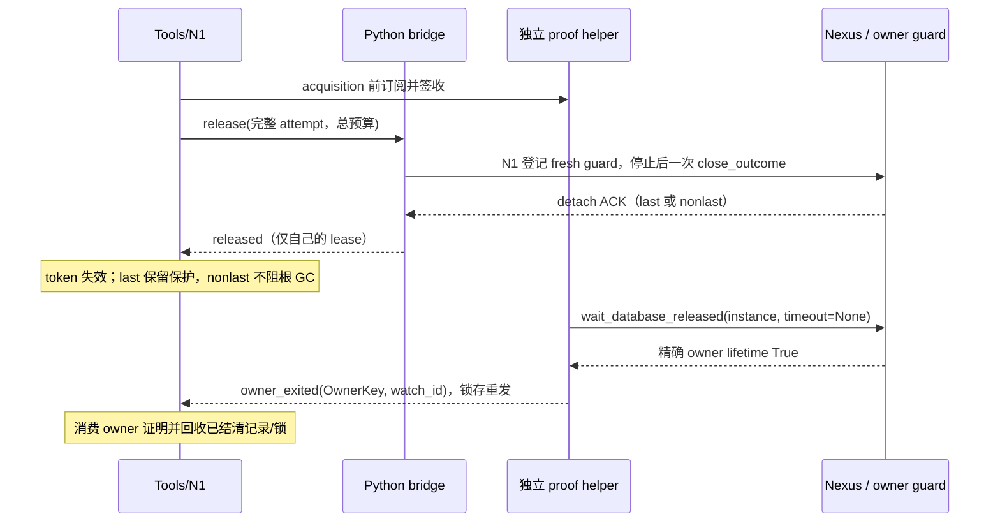

# Nexus 释放与打开协议：N7a-R 设计

状态：第一阶段 r2 设计修订，已落实 U1–U4，待增量设计复审；不代表实现、测试或 N7 验收通过。
日期：2026-10-17。设计基线：`feat/nexus-backend`，`f47dd2301b096f1c4b6643906f6e8976e8663469`。
设计输入提交：`ff81992412187cf966b1e02c74b3dc1cad02713f`；产品与测试仍为上述 f47dd23。
第二阶段须另行派单；本阶段只提交本文件及主计划 N7 中的引用。

## 1. 依据、目标与保留边界

依据是 [主计划](nexus-backend.md) 第 5 节、N1–N7 交付约定、全部验收裁定和
[测试约定](../TESTING.md)，以及以下终审、设计评审与用户裁定：

- `/tmp/ida-nexus-run-20261015.98rmfb/n7a-final-audit/report.md` 全文，特别是状态机、不变量、F1–F10、简化方向与存疑项。
- `/tmp/ida-nexus-run-20261015.98rmfb/n7a-rereview8/report.md` 全文，特别是 R8-F1/R8-F2。
- `/tmp/ida-nexus-run-20261015.98rmfb/n7a-refactor/review-claude/report.md` 全文（P1-1/P1-2、P2-1–P2-12、§4–6）。
- `/tmp/ida-nexus-run-20261015.98rmfb/n7a-refactor/review-astra/report.md` 全文（D1–D5、§3–6）。
- r2 委托 `prompt-design-r2.md`（SHA256 `c7e195bef5f9f6ff187e48e7d8884adb1399a640caaab5bd1d14e5a3c570986a`）中的 U1–U4，已裁定结论见 §10.3；逐条回应见外部 `review-response-r2.md`。
- `/tmp/n7audit-repro.5EnFte/{harness/src/main.rs,stub_bridge.py,run.sh}`、两位 reviewer 的 `/tmp/n7rdr-repro.{wzQ1QG,GMAiQAHD}/` 及固定 Nexus 源码只读参考；不执行旧 run.sh，不改现场。
- 固定 Nexus 0.13.4 加三个本地补丁，`handle.py` SHA256 `aa5d7ea42caaa922ef494d7d8a1406396537a4ea88d9e833825e08c8d279025e`；本轮只读其公开契约。

目标是把四个事实分开：调用方结果、一次命令的投递、自己的 lease 是否 detach、精确 owner 是否释放数据库。
每个事实有一个权威状态持有者，其余层只消费带身份的证据。现状的关键接缝是：

| 基线入口 | 已核对的行为 | 设计后责任 |
|---|---|---|
| `src/router/nexus_transport.rs` 的控制帧期限 | Release 默认 2000ms | detach 控制仍最多 2s；发送前准备改用 close 总预算，不承担保存/退出等待 |
| `nexus_bridge/lifecycle.py` | 最后 ACK 后在同期限等 lifetime，组内传播证明 | 一次性 detach；owner 证明独立观察 |
| `src/router/nexus_bridge.rs::apply_event` | `release_unconfirmed` 删 pending，之后未知事件可使整桥断开 | 命令终态与 owner 事件分流，单事件隔离 |
| `nexus_bridge/bridge.py` 的 open | wait_analysis 完成后才通告 opened | 取得 handle 即登记，准备完成才对外发布 |
| `nexus_bridge/open_recovery.py::Snapshot` | 最终文件直接复制，回滚共用 open 期限 | 完整 staging、逐文件原子发布、journal 恢复门禁 |
| 固定客户端 `handle.py::open` | resolve 后 attach；连接异常还会 resolve/attach 一次 | 公开结构化获取结果与精确 attach 边界，见第 5 节 |

以下已接受语义继续成立：不重放可能已生效的 release；没有相应证明不称已释放；保护无法确认不默认保存或 close。
r9 首次 Root 不可见且未修改时，不保存关闭并在双证明后重开，最多三次；中途丢失永久拒绝写回，保留 TEMP|KILL、savebase/closebase hook、显式 save 前校验。
崩溃恢复继续采用快照、允许 Nexus 内部恢复、事后隔离与还原，不改成禁止恢复。
新代际、跨 router flock、隔离区、宽限期、close 证明补丁、共享 lease 隔离和 N1 停止证明均保留。

不扩大已登记的保证：独立外部 opener 的 FD/注册/隔离路径窗口，guard 安装前 Nexus 恢复保存窗口，脚本或其他客户端直接保存、未订阅通知、受信任代码篡改、native 不可抢占均仍存在。
不声称修复 IDA r9 根因；Linux、GUI、活动 debuggee 与专用输入的未验收范围不由本设计关闭。

## 2. 身份与唯一状态所有权

### 2.1 物理身份与 incarnation

`OwnerKey = (state_root_identity, record_id, pid, started_at, canonical_idb_path, backend)`。
state 根身份为公开 get_state_dir 解析结果及目录 device/inode；五个 instance 字段逐项匹配，不能按路径/PID 猜配。
它表示稳定的物理 owner；router、bridge、helper incarnation 与 watch_id 是独立的投递身份，**不属于 OwnerKey**。
换 bridge/router 或新建订阅不能改变物理身份，也不能使同路径新 owner 继承旧退出证明。
只持久化非敏感公共字段；不序列化 token，不私读注册内容，不用 record_id 拼造 instance。
必需的独立 proof helper 持有通过公开发现取得的真实公共 instance 对象，见 §3.2–3.3。

`LeaseKey` 是完整 `SessionLease`（client_id、lease_id、instance_id、generation、owner kind）。
`DeliveryAttempt` 是完整 target 加单调 sequence；owner-exit 不使用 release sequence。
同 owner 的所有 lease 可引用一个观察项，但每个物理 handle 保留自己的 ACK 与 detach 结果。

`AcquisitionId = (parent OpenIdentity, purpose, ordinal)`，purpose 明列 final、verification、initial-root-retry、auxiliary。
auxiliary 即使在父用户结果结束后获取，也引用持久保留的父身份与独立 ordinal，不复用用户 open 或旧 lease 身份。
至多三次 r9 尝试、verification 和断连清理都串行，按需最多两个同时存活资源槽，见 §5.1。
这些是 adapter IPC 身份，不是 Nexus 私有 lease_id，不新增用户参数。

`LaunchIdentity` 包含 parent/acquisition、launch suffix、Popen 身份及启动时刻、log_path、目标/state 根和预期 backend。
launcher PID/退出不等于实际 owner PID/退出；不能由启动观察到期推出没有写入者。
`RecoveryId` 是目标身份下的唯一事务编号；其 journal 和锁在目标旁，与 IDA_CLI_HOME 无关。

### 2.2 逐层状态、事件与转移

| 层 / 唯一持有的事实 | 状态 | 事件与转移 | 不再判断什么 |
|---|---|---|---|
| owner guard：是否允许保存/自动关闭写回 | Uninstalled → Healthy；Root 缺失 → PoisonedSafe；查询/标志/hook 不可确认 → ProtectionUnavailable | 每次 before/after、显式 save、fresh close_status、savebase/closebase 重新采样；Poisoned 不恢复 Healthy；只有实际设置并读回 TEMP\|KILL 才为 PoisonedSafe | 不判断 lease 是否释放、不共享 owner-exit 证明 |
| Nexus 服务端：lease 成员与 owner 生命周期 | Live → Detached；最后引用按 keepalive 进入 Draining → 数据库关闭 → lifetime 释放 | 公共 release 或 SSE EOF；detach ACK 可先于保存结束；GUI/其他引用继续存活 | 不改服务端、不新增协议 |
| 客户端 handle：公开调用边界及原始 detach outcome | Connected → CloseIssued → AckDetached / DetachUnknown；连接状态正交 | 调用前锁存一次性请求；有效 last/nonlast ACK 均记录 lease_released；异常保留原始字段；同 handle 不重复发请求 | 不让 status='uncertain' 掩盖已取得的最后 ACK，不把 EOF 当 owner 释放 |
| Python bridge：物理 handle 账本与调用阶段 | Acquired/Preparing → Ready 或 CleanupRequired → DetachIssued → Detached/Uncertain；BlockedBeforeSend 可退回 CleanupRequired | acquired 立即登记；ready 才交付；失败转清理；每个 handle 独立 guard 与一次 detach；保存拒绝累积 | 删除 release_group 证明传播；不自行推断 N1 phase，不用通用 public_started 猜所有命令 |
| 独立 proof helper：公共 owner-exit 证据 | Watching → Exited；观察异常 → ObservationFailed → 只读重新观察 | 每 OwnerKey 一个 wait_database_released(instance, timeout=None) 线程；True 才发 owner_exited；异常发 owner_observation_error | 不发 release、不等待控制帧预算、不关闭 sibling/GUI |
| Rust 事件泵：相关性与交付可靠性 | pending command / acquisition custody / owner subscription，三张分开的有界表 | 命令结果只结算对应 attempt；owner_exited 按 helper 身份、watch_id+OwnerKey 投递；重复命令幂等、未知命令丢弃；迟到 custody/stop/proof 仍消费各自责任 | 不持有第二套 lease 释放状态，不因未知消息 fail 整桥 |
| N1：逻辑会话、操作、投递及清理责任 | 会话新增 Preparing；Preparing → Active 或 ReleaseRequired → ReleaseRequested → Released；Disconnected 正交保留责任 | opened 登记；带 disposition 的 custody_ack 不代替内部 operation grant；open_ready 发布；失败转 ReleaseRequired；NotSent 恢复清理阶段；Uncertain 不重发；匹配 ACK 或 owner 证明确认 detach | 不把 Released 当 owner 已停止；调用方终态、execution_stopped 和投递状态继续分离 |
| Tools：对外记录、owner 保护与文件锁 | PreparingRecord → ActiveRecord → DetachedRetained → Retired；异常为 CleanupBlocked / OwnerObservationFailed / RecoveryBlocked | N1 Released 使 token 失效并退出活动列表；last/Uncertain 保留 owner 根 SH，nonlast 释放本次 lease guard；startup/recovery 有独立持有者与终态 | 不用 15s/120s 到时推断释放，不轮询第二套 owner 状态 |

Tools 的 owner 保留表是资源账本；N1 是会话状态的唯一权威。Python 的状态是原始 handle 调用事实，不能直接改 Tools。
Rust 与 Python 的短暂消息延迟由显式 InFlight/CustodyPending 表达，不能出现一边 Active、另一边已丢 handle 的稳定状态。



## 3. 两阶段释放与 owner 观察

### 3.1 阶段一：自己的 lease detach

一次逻辑 close 先用 §4 的发送前预算完成 fresh guard、自有分片清理与错误签收，之后才投递至多一次
close_outcome(wait_for_database=False)。detach 控制预算仍最多 2s，不等保存；保护不可确认时绝不发 detach。
根损坏但 TEMP|KILL 已确认时允许不保存 detach，同时将 saving refused 独立返回调用方。

| 原始证据 | N1 / 控制结果 | 后续责任 |
|---|---|---|
| 有效 nonlast ACK | Released / Confirmed | 本 lease guard 释放；只保留轻量 OwnerKey/诊断，不阻整根 GC |
| 有效 last ACK，shutdown_pending=True | Released / Confirmed | owner draining；Tools 保留该 owner 根 SH，最终保存不占控制预算 |
| 请求已可能发出，ACK 丢失/坏 JSON/传输失败 | ReleaseRequested + Uncertain | 不重发；保留精确 lease、owner 与根 SH；等公共 owner proof |
| close_outcome 尚未调用 | NotSent，退回 ReleaseRequired 或原 phase | 可新 attempt；内部 RPC 停止责任与保护失败仍独立存在 |
| owner-exit 先于 detach 结果 | 锁存 proof，仅结清同物理 owner 的旧 lease | 不伪造 ACK、不改变原投递、不丢保存错误 |

SSE 证据另分为 LocalStreamClosed（本地 shutdown/close 成功）、PeerEOF（读到 EOF）、StreamCloseFailed。
它们均不是 detach ACK 或 owner proof，不能将 Uncertain 改为 Released，不能借 heartbeat 到期宣告停止。
Claude 的真实 stub 实验在 heartbeat=0.5s 下约 1.34s 自动 detach，说明健康服务端最终会回收断流 lease；
默认 heartbeat 的 10–15s 只是预期观察尺度，调度、网络和服务异常下不作为硬证明或解锁计时器。
**Uncertain 不阻止附加同一健康 OwnerKey**：新请求在目标 gate 下公开发现并精确匹配同一 owner，
健康 attach 可继续，旧 Uncertain 责任单独保留。这样共享 GUI 长存也不会阻断同 owner 的新 opener。
只在服务端仍健康且 heartbeat/调度推进的故障模型下预期断流有界回收；没有 owner proof 时未知记录不伪收敛。
不同 OwnerKey 的新建必须先取得旧 owner proof；没有精确 instance 或 proof 则 pending/blocked，而非等待固定秒数放行。

primary 与自有 auxiliary 各有独立 LeaseKey、AcquisitionId、N1 清理责任与 release attempt。
auxiliary 在创建前登记 cleanup-only；先推进所有可请求成员，每成员只发一个终态，删除组内 donor/二轮协调。
Tools 只聚合结果与保存错误：所有自有成员有 detach 证明才称本次自有引用释放完成。
primary ACK + auxiliary NotSent 时前者保持 Released，后者可在停止/保护条件满足后新 attempt；
不能把整体锁存为 Uncertain。已发送无证明的成员不重发，其余 NotSent 成员仍能独立推进。
辅助检查失败返回原错误并保留 handle；primary 成功不能掩盖它。

删除 release_unconfirmed；每 attempt 只有一个命令终态，后来的 owner 证明走独立通道。
N1 `owner_released(OwnerKey, proof)` 核对 owner→lease 绑定，结清旧 lease，包括实际已退出的 NotSent/Disconnected 清理项；
原 ACK、投递和调用方确定结果保持，不能让 owner 退出把失败业务改成成功。

### 3.2 必需 proof helper、owner 表与立即重开

proof helper 是协议的**必需组件**，由 Rust 启动/管理，与业务 bridge 不在同一进程、线程池或父进程死亡域。
它只通过公共 discover/wait_database_released 工作，不执行用户业务，不发 release/shutdown，不加载 IDA。
Rust 在 resolved 阶段发送非敏感 OwnerKey，helper 自行公开 discover、逐字段匹配，持有返回的真实 instance。
`subscribe_ack(OwnerKey, helper_incarnation, watch_id)` 必须在 acquisition 继续 attach/准备之前签收；
已建立 SSE 的获取回调若尚未完成订阅，则仅保留 custody，不准开始准备。订阅失败不能丢 handle 或靠 absence 放行。
同 OwnerKey 合并 watcher，使用 wait_database_released(instance, timeout=None)；线程无限等待仅属后台观察，不阻用户请求。

helper/Rust 使用私有 0700 运行目录下的 0600 Unix socket，校验同 uid、peer credentials、endpoint device/inode、协议版本和 helper incarnation。
端点定位及非敏感 helper 身份记录进相关目标 journal；home 仅可放定位副本，不能成为恢复 gate 的权威。
消息含 physical OwnerKey、watch_id、helper incarnation、单调 proof_seq；Rust/bridge incarnation 只校验本连接，不参与物理证明有效性。
helper 取得 True 后先以 temp+fsync+rename+目录 fsync 落盘非敏感 proof spool，再重发 owner_exited 直到 Rust 签收。
Rust 先更新可靠 owner 表/必要 journal 再 ACK；按 (OwnerKey, proof_seq) 去重，重复订阅立即返回锁存事实。
重连建立新 watch_id 时以 OwnerKey 继承已核验的旧事实；旧 bridge 的命令事件不能污染新连接，但不能因此丢弃真实 helper proof。
instance 及其 SDK 内部认证字段只留 helper 内存，既不 IPC 传 token 也不落盘；磁盘 proof 是受保护的本地观察记录，不是 release 授权。

仅 last-ACK 和 Uncertain 的 retained owner 持根 SH、计 `max_pending_per_tenant` 不确定容量；
nonlast ACK 移出本次活动/不确定容量、释放本 lease 根 SH，轻量记录计单独 owner 观察表，不能阻整根 GC。
其他尚活本地 lease、startup 或 recovery 自己的 guard 仍保留；nonlast 不能释放这些独立义务。
正常成功 open 的 content/open EX 在发布结束释放；失败 open 的文件保护按各自义务保留；但无失败恢复意图、无 startup/文件写入且所有内部 operations 已停止时，
在目标锁下把未知 detach 的 content/open EX 转交为 root SH + durable 精确 owner 记录，允许随后仅附加同一健康 owner，不能因此另建 owner。
真实 failed-owner-held/恢复事务仍阻断任何新 open，直到双证明与事务结清；未知 detach 本身不伪造文件失败意图。
owner proof 先到要等本地清理与错误归集，不删除后来的 saving refused 所需墓碑。
外部 owner 的 GC 保护仍靠公共占用、隔离和宽限期，不能靠轻量记录冒充根锁。

立即重开采用一条统一规则：

1. 同 router：Tools 在派发新 open 前查目标 owner 表。last-ACK/draining 在**该新请求原有预算内**等匹配 owner_exited，收到后在 gate 下重核再打开；预算耗尽返回 Busy，附 OwnerKey、stage 和等待方式。Uncertain 只准附加同一健康 owner，不准另建 owner。
2. 跨 router：目标 gate 下，attach 结构化 503/busy 或 resolve busy，且公开发现存在精确目标 instance 时，bridge 交 helper 签收观察并在新请求剩余预算内等待公共 lifetime；退出后**只重新 resolve 一次**，再按公开 API attach。SDK 原 open 已有的连接失败重解析也计入这个一次额度，不叠加外层重试，不重放业务或可能成功的 attach。
3. 无匹配 instance 或等待未完成时返回明确 Busy/UnknownOutcome，不能路径猜配、重置 deadline 或轮询无限重开。r9 的三次双证明重开是另一受限流程，不增加本规则的重解析次数。

小库在与 f47dd23 同样的新请求预算内，close→立即 reopen→读回修改应一次请求成功，不把正常 draining 直接透出为 Busy；
慢保存超出该预算才可 Busy，之后新请求继续消费原 proof。§9 同时验收小库无体验回退和大库诚实 pending。
只需立即拷贝的调用方：close 后从现有 status 取得非敏感 owner_observation_ref，在同一 status 等待路径指定 wait_owner_exit 与自己的预算；
返回 exited 才拷贝/备份或重开，pending/observation_failed 不称保存完成。等待不新增 lease，不复用 close token，也不宣称退出必然保存成功。

### 3.3 helper/bridge/router 故障、版本与关停

启动顺序：Rust 统一解析 home/state → 启动 helper 并版本/hash 握手 → 启动 bridge 并握手 → admission → subscribe_ack → acquisition/准备 grant。
helper 是每 router 管理的一项服务进程，router 崩溃不连带退出；端点可由下一 router 按 journal 定位、核验后接管。
正常关停先拒绝新 acquisition/业务、停止内部 operations、清理自有 lease，再等待或明确转交 owner/startup/recovery 责任；
bridge 可先退出，helper 最后在所有订阅已签收结清且无保护转交后关停。用户关停预算不足时返回仍 pending 的责任，不能杀共享 owner 或丢 spool。

| 故障 | 证明与推进规则 |
|---|---|
| bridge 崩溃，owner 正在关闭 | helper 持真实 instance 独立等待；owner 已 reap 也能用该对象观察，proof 重发到 Rust；无新 bridge 重建 instance |
| helper 通道断开但进程存活 | Rust 保留表/guard，在有界连接预算内重连、重订阅、重放缓存 proof；连接超时只报告 ObservationFailed，后台退避继续 |
| helper 自身崩溃，owner 仍存活可发现 | 新 helper 版本握手后公开 discover 精确匹配真实 instance、签收；Rust 保留原物理身份与全部义务，恢复只读观察 |
| helper 崩溃，owner 已退出且注册被 reap | 若已持久 proof spool 或 Rust 已签收 proof 则核验重用；无 proof 且业务 bridge 仍持原始 instance 时由它公共 wait 取证；所有原始对象都丢失则显式 blocked，不用重建 instance |
| helper 与 bridge 同时丢失 | 先消费已落盘 proof；owner live 时重新公开订阅；owner 已 reap 且无 proof 时进入 §10.3 的残余故障窗口 |
| router 在 failed-owner-held 下重启 | 目标 gate 先读取 journal/OwnerKey/helper 端点，接管存活 helper 或其持久 proof；只读恢复失败时 blocked，不能以无旧活动 session 为由解除 gate |

观察异常发 owner_observation_error，保留原原因/guard，有界退避只重试只读观察；不重发 detach。
helper 容量在获取前预留：每不同 OwnerKey 一槽/一个等待线程、共享 owner 引用计数；每 tenant 有 watcher 与 retained owner 上限。
spool/墓碑有独立条数和字节上限；达到上限拒绝新 admission，不能丢未签收 proof 腾槽。线程不占 release/业务/stop 池。
router 退出 OS 会释放其 flock，故跨重启保护靠目标侧 durable gate、公开占用及 GC 原有检查；不能声称 flock 自动跨进程复活。
startup 和 recovery 的未结记录必须在有副作用前进入目标 journal；启动扫描只加速，真正放行仍按每次目标 gate。
新 router 不恢复用户 session/client/attempt，不持久化可重放 release 授权；后台只结清旧责任，用户 open 用新请求。

已批准的故障模型是：单个业务 bridge 故障可自动恢复；helper 单故障在仍有真实 instance 或持久 proof 时可自动恢复。
所有观察者和未持久证明同时丢失、owner 已 reap 时**不承诺自动恢复**，执行 §10.3 的离线人工流程；不能私读 token 或静默切 record_id 重建。

## 4. 精确副作用标记、预算与错误传播

### 4.1 请求边界与 N1 停止责任

以命令各自的事实替代 public_started：BeforeDetach / DetachMayBeSent / AckDetached，
BeforeAttach / AttachMayBeSent / Acquired；execute/cancel/shutdown 继续原投递与停止语义。
控制 grant 只表示允许开始处理；真正进入 close_outcome 前才锁存一次性 DetachMayBeSent。
guard RPC 超时只说明 detach 未发送，不代表 guard RPC 未执行/已停止。

选择**精确登记每个内部 operation**，而不是聚合停止义务：已有 N1 因果停止接口可逐项审计，也避免 bridge EOF 时证明“聚合内部已无工作”依赖第二套状态。
准备、fresh guard、自有分片清理都经 §5.2 的内部操作准入/grant。每个 operation 带精确 lease/acquisition、operation_id、purpose、attempt 和期限。
保留 guard/cleanup RPC 的停止门禁：NotSent 可排队新的逻辑 close attempt，但在旧内部 operation 真正停止前，不发下一次清理/guard/detach。
不采纳 Claude P2-3 去除停止门禁的建议，原因是 U4/D1 要求保留 N1 停止证明；幂等不等于已停止，已进入 native 的 RPC 不一定被 lease detach 撤回。
取消可以用已有公共 cancel_operation_outcome，只有精确返回、因果停止或匹配 owner-exit 才补 execution_stopped，不能用 SSE EOF/用户到期代替。

| N1 状态 | 重试规则 |
|---|---|
| Active、Preparing 转来的 ReleaseRequired、Disconnected，且 detach=NotSent | 可新建 sequence，但先等待原内部 operations 停止并复查 fresh guard；人工 close 可显式重试 |
| ReleaseRequired 且 lane Busy/可证 NotSent | 有界退避自动推进已受理清理；保护不可用转 CleanupBlocked；不做 10ms 热循环 |
| ReleaseRequested 且 Queued/Acknowledged/Uncertain | 不发第二次 release；只等原结果/owner proof |
| Released | 幂等返回已记录结果，不请求远端 |
| ShutdownRequested / 原操作未停止 | 保持禁止 detach；ACK 不冒充 execution_stopped |

### 4.2 发送前预算、线程容量与签收

close 总预算沿用调用方原期限及现有最多 15s 外层保险，不重置；拆成 preflight 与 detach 两段。
preflight 可使用剩余预算减去最多 2s detach 及签收余量，不再挤进旧 2s 控制帧。每次内部 RPC 的执行 timeout
取剩余 preflight 减去客户端固定 5s HTTP 余量；不足以容纳 5s 余量就不投递，报准确 NotSent。
因此公共 execute_python 的 timeout+5s 不会偷占 detach 预算；不修改 HTTP 私有协议。
控制调度不让 guard HTTP 占用 release_pool：独立 preflight_pool 2 槽、detach_pool 2 槽、既有 stop_pool 2 槽，队列均有 admission 上限且按 owner 公平轮转。
同 owner 串行内部操作，owner 忙不会占两个 detach 线程。队列到期未投递是 NotSent；已投递超时保留 operation/停止义务，slot 仅在调用实际返回后释放。
本地 queue、签收的等待上限复用现有 dispatch_ready/grant：最多 2s 且不超过当前阶段剩余预算；不是另加 2s。
在总预算里预留至多 2s 给 release_observation ACK；每次 close 增加一次本地 IPC 往返和状态写入，必须计入 preflight 时序。
owner 真正长时间忙于不可抢占 native 时不承诺 close 成功；已受理清理保留 ReleaseRequired/operation pending 后台推进，status 可查，不要求用户反复 close 来维持责任。
后台重试以新的有界 preflight 预算等待原 operation 停止，绝不重放已可能发送的 detach 或吞掉保护错误。

### 4.3 保存错误的可靠交付

结果带原 cause、command stage、完整目标、save_guard_error、cleanup 与 owner 状态。
保存拒绝由生产 guard/真实公开 RPC 产生，NotSent/Uncertain/Released 及 auxiliary 失败路径均累计。
detach 前把 fresh guard 拒绝/保护状态经 release_observation 交 Rust，Rust 先写入权威记录再签收；
该 sideband 不改变 detach delivery，不删除 command pending。ACK 丢失用同 observation_id 幂等重发，超时不 detach、结果 NotSent，Rust 已收事实不回滚。
桥在签收后崩溃，Rust 仍把保存拒绝交付 caller/status；签收前崩溃报告保存/准备结果未知，不伪造拒绝或成功。
owner proof 不清除错误，墓碑按既有容量保存；不以 take 一次清空 Uncertain 的原错误。
close 已 detach 但保存被拒绝仍报错，注明 lease 已释放、owner 是否 pending，以及已知未保存修改丢弃事实。
ACK 后本地清理失败独立报告，不能覆盖 parsed ACK；close 成功不等于保存已完成或备份可用。

## 5. open 不留孤儿：先登记，再准备与交付

### 5.1 custody、disposition 与串行 acquisition

取得 handle 即通告内部 opened；Rust/N1 先托管 Preparing，准备完成才对外发布。
不等 Python 用过期 open deadline 清理完才通知 Rust；能力未验证时不伪造 IDA 版本、不接受用户业务。

| 事件 | Rust/N1 原子处理 | Python 后续 |
|---|---|---|
| opened(acquisition_id, lease, OwnerKey, preparing=true) | 核对预留槽，接管资源；订阅 helper 并签收；回复 custody_ack(disposition=prepare 或 cleanup-only, grant_epoch) | 仅确认 custody；prepare 还须逐个内部 operation grant，cleanup-only 绝不启动准备 |
| open_ready(acquisition_id, capabilities, recovery) | 当前父 open 未取消/超期、全部准备成功且无未停止 operation 时 Preparing→Active、交付 token | 不保留第二套用户终态 |
| open_cleanup_required(acquisition_id, cause, operations) | 父结果保持唯一失败；停止准备；Preparing→ReleaseRequired，停止后调度清理 | 只执行 N1 授权的内部 cleanup |
| open_failed_no_acquisition(stage, startup, transaction) | 用户确定失败；按 §5.4 三行表分别转交责任，**不能一概释放 guard** | 无新 attach；保留启动/文件事实直到签收 |

父取消/超期/future drop 与 custody 由同一 N1 锁仲裁；取消先发生时 disposition 必须 cleanup-only，即使墙钟仍有 open 余量。
prepare disposition 不是无限授权；每次 operation grant 原子复核父状态与 grant_epoch，取消后旧 grant 不再准入新 RPC。
已投递 RPC 走停止证明，不能由撤销 grant 伪称未执行；open_ready 迟到只补事实，不覆盖父失败。

子获取串行：final、r9 retry、verification 在前项双证明与事务结清后才获取下一项。
每 parent 按需最多两个物理槽（一个当前 acquisition + 一个必要的 cleanup auxiliary），不预留七个；第二槽不足在获取 auxiliary 前 Busy，不能先获取再找槽。
正常串行复用已结清槽，AcquisitionId/LeaseKey/ordinal 永不复用。父用户结果结束后，父资源记录仍可定位 cleanup 子项。
在既有 tenant 总容量计 parent/物理槽，不静默乘容量；helper watcher/retained owner 与墓碑分别按 §3.3 上限计费。
已结清身份墓碑按条数/字节上限淘汰最旧**无未结义务**项；未签收事件或 proof 不能因容量被删，满则拒绝新 admission。

custody 采用现有 dispatch_ready/grant 的有界往返模式：相同 AcquisitionId+LeaseKey 重发 opened，Rust 幂等返回相同 custody 决定；
后续取消可把 disposition 收紧为 cleanup-only（递增 grant_epoch），不能恢复 prepare。身份冲突隔离当前 acquisition 并保留原资源。
往返上限最多 2s 且不超过当前握手预算；超时停止所有准备、保留 Python 强引用与预留 Rust pending，不转用户成功。
Rust 已接管但 ACK 丢失仍负责清理；未签收期间 Python 是物理 custodian，**不能自行直接 close**，只能重发和等待 N1 cleanup grant。
bridge 正常停止必须先移交/停止 operations；bridge 真正 EOF 时 SSE 由 OS 关闭，Rust 保留精确清理/停止义务，helper 继续观察，不能靠 EOF 报 Released。
来自旧用户 pending 但已登记 acquisition 的消息仍接管清理；完全未知命名空间不授执行权，报告 custody 错误、保留 Python handle，不断开其他会话。

### 5.2 Preparing 内部操作与 N1 精确停止表

已有 execute_python(..., operation_id=...) 与 wait_autoanalysis(..., operation_id=...) 直接接线到 N1，**不需补丁添加参数**。
能力查询、guard 安装/采样、Root 检查、analysis、分片清理都显式登记为 internal purpose，用户 Execute 仍只允许 Active。

| 阶段/事件 | N1 权威转换与安全条件 |
|---|---|
| 准入 | 先分配精确 operation_id，绑定 acquisition/lease/purpose；Preparing+prepare 仅准必需准备，ReleaseRequired/cleanup-only 仅准停止/清理；同 lease 冲突互斥 |
| dispatch_ready / grant | 在操作表登记 Queued，复查父取消、剩余期限、grant_epoch、helper subscription；实际 grant 后 bridge 才可调公共 RPC；未发出是 NotSent |
| 完成 | 匹配公共 RPC 返回/明确 RemoteError(operation_timeout) 确认该调用已返回，写 outcome 与 execution_stopped；成功可推进下一个准备阶段 |
| 传输超时 / bridge EOF | 可能投递的 operation 为 UnknownOutcome，保留停止责任；不能由父失败、socket 关闭或 detach ACK 推出 stopped |
| 取消/超期 | 撤销未来准备 grant，对已发 operation 发公共精确 cancel；cancel 请求本身不是停止证明，stop_pool 独立推进 |
| 停止证明 | 精确执行返回、匹配因果 cancel proof 或同物理 owner-exit 才补 stopped；迟到事实不改 caller 已确定失败 |
| ReleaseRequired | 父失败即转清理阶段，但只有该 lease 的全部内部/业务 operations 停止后才准 fresh guard 与 detach；guard 自己也按本表登记、返回后才进入 detach |
| Ready | 所有必需准备成功、无 unknown/still-running 操作、能力实测匹配、父仍有效时才 Active；用户业务之前无执行权限 |

停止是 RPC/执行停止，不代表能停止 IDA 所有后台分析；不改变原有 N1/N5/native 不可抢占边界。

r9 仅首次 Root 异常、未业务修改、managed owner 时自动重开；初开最多总共三次。
失败项先转 ReleaseRequired，取得本 lease detach 与同 OwnerKey owner-exit 双证明后回滚，前项未结清不启动新项。
所有重开消费原 open deadline；超期禁止下一次 open，不撤销清理/已开始回滚；第三次失败仍还原并返回现场与次数。
GUI 首次失败只清理自己的 lease，不重开、不 shutdown；会话中途 Root 丢失永久拒绝写回，保留 TEMP|KILL、hook 与显式 save 前校验。
verification 有独立 acquisition/OwnerKey，副本只在 owner-exit 后清理。

### 5.3 U1：公开客户端获取结果、资源交付与 ACK

沿原公开实现增加分阶段 outcome/回调，冻结**结果契约**，最终最小文件范围由 R0 原型确定，不预先限定只改 handle.py。
不改服务端、不在 bridge monkeypatch 私有函数、不手写 HTTP/SSE、不解析异常字符串；原公共签名与返回/异常契约兼容。

公开获取结果含 stage、handle 或 None、resolved public instance 或 None、类型化 failure_kind、启动义务完整 LaunchIdentity 列表及文件事务引用。
每次真实 attach 之前公开 stage callback 记录 BeforeAttach/AttachMayBeSent；resolved 交付时先完成 helper 订阅。
SSE 建立后立即 acquired callback 把可 cleanup 的 handle 转给 custodian，**早于 monitor thread.start()**；
SDK 先保有强引用，回调正常签收才完成物理交付。回调异常时 outcome 仍交付同 handle+cause，SDK 保留强引用直到 bridge 显式接管，不能自动 close 掩盖资源归属。
已交付后的 monitor 初始化失败返回 handle+cleanup_required；不再报无 acquisition。
已取得 handle 或 acquired 回调失败不是再次 resolve/attach 的理由，outcome 优先交付资源，不能被原连接异常重试分支吞掉。

固定 _open_lease 在 request/getresponse、非 200、socket 不可用的失败路径关闭连接；
_open_lease 返回后已知构造缺口是 threading.Thread(...).start() 失败，不泛称所有构造异常都有漏流。
探针需覆盖这些真实边界和 callback 异常，分别确认本地流关闭事实与资源交付；即使本地流关闭也不把它当 detach ACK。
确定 busy、参数/resolve/probe/worker_cwd 拒绝不置 AttachMayBeSent；503/draining 按 §3.2 的公开等待与一次重解析规则。
attach 后传输/解析失败按真实 stage 与已存 handle 分类，不能按异常类名或字符串一刀切；未获 handle 也必须交付启动/文件责任。
原 Handle.open 是 resolve→attach，NexusConnectionError 后 resolve→attach 一次；新 adapter 只接入这一生命周期次数，不额外叠加重试。

启动观测在 SDK 内部现有 spawner 注入口采集 Popen、log_path、launch suffix 等事实，公开传出；
spawn 意图先由 Rust 持久登记，Popen 创建后在等待 ready 前立即交付 LaunchIdentity 并签收。
若进程已创建但身份交付失败，spawn_intent 未结清且明确 startup-unconfirmed，不允许以没有 handle 释放保护。

close-proof 补丁锁存 parsed ACK 与 ack_kind/lease_released，local cleanup_failure 独立；后续清理异常不能将 ACK 改写成 uncertain。
一次性 close、cancel-unknown、loopback 原语义保留。补丁/prepare 哈希与 probe 在第二阶段同步更新，本轮不动。
这是 U1 对原“不改三个补丁”的有条件偏离；准备 operation_id 是 adapter/N1 接线，不列为 SDK 扩展。

### 5.4 无 lease 时的启动与文件事务义务（D2）

| 用户失败之外的事实 | 权威持有者 / 终态 | 容量、超期与跨故障处理 |
|---|---|---|
| 确定无 lease、无启动、无未结文件事务 | N1 确定 no_acquisition；Tools 核对本地任务结束后释放本次准备 guard | 释放 parent/物理槽，诊断墓碑单独计费；不阻新请求 |
| 无 lease，但 StartupPending（含 spawn_intent 未结清） | Rust startup 表 + 目标 journal 持启动/文件保护；公开回调提供 LaunchIdentity；实际启动树退出且无 owner/写入义务，或完整转交 owner 后才结清 startup | 每启动占 parent 清理容量/观察槽；观察预算用 startup_timeout+grace，默认 20s，仅转 startup-unconfirmed 不释放；桥 EOF 不抹表，router 重启 gate 接续 |
| 无 lease，但有未结 recovery 或备份处理 | durable journal + 单一恢复 job 权威，Tools 保留资源引用；归档无失败意图的 ready，或恢复至 restored/明确 blocked | 事务条数/全部字节计 recovery 预算；open 到期不取消 job；桥/router 退出由目标 gate 续跑，无预算不新建事务 |

startup 只有在公开发现得到精确物理 owner、helper subscribe_ack 完成、Rust owner 表与 guard 交接落盘后才转为 owner 保护；
不得先放 startup guard 再申请 owner guard。launcher 已退出但实际 worker 仍可能 ready 时不结清。
没有可证真实启动身份/派生进程退出时保持 startup-unconfirmed/blocked，交 R0 API 原型验收，不能按 20s 或 absence 推导安全。
router 重启不杀无权管理的 owner；若 startup 事实不足按 §10.3 离线恢复，而非伪造停止。

resolver 在 attach 前创建 crash 备份只是复制，不能等同原组件已移动/损坏。
resolve 失败后，job 在目标锁下核对 before/after 目录身份、原组件 hash/mode、无未结 startup/owner/operation；
无失败意图且原组件未变时登记备份证据、归档 ready/中止事务、释放保护，不做无意义还原。
原组件变化或备份不完整时保留字节与原因；若已有失败意图则进入相应恢复阶段，身份/占用不明则 blocked。
startup 与事务可同时存在，三行表按义务并集处理，任何一项未结都不能一概释放文件保护。

## 6. 回滚原子发布与启动恢复

### 6.1 原子性的准确范围

单个文件可原子 rename，任意用户目录中的 packed 与多个解包组件无法一次 rename 成为整组事务。
本设计保证：最终路径从不暴露截断文件；协作 ida-cli opener 在 journal 提交前不能进入 Nexus；崩溃后可继续还原或明确拒绝。
不承诺外部忽略锁的 opener 永远看不到组件间的中间状态。整组目录替换只适合独占新代际，不能移动任意用户父目录或改变其路径身份。

### 6.2 U3：目标旁事务目录、身份与持锁步骤

权威 journal **本身放在目标旁**，不采用跨 home 指针作为权威，减少跨根身份/可用性依赖。
目标为原 canonical IDB 路径；门禁 key 精确采用 Nexus identity_key 规则（realpath/abspath/expanduser；darwin casefold、win32 normcase、其余保留），
锁名用其 UTF-8 的完整 SHA256，身份值只用于比较，不把 casefold 字符串当文件路径。
同目标的大小写别名必须落同一 key/锁；目标父目录 device/inode 和真实 basename 是额外一致性约束。

布局为 `<target-parent>/.ida-cli-txn-<key>/`（稳定 0700 协调目录），包含稳定 `lock`（0600）、
每事务唯一 `<RecoveryId>/recovery.json`、不可变 snapshot、failed-files-N、staging-N、quarantine-N。
staging 与 quarantine 都在这个私有 sibling 内，检查 st_dev 与目标父目录相同，不会因 IDA_CLI_HOME 跨卷触发 EXDEV。
文件/目录全用受核验 parent dirfd 的相对访问，目录 O_DIRECTORY/O_NOFOLLOW，创建 O_EXCL/O_NOFOLLOW，普通文件 0600 后按快照恢复 mode；
并发 mkdir/EEXIST 后核验既存对象，不能接管 symlink、他人 uid、非预期 mode/类型或被替换的 inode。
身份清单记录 target key、uid、父目录和协调目录 device/inode、事务目录/锁 inode、组件 device/inode/size/hash/mode、OwnerKey、LaunchIdentity、helper locator、每步意图及完成证据。
所有 reopen/移动之前 fstat+目录身份复核，拒绝路径穿越、额外文件、硬链接身份冲突和未知覆盖。
目标父目录不可写、无法可靠 fsync/锁、无法建立同卷事务目录或保证非覆盖 rename 时，在任何 probe/Handle.open/worker 启动之前明确拒绝并给路径/cause，不退回 home。

journal v2：snapshotting → ready → failed-owner-held → staging → prepared → isolating → publishing → restored → opened；
异常为 blocked（原阶段/原因）；startup_pending/备份义务是正交子记录，不用 ready 伪称全部结束。
快照/事务意图先 durable 再允许 Nexus 恢复；更新均 temp(O_EXCL)+文件 fsync+原子 journal replace+目录 fsync。
替换只用于自有、已核验 journal，不用于用户数据。首次建立协调目录/锁/事务目录后分别 fsync 父目录，lock 永不 unlink/recreate，避免两个锁 inode。

1. 统一锁序 root SH → content EX（如需）→ Rust open EX → **目标侧 lock EX**。不同 home 的前几把锁可以不同，但最终必须争用同一目标锁；任何持目标锁的恢复 job 不反向索取 home 锁。GC 仅根 EX 非阻塞，不反向等待目标锁。
2. 在目标锁下检查 §6.3 gate，再创建/校验 snapshot 并 fsync，持久 ready 后才准 Nexus 恢复；spawn 意图与备份 before 清单也先入 journal。snapshotting 不完整不能用来还原。
3. 首次 Root 失败先写 failed-owner-held 失败意图、抓取失败组件；等待 lease detach + 精确 owner-exit 双证明及所有 N1 停止义务。第三方持有或证明未知时保留 gate，绝不回滚/新建 owner。
4. 已开始回滚交独立恢复 job，自持 root SH/目标 lock EX/dirfd，用户期限不取消 job，drop 不提前解锁。Rust 保存 job_id、阶段、目录、bytes、cause 到 status；job 崩溃后锁由 OS 释放，但 journal gate 仍在，下一 open 接续。
5. 先复制全部 snapshot 到同卷私有 staging，核对 size/hash/mode、fsync 每个文件和 staging 目录，再 durable prepared。复制不直写最终路径，不使用 open 剩余期限中断数据搬运。
6. 重新核对目标目录、组件与公共占用，逐文件先 journal 移动意图、fsync，再非覆盖 rename 到同卷 quarantine，fsync 源/目标目录后落完成项；未知变化停止。不得以跨卷 copy+unlink 静默替代 rename。
7. staging 完整组件按清单逐项非覆盖原子 rename 到原路径；每步 journal 意图、双方目录 fsync、完成项及新 inode。中断可以留下“部分完整组件”，gate 阻止协作 opener 读它们。
8. 全组 hash/mode/目录身份与公共无占用复核、staging/quarantine 清单一致后，durable restored 才解除本次失败意图 gate。原 open 仍有余量才下一 acquisition；成功 open 标 opened；三次失败也留 restored/原因。

ENOSPC、权限、fsync、EXDEV、内容/身份冲突保留 journal/snapshot/staging/quarantine，并报告确切阶段，不能只报 open timed out。
事务全部字节（包括同卷副本）计恢复保留量，不混作可回收缓存；用户库按 target/uid 计一次，跨 home 汇总用 RecoveryId 去重。
新事务 admission 先检查保留条数/空间预算，不足就拒绝；启动/owner-held/blocked 记录不能因超额丢弃。
**GC 永不删除**协调目录、journal、快照、staging、quarantine、合法 crash 备份和人工恢复证据；status 展示目录、状态、原因、保留字节和归属。
已完成证据只能在离线维护、备份核验及明确授权后人工归档；稳定 lock 仍保留，不把“已归档”自动等同可删除。

### 6.3 每个受支持 router 的目标 gate 与 v1 升级

任何受支持的新协议 router，**与 IDA_CLI_HOME 无关**，在任何 probe 或 Handle.open 之前都在目标 lock EX 下读取目标标记/journal，
重新核验身份与未结义务。启动扫描/各 home 中的索引只是加速或诊断，不能代替目标侧逐次检查。
锁竞争按本请求预算等待；持锁者退出后重读 journal，不以获得锁或 discover absence 认定可开。
损坏/未知版本 journal、目录身份变化时拒绝该目标并显示目录，不能忽略坏 JSON 或猜测它不相关。
目标保护也涵盖不同 IDA_NEXUS_STATE_DIR：Nexus 公共占用不足以识别的外部 owner 按未知保留，不能扩大原有跨 state 发现保证。

v1 或 v2 的 snapshotting/ready **无失败意图**时，归档保留且不以该 ready 阻断、不要求现场与快照相同；
Nexus 可能已合法修改组件，这不是自动 rollback 的理由。独立 StartupPending/活跃文件 job 仍按各自责任等待，不能被 ready 归档清除。
v1 failed-owner-held/rolling-back 及 v2 staging/prepared/isolating/publishing 必须升级/续跑或明确 blocked。
升级在目标锁下核对原 journal 身份/target/清单/hash，将必要证据完整复制到同卷事务目录、fsync 后发布 v2 标记，最后把旧记录归档为已迁移指向；中断时至少一份完整证据仍在。
不跨卷 rename 旧 home 的证据，导入失败保留两边并阻断；同 RecoveryId 导入幂等。
首次升级须离线盘点已使用的 home 中旧 v1 记录并导入目标侧，未导入的其他 home 旧记录无法凭空发现；
混用不执行目标 gate 的旧 router 不属受支持协作集，升级期间先关停旧 router，不宣称它也受新 gate 保护。

v2 根据每个意图的 source/destination device/inode/hash 幂等续跑，来源不明或内容不同绝不覆盖。
failed-owner-held 在重启后按 §3.3 从存活 helper/持久 proof 恢复，匹配旧 physical owner 后才推进；
owner 已 reap 且所有 proof 丢失按 §10.3 blocked。恢复 job 的失败/续跑均由 status 报告，完成不重放旧用户 open。

### 6.4 F7：Nexus 自己的 crash 备份

固定上游 database_state._backup_unpacked_database 会生成 `<target>.crash-<UTC>-<pid>-<suffix>/`，目录属于 resolver 进程，不能拿 owner pid 强行匹配。
恢复清单对这个**精确目标**的新目录单独分类：限定格式、同父目录、非 symlink、普通组件文件、内容/名字对应原 unpacked 快照、无额外文件，并记录目录与递归文件身份。
已存在的备份列入 before；本次新增项先登记 journal 再通过 failed 检查。仅按前缀放行不足以授权移动/覆盖。
内容不完整或来源不能证实就保留并报 blocked，不能删除取证目录或将它当用户目标组件还原。
合法备份被保留为恢复证据，不阻断正常 rollback/retry；不自动 GC。增加 packed+crashed、无 packed、部分备份及 backup 后 resolve 失败的轨迹；无 lease 的结清按 §5.4。

## 7. 接收器隔离与默认目录

Rust apply_event 先分类 command、acquisition、owner 事件，再核对各自身份。
release_observation 属于当前 release 的非终态 sideband，单独签收且不删除 pending；命令终态与 owner-exit 分开消费。
命令未知 attempt、旧 sequence、重复终态、错误 target、未知 event 记录限频日志后丢弃；当前请求可标协议错误并保留清理责任，不能 fail 共享物理连接。
“迟到”不等于“无价值”：已注册 acquisition 的 custody、当前 operation 的停止证明、已登记 OwnerKey 的 owner_exited 仍经各自权威表消费，即便 command pending 已删除。
未知携 handle 消息按第 5 节先处理资源责任，不能用宽松忽略吞掉新 lease。
无法解析的单个完整 JSON 行隔离处理；帧大小/实际 EOF/物理写入失败等连接级故障继续走真实断连，不能吞掉真实 I/O 问题。

lifetime socket 的 accept 与单连接握手分开：recv timeout、EPIPE、OSError、UnicodeDecodeError、无效 ASCII/超长/未知 lease 都只关闭该 connection，清除其临时项，accept 循环继续。
send ok 成功后才安装 lifetimes 条目，替换旧条目时在同一锁下核对精确 lease/incarnation 与当前取消/断连状态；期间 lease 断连或取消则撤销新条目、只关闭本次新连接。失败不能留下坏连接或提前关闭健康旧连接；若旧连接本身已断则保留真实断连，不伪造健康。
监听器自身非关闭期间失败可显式设置 lifetime listener unhealthy，报告并恢复该监听器，不触发 Bridge.stopped 释放所有 lease。
N5 owner EOF 清理依旧只对精确 context/incarnation 做公开 attach、串行清理；与新 owner-exit watcher 是两个方向不同的通道，不能混用。

F10 以 Rust idb_store::ida_home 的行为为唯一解析来源：非空 IDA_CLI_HOME 优先，否则 HOME/.ida，HOME 缺失才 /tmp/.ida；不擅自展开显式 `~`。
Rust 启动 bridge/helper/恢复 job 时传递计算好的绝对 `ida_cli_home`（固定启动 CWD 解析相对路径），Python 的 worker_cwd、cache 与运行目录使用它；recovery 的权威 journal/锁固定在目标侧，home 只作索引。
独立 Python 测试入口使用同规则解析函数，并与 Rust 表驱动对照：未设置、空、相对、绝对、HOME 缺失及空 HOME；不使用 Path.home() 引入另一套默认值。
这只统一 IDA_CLI_HOME；IDA_NEXUS_STATE_DIR 的公开 get_state_dir 规则保持不变。

## 8. 问题映射与跨层不变量

### 8.1 审查问题逐项映射

| 问题 | 设计消除方式 | 第二阶段的决定性证据 |
|---|---|---|
| F1 / P0 | ACK 与 owner 退出分离，watcher 不因控制期限或 120s 观察结束失效 | last ACK 后 owner 3s/超过旧观察窗释放；无需重启可重开；大 IDB 实测 |
| F2 / P1 | 一个命令终态；删除 release_unconfirmed；owner 事件独立；未知事件不使整桥 fail | 原 56 条事件轨迹回放，A 故障而 B 始终可用 |
| F3 / P1 | close_outcome 边界前 NotSent，N1 可新 attempt；保存/原错误在全部结果返回 | busy guard、锁/期限、辅助保护失败的调用方断言及请求次数 |
| F4 / P1 | acquired 即登记 Preparing；失败进入 ReleaseRequired；分析停止另证 | wait_analysis 两类超时，Python/server/N1 实际 lease 集一致，无 orphan |
| F5 / P1 | 分阶段结果；busy/503 先公开等待与一次重解析；startup/文件义务独立 | 失败后新请求成功，启动慢但无 handle 时也不丢后台写保护 |
| F6 / P1 | 完整 staging+非覆盖 rename+journal gate；回滚脱离 open 期限 | 每次文件操作/日志边界中断重启，最终完整还原或明确 blocked |
| F7 / P2 | 精确登记并验证上游 crash 备份目录 | packed+crashed 首次 Root 失败可回滚、重开，备份原字节保留 |
| F8 / P2 | 生产 bridge 驱动真实 Rust 接收器；不再靠重入旧 release 协调 | 无“测试直接再调 run”或夹具伪造迟到 released 的收敛证据 |
| F9 / P2 | 单连接握手隔离，listener 错误单独恢复 | timeout/EPIPE/非 ASCII 与握手替换期 lease 断连/取消后同桥 A/B/新握手仍正常 |
| F10 / P2 | Rust 统一 home 解析并向 Python 传值 | unset/empty/relative/HOME 缺失矩阵均一致，测试只触及私有 HOME |
| R8-F1 / P2 | 去掉测试对 release_state(errors) 的预填，由真实 guard/RPC 错误产生 sideband | 去预填仍能在真实 CLI/MCP close/save 调用方观察保存拒绝 |
| R8-F2 / P2 | 时序图驱动矩阵；成员动态变化；I5 前提修正 | sibling 中途加入/离开、last ACK 后 owner 仍 held 都真实进入矩阵 |

上述是待实现的修复对应关系，不是本轮关闭这些问题的结论。

### 8.2 本轮评审映射与责任冻结

| 评审问题 | r2 设计落点 | 第二阶段决定性验证 |
|---|---|---|
| Claude P1-1/P2-9、astra D3 | §2.1、§3.2–3.3；U2 必需独立 helper，不采纳 instance 重建 | bridge draining EOF 自动消费 proof；helper 崩溃 live/reap、同时丢失、router 重启分别验证 |
| Claude P1-2 | §3.2 统一立即重开预算与一次重解析 | 小库同/跨 router 一次请求重开读回，慢保存预算耗尽才 Busy |
| Claude P2-1/P2-2 | §3.1–3.2；EOF 不是 ACK，同健康 owner 可 attach；nonlast 不阻根 GC | 丢 ACK+长期 sibling 仍可 attach、旧未知保留；last/Uncertain 留 SH |
| Claude P2-3/P2-4/P2-8、astra D1 | §4、§5.1–5.2；精确 N1 operations、独立预算/池、可靠错误签收 | guard timeout NotSent 但未 stopped、签收丢失、取消早于 custody、准备 EOF |
| Claude P2-5、astra §4(c) | §2.1、§5.1；purpose/父身份、串行按需两槽、墓碑计费 | r9/verification/auxiliary 容量与迟到消息不漏资源 |
| Claude P2-6/P2-7、astra D4/D5 | §6；Nexus key、目标侧同卷 journal/gate、无失败 ready 归档 | 大小写、v1、跨 home 中断、不可写、跨卷配置/EXDEV |
| Claude P2-10/P2-11 | §9.1–9.2、§10.1；barrier 分片、owner 模块版本 | 真实事件泵及 F9 竞态、旧 owner 模块明确拒绝 |
| Claude P2-12、astra §6 | §11 核心/增强与 R0 后重估 | 每步只认可已跨层验证范围，R3a/R3b 分步 |
| astra D2/§5 | §5.3–5.4、§6；启动与文件事务不是 no_lease 的附带布尔值 | 无 handle 慢启动、启动身份失败、backup 后 resolve 失败 |

| 责任 | 权威决策/证据持有 | 结清条件 |
|---|---|---|
| 准备/cleanup RPC | N1 精确 operation 表；bridge/SDK 只交付调用事实 | 返回、因果停止或同 owner-exit；父失败不是停止 |
| startup 无 lease | Rust startup 表 + durable target journal；SDK/spawner 给 LaunchIdentity | 实际启动义务退出或无缝转交已订阅 owner，超期不解锁 |
| owner 观察 | 必需 helper 的真实公共 instance / proof spool；Rust 可靠 owner 表消费 | physical OwnerKey 的公共 lifetime proof，独立于各 incarnation |
| recovery | durable target journal + 单一恢复 job；Tools 持资源引用 | restored/归档可结清，blocked 保留 gate；open 终态不撤销 |

### 8.3 I1–I6 的修正定义

| 不变量 | 精确定义 |
|---|---|
| I1 保存保护 | 每个可能引起关闭写回的自有 handle 在一次 detach 前通过 fresh guard；缺 Root 只在 TEMP\|KILL 已确认时不保存释放；保护不可确认不发 detach；显式 save 先采样；中毒不可逆 |
| I2 不重放 | 每个物理 handle 最多调用一次有副作用 release；NotSent 重试只针对确未请求者的独立 attempt，execute 无自动重放；从不重置 requested 来换取收敛 |
| I3 证明充分 | N1 Released 有该 lease 有效 detach ACK，或精确 owner 公共 lifetime proof；last/Uncertain 的 owner 保护删除只据 owner_exited 且其余义务已结；nonlast 仅撤本 lease guard；EOF 不是 ACK；ACK/owner/停止三种证明不混用 |
| I4 错误到调用方 | 生产 guard/RPC 产生的每个保存拒绝到达 close/save 的 CLI、MCP 包装，NotSent/Uncertain/Released 都保留；不能由测试写私有 errors 造证据 |
| I5 有条件收敛 | 前提为 **owner 在期限内真正释放**，事件通道/只读观察健康且调度可推进时，已发请求的保留责任在规定观察断言期内结清；lease 数为零不是前提的替代品。这里期限是测试的 owner 观察期限，不是 2s 控制期限 |
| I6 精确责任 | 仍需 owner 证明的未知 detach 成员保留精确 handle/LeaseKey/OwnerKey/guard；有效 nonlast ACK 的整个本组可报告 lease 已释放，第三方继续使用。只有 last/Uncertain 保留 owner 根 SH，nonlast 的轻量观察不阻整个根 GC；不能以 retained 诊断否定已释放 lease |

新增跨层约束：

- C1 状态一致：Python 所有自有物理 handle（含 auxiliary）均有 Rust custody/pending acquisition；稳定点双方 LeaseKey/OwnerKey 集相符。owner 内 slices.cleanup_disconnected 创建的辅助 lease 若不由 adapter 托管，列为可能延迟 owner 退出的第三方，不能冒充已登记自有 lease；Released 后不可执行业务。
- C2 无孤儿：handle acquired 到 Rust custody_ack 之间有已预留父 open 和 Python 强引用；所有失败、取消、断连、析构均转清理，不能仅报 failed 丢引用。
- C3 可恢复：每个等待有状态、原原因与下一推进条件；有证据必消费，不会因旧 pending 被删永久卡住。guard 永久不可用/外部 owner 永不退出时明确 blocked，不能承诺强行释放。
- C4 N1 停止语义：detach ACK 不证明业务停止或保存成功；unknown caller 终态不被 owner 退出改为 success；只补精确停止证据。真实 owner-exit 可证明其旧执行不再运行，不能作用新代际。
- C5 故障隔离：一个 lease/attempt/握手错误不改变其他 lease 的 phase、operation 或 bridge 存活状态；物理整桥断连仍诚实报告。
- C6 文件完整性：原路径每个已发布文件均完整校验；未提交 journal 禁止协作 open；无覆盖未知文件、无路径穿越、无 symlink 跟随；快照与现场证据不自动删除。
- C7 容量与交付：获取前预留 custody/helper watcher，串行按需最多两物理槽，startup/事务/墓碑分别计费；不能丢证据腾槽。consumer lag、future drop、120s 超时不撤销责任。
- C8 授权与停止：custody_ack 带 disposition；prepare 仍需每 operation grant，取消先于 custody 时只清理；内部 RPC 未停止不 detach。
- C9 故障域：helper 必需且先订阅签收；缓存 proof 重发按物理 owner 去重，不因 bridge/router 换代丢事实；全部观察丢失显式 blocked。
- C10 目标门禁：任一受支持 router 在 probe/open 前争同一目标锁、查同卷 journal；不同 home、大小写别名不能绕过，GC 永不删事务证据。

## 9. 测试方案与红绿证据

### 9.1 跨层 harness

将终审模式维护进现有 nexus_bridge_regressions 的 support：真实 Rust RouterState/Tools、N1、生产 transport/事件泵和生产 bridge.py；只替换 Nexus HTTP/SSE 传输。
真实固定客户端的 open/attach/close_outcome/异常包装及生产 guard/lifecycle/open_recovery 不替换；helper 是真实独立进程，IPC/重连/落盘 proof 用生产路径。
owner 由私有 flock 和真实公共 wait_database_released 模拟，绝不读取/争用用户 Nexus 锁；guard 用生产 save_guard 源码配合公开 IDA stub，或真实 E2E 验证。
每场景用全新短路径 HOME/state/tmp/IPC、样本副本、独立 CARGO_TARGET_DIR；env -i 白名单，记录实际加载源码哈希和补丁版本。

同时记录 commands、原始 ACK、Python events、Rust accepted/dropped events、server lease 集、Python handle 集、N1 phase/delivery/stop、Tools 记录/锁与用户响应。
不能只断言 Python events 列表，也不能 stub N1 的转移、直接塞 release_state、手工把 released 投递给 Rust 来当产品会产生的证明。
旧事件回放只证明接收器健壮性；收敛必须由生产 watcher 的真实公开 proof 导致。

矩阵调度一律使用文件/管道 barrier 或注入单调时钟，不用真实 sleep 模拟 3s/15s/120s；owner 真正放 flock 后才产生公共 proof。
同一个 Rust+bridge+helper 可复用多条互相隔离的 lease 轨迹，每条有独立 parent/state/事务与 finally 审计；崩溃/重启族使用单独进程组。
按 target/轨迹族分片，每片 timeout 30s；含多次进程故障的分片预先说明启动/精确清理开销后用 120s（不是所有测试一律延长）。
记录实际轨迹 ID/数量与前后 uptime；片内来不及完成即 FAIL/BLOCKED，不跳过、不重复挑 PASS。真实 IDA 另按 §9.3–9.4 上限，不用虚拟时钟伪造自然保存耗时。

### 9.2 可达轨迹矩阵

生成器从“可执行事件”推进状态图，而非用初始 live 数过滤笛卡尔积。每条边记录前提、实际调用与后继；排除项给协议证据，等价归约给完整观测映射。
基础维度为 primary/auxiliary/sibling/GUI/warm、guard 健康/缺 Root 已保护/查询失败/标志失败、NotSent/last/nonlast/ACK 丢失/坏响应、断连/预算/容量。
owner lifetime 不再是每个 release 成员的证明共享维度；它仍是**独立 owner watcher 状态机**的必测时序，不能从跨层矩阵删掉慢退出。

| 轨迹族 | 必须覆盖的边界与断言 |
|---|---|
| R8 动态成员 | sibling 在两次本组请求间离开：nonlast→last；中途加入：nonlast→nonlast；服务端真实 detach 逻辑推导 ACK，不按期望预填 |
| 零 lease 但 owner held | last ACK 即 N1 Released；Tools guard 留存；owner proof 早于/晚于 ACK、旧 2s/15s/120s 边界后均自动消费 |
| 一次性与原始 ACK | 丢 ACK 不重发；同 owner proof 可结清未知成员而不改 release_acknowledged；第三方持有时仅报自己已释放，不报 owner exited |
| 请求前失败 | guard busy、检查超时、辅助保护失败、lane 满、检查后期限耗尽均有准确的逐成员 NotSent/Uncertain 与原错误；primary ACK 后 auxiliary NotSent 仍能独立重试，新 attempt 不重复已发送者 |
| open custody | 所有准备边界的取消/drop/异常、两种 analysis timeout、opened/断连乱序、custody ACK 丢失、容量预留失败；失败后同路新 open 能推进 |
| 接收器 | 原 189 行的完整 wire 序列及 56 条致命序列、重复终态/未知事件/错身份，B 与控制通道继续工作；不能复用旧单层绿测当充分性 |
| owner watcher | True/异常/bridge EOF/重连/同路径换 owner/PID 复用/字段缺失、全部五字段单变反例；状态表非 broadcast 驱动锁回收 |
| 文件恢复 | 每个 copy/fsync/rename/journal 意图前后注入真实子进程退出、ENOSPC、身份变化、symlink、备份目录；新 router gate 阻止读半组，重复恢复幂等 |
| bridge 崩溃且 owner draining | 关闭 barrier 保持 owner，杀自有 bridge、再放 barrier；helper 独立 proof 自动结清旧 lease/锁，无新 bridge 伪造证明 |
| close 立即 reopen：同 router | last ACK 后同请求预算等待 owner-exit 再开；小库与 f47dd23 同预算成功并读回修改，未退出时只在预算耗尽 Busy |
| close 立即 reopen：跨 router | B 遇结构化 503/busy，公共 lifetime 等待后总共只重解析一次；不叠加 SDK 内重试，不重放有副作用请求 |
| 大小写别名 | Foo.i64/foo.i64 按 Nexus identity_key 争同目标锁/标记；实际文件路径保留磁盘大小写 |
| v1 升级 | 无失败 ready 即使现场已改变仍归档不挡；failed-owner-held/rolling-back 安全导入同卷，迁移中断不失证据 |
| 旧 owner 模块 | 长存 owner 残留 v1 guard/release/slices；版本/能力错配明确拒绝，不重用旧模块或静默卸载 hook |
| 早取消与晚 custody | 取消先于 acquired、custody 后仍有时间；ACK=cleanup-only，准备 RPC 计数为零；重复/丢 ACK 不漏资源 |
| guard 超时后 NotSent | detach 次数零，但内部 operation UnknownOutcome/未停止；原 guard 真实停止前不发下一 guard/cleanup/detach |
| 准备 RPC 发出后 bridge EOF | N1 已登记 operation；父 open 失败不证明停止，helper 独立保持 owner proof，迟到停止不改 caller 结果 |
| 无 handle 的慢启动 | spawner barrier 在 Popen/ready/身份签收处暂停；StartupPending/20s 后 startup-unconfirmed 保留保护，launcher 退出不冒充 worker 退出 |
| backup 后 resolve 失败 | 无 worker 且原字节不变时备份归档/事务结清；部分备份、组件变化、有 startup 时 blocked/续跑，不因 no_handle 丢 journal |
| helper 崩溃：owner live | 新 helper 公共发现同物理 instance、签收重订阅；旧 owner 责任连续，未签收不准新 acquisition |
| helper 崩溃：owner 已 reap | 持久 proof/仍在的真实 instance 可用；都无时明确 blocked 并给人工流程，不重建 instance |
| helper 与 bridge 同时丢失 | proof 已持久与未持久两条分支；前者重放去重，后者 owner live 可发现、reap 必 blocked，不能伪称全部故障自动收敛 |
| router failed-owner-held 重启 | 新 router 先目标 gate，重连存活 helper 或消费 spool；无 proof 不以 absence 解锁；不复活旧 release 授权 |
| 不同 home 同 target 恢复中断 | A 在 publishing barrier 退出，B 的另一 home 争同目标锁并续跑 journal；probe/open 从未读半组，所有目录同卷 |
| 目标目录不可写/同卷失败 | 在任何 Nexus probe/open/spawn 前明确拒绝；home 可写也不绕过；EXDEV 保留现场不 copy+unlink |
| F9 握手替换竞态 | 在 send ok/安装/替换 barrier 断 lease 或取消，旧健康连接不误关；失效新条目撤销，A/B 与后续握手仍正常 |

R8-F1 必须先移除预填取得真实红例，再经生产错误收集变绿；保存拒绝用公开执行响应/异常注入，最后从真实 close/save 调用方断言。
I5 前提不成立的 owner-held 场景只检查 I1–I4/I6 和明确 pending；当 barrier 真释放 owner 后继续同一运行，检查 I5，不能启动第二次 release 或新建 router 掩盖问题。
结果 JSON 保留全部可达轨迹、排除理由、每项不变量和原始错误；数量由生成器产生，不预设“189 全绿即完工”。

### 9.3 真实 IDA 与 F1 大库实测

第二阶段按 TESTING 新 prepare 环境运行 lifecycle、contract、concurrency、N6、special_inputs，保留 E03/E05/E06/E07/E20/E21/E22、r9 guard 与恢复专用场景。
GUI attach 释放不退出 GUI；真实 thirdparty/warm lease 隔离、保存拒绝、初开总共三次上限、会话中途不重开均须验证。
自动 savebase/closebase 在实际 close_database(save=True) 写盘前的保护效果需重新取证，不能仅引用 SDK 注释。
WorkerStartError/启动超时需真实 barrier 验证 spawn/grace：失败后 worker 是否仍在写、启动保护何时交还，不能靠 stub 假设停止。

F1 另外使用本机较大 Mach-O 的**只读来源副本**，在私有目录分析生成 i64，实测 packed 大小必须 >100MB。
若未达到门槛，换另一合适测试输入，禁止填充文件伪造“大库”。生成前记录源/副本哈希；不得打开用户已有 IDB。
用同一已分析 seed 的两份完整副本分别跑基线 f47dd23 与候选，各用与本身 readiness/客户端 hash 匹配的 prepared 环境；不能用候选新补丁造成旧基线 hash 红。不共享 owner/缓存、不更改比较规则。
准备和分析的建议外层 timeout 1800s（大库首次分析与打包），每次流程 600s（保存/关闭/重开及精确清理）；执行前说明理由和实际上限，超时仍为 FAIL/BLOCKED，不能算完成。
记录单调时刻：open 接纳/ready、改一处可读回注释、close 发出/guard/ACK、N1 Released、owner_exited、锁回收、立即 reopen 接纳/ready、修改读回。
大库仅记录功能时序，无 QPS/TPS/criterion。last ACK 后立刻发新 open；严格按 §3.2 在该新请求原预算内等待 owner proof 并继续，只有预算耗尽才返回 Busy。最终必须在无需 router 重启下重开并读回修改，不能以一次 Busy、只见 close 返回或单层 Python 事件作为通过。R2 以 barrier 红绿为主，大库作为 R7 确认证据。
候选必须展示实际 detach 一次、owner 关闭可超 2s、无需重启 router、最终同一路径新 owner 与保存修改一致；若大库仍关闭 <2s，真实结果如实记录，并用可控 owner barrier 覆盖慢退出，不声称实测自然触发 F1。

### 9.4 执行门禁与证据

所有编译/检查/测试用 shell timeout，默认 30s；冷构建按 TESTING 事先说明 180s，真实整套按原 210s，S1 两个长观察单用例按 150s 且串行。
保留 12+13 门禁、默认及 nexus-test-support Clippy、lib 三轮、Python test_nexus_*.py 每文件独立及 env -i 两模式、bridge pytest、三个补丁 probe 红 2/绿 0。
既有 just/Makefile 未固化 timeout 或隔离 target，不直接调用无界入口；集成用 cargo test --test 指定 target。只改文档的本阶段不运行这些产品门禁。
未来的新目标命名由实现提交登记；下面只是现有 target 的命令形状，不是本轮运行记录：

```sh
timeout 30s cargo test --locked --test nexus_contract
timeout 30s cargo test --locked --features nexus-test-support --test nexus_bridge_regressions -- --test-threads=1
timeout 150s cargo test --locked --test nexus_n7_fix1 s1_expired_observer_next_open_consumes_exact_proof -- --exact --test-threads=1
```

每条命令记录最终 HEAD、完整 argv、开始/结束 uptime、退出码、实际用例集与数量；exit124/零测试/缺依赖均非 PASS。
基线红例用 git show 归档全部依赖模块和其匹配的固定客户端，记录哈希，不能以缺模块或 readiness/hash 错配制造红测。
每轮 finally/独立 cleanup/assert_clean 精确核对登记进程已退出、公开注册及自有 socket 零残留；不得全局 pkill 或清理其他环境。
历史 S1 的 120s 边界保留，但改用生产 owner watcher 产生证明；不通过手工迟到 released 冒充生产行为。

## 10. 迁移、兼容与裁定点

### 10.1 对外变化与差异清单

| 项目 | 设计后行为 / 对外差异 | 保留的契约 |
|---|---|---|
| close 成功时机 | last/nonlast 有效 ACK 即本 lease detach；**close 成功不等于保存完成**，需要立即拷贝的调用方按 §3.2 等 owner-exit | 只释放自己，不 shutdown sibling/GUI；owner 退出仍不证明保存必然成功 |
| close 保存错误 | NotSent/Uncertain/Released 都交付保存拒绝与原 cause；parsed ACK 后本地清理错误独立报告 | 根损坏不保存，未保存编辑丢弃的已知事实继续提示；晚期实际保存失败可能只在 owner 日志可见，与 f47dd23 相同 |
| 状态投影 | Preparing、lease detached、owner pending/observation_failed、startup-unconfirmed、recovery job/目录/bytes/blocked 可在 status/meta.nexus/错误 data 查询 | 关闭后旧 token 作废并移出活动列表；不把轻量 owner 观察当活动 opener，不输出认证 token |
| 错误分类 | 请求前 detach NotSent；可能发送而无证明 UnknownOutcome；503/busy 先按预算等公开 lifetime 再一次 resolve；保护/观察失败附 stage/cause | 原 -32602/-32601/-32000、NeverReplay、调用方确定终态不变；不解析异常字符串做重试 |
| 再次 open | 同 router 先等已知 draining；跨 router 公开等待/一次重解析；小库关闭→重开→读回修改不弱于 f47dd23；同健康 owner 的 attach 不受旧 Uncertain 阻断 | 新请求总期限不重置；未知旧 owner 不放行另建 owner；r9 三次与双证明保留 |
| GC 与容量 | nonlast 不额外持根 SH；last/Uncertain、startup/recovery 保留并计费；目标旁事务永不自动 GC | 新代际/flock/隔离/宽限期组合不变，不靠丢证据或关闭其他 owner 腾槽 |
| 本地客户端补丁（U1 差异） | **偏离原先“不改三个补丁”的裁定**：有条件扩展公开阶段结果、handle 回调、启动身份、ACK/清理分离；R0 决定最小文件范围 | 不改 Nexus 服务端、不手写私有协议、不 monkeypatch；operation_id 已有，只接线 N1 |
| helper（U2） | 必需的 Rust 管理独立 proof helper，持真实 instance，先订阅、可靠缓存重发；多一个有界进程/线程/证据成本 | 不用 record_id 重建 instance，不保存 token；全部观察丢失时 blocked |
| 恢复目录（U3 差异） | 用户 IDB 旁新增 0700 sibling 事务目录及稳定锁；不同 home 同目标互斥；目录不可写/同卷条件不足在 probe/open 前拒绝 | 单文件原子与协作 gate 保证，任意外部 opener 不受锁约束；旧 v1 要离线盘点导入 |
| 日志/诊断 | 删除 release_unconfirmed/donor；新增 watch/custody/disposition/stop/startup/restore 阶段与保留原因 | r9 首次取证、次数、默认 stat-only、显式 forensic hash 选项保留，不新增比较豁免 |

新旧 Rust/bridge/helper IPC 不混用：readiness 要求 release/open/owner observation protocol version、能力集与客户端 hash；
任一错配启动/准入明确失败，不静默回落旧协议。wire frame v2 可保持，新增消息族单独带版本。

长期存活 owner 内 `_ida_cli_save_guard_v1`、`_ida_cli_release_protocol_v1`、`_ida_cli_nexus_slices_v1` 也必须版本化。
每个模块暴露 protocol/schema/content digest，安装前先查询；同名旧 digest/能力不足立即 ProtectionUnavailable/ProtocolMismatch，不能“存在就复用”。
新模块名/内容版本随协议一致升级，但已有 hook 不能叠装、无检查卸载或自动替换以冒充新保护；不兼容活 owner 明确拒绝准备/写/自动 detach，保持已取得 custody 与诊断，待离线关闭后升级。
GUI/第三方 owner 不为升级被强关；兼容性由真实旧模块 fixture 验证，不凭桥接 readiness 推断 owner 兼容。

不迁移活 session；开发验证只重启自有 router。生产升级仍需离线备份、停止旧 router 与用户授权，不能让旧协议 opener 绕目标 gate。

### 10.2 与 master 及 N9

本地 master/origin/master 在本轮只读核对为 `27a54cca29ba56447fe0044b167e7d0ee33a273c`；未访问远程确认“最新已发布版本”，不得把该 ref 等同发行包证据。
相对已发布 master 的兼容基准仍为主计划固定 N0 产物与其哈希：旧 native/idat 的关闭与 Nexus lease/owner 两阶段不同；新增诊断不能破坏成功业务结果、地址/类型、CLI/MCP 包装或严格比较。
N7 已批准的新代际路径/input_file_path/缓存统计差异继续按原表登记，本设计不新增比较字段豁免。

N9 删除 native-linked/idat-compat 普通执行、dev 开关、旧依赖/选择逻辑时，必须保留本协议、r9 guard、startup/recovery gate、owner watcher 与所需客户端补丁。
`IDA_CLI_HOME` 默认值必须在取消 dev 开关前对齐。离线 sbx/idat 准备仍保留；旧版本对照依赖冻结可执行产物而非旧源码。
清理后重跑 E00–E29 与新跨层用例；N8 旧结果不能替代。运行回退依赖旧发行版本及已关闭备份，不能运行时静默切旧后端。

### 10.3 已裁定结论与剩余需用户裁定窗口

以下已由本轮用户 U1–U4 裁定，不再作为待选方案：

1. U1：采用 astra 的有条件 SDK 扩展，R0 冻结结果契约并原型确定最小文件范围；删除准备 RPC 增加 operation_id 的错误要求。公开调用/服务端边界不变。
2. U2：必需独立 proof helper，acquisition 继续前签收；不采纳 Rust 保存 record_id 后重建 instance 给新 bridge 的方案，也不把它留为 fallback。
3. U3：journal 本身、staging、quarantine 与恢复锁都在目标侧同卷私有 sibling，所有受支持 router 在 probe/open 前锁下检查；home 不再分隔门禁。
4. U4(a)：close 只证明自有 lease detach；nonlast 不持根 SH，last/Uncertain 保留；保存拒绝到 caller/status，立即重开与备份等待路径见 §3.2。
5. U4(c)：Preparing、串行按需最多两槽、含 auxiliary/父身份的 acquisition；custody_ack 明示 disposition；本设计选择 N1 精确 operation 停止责任，不采纳去掉 guard/cleanup 停止门禁。
6. U4(d)：单文件原子发布 + 可恢复 journal + 协作 gate；Nexus key、无失败 ready 归档、job 状态/续跑与外部 opener 的中间状态窗口均明示。
7. U4 范围：先做 §11 必需核心；增强另派；原规模偏乐观，R0 API 原型/状态表完成后重估，不为行数削弱故障覆盖。

**剩余需用户裁定的窗口 W1**：所有原始观察对象及未持久 proof 同时丢失、owner 已退出且注册被 reap。
在禁止重建 instance/私读 token 的边界内，没有足够证据自动补旧 owner proof；状态必须是 ObservationRecoveryBlocked，
保留目标 journal/已知身份/原错误，拒绝新建 owner、回滚与 GC。startup 身份交付同时丢失而无法证明退出也走同样离线门禁。
编排者需请用户接受这个残余故障模型及逐目标离线恢复，或另行裁定更强公开观察 API；本轮不扩大 API/故障容忍承诺。

W1 的人工恢复是受控维护，不能伪造 public_owner_lifetime，必须有单独 manual_offline_recovery 证据及明确授权。
第二阶段 R4 必须在现有模块交付 `python -m nexus_bridge.open_recovery --maintenance` 维护入口（本轮尚未实现，不能现在执行），并用私有样本演练后才允许发布。维护者先从匹配候选的 prepared 环境取得 PREPARED_PYTHON，设置下列路径变量，均来自 status/核验后的清单：

1. 从 status 取得 target、RecoveryId、journal、state 根、helper locator 和全部相关进程/组件清单；停止所有可能打开该目标的 router、GUI、第三方与启动进程，禁止新 opener。跨用户/远程写入者不能排除时停止维护并继续 blocked。
2. 用 `timeout 30s lsof -- "$TARGET"` 及对 journal 组件逐项的同类检查列出仍持 FD 的进程；检查所有登记启动树与公开 discover/probe。阴性只是辅助证据，**真正前提是维护者建立离线独占窗口**；不要删除 Nexus 注册/lock/token 文件。
3. `timeout 30s cp -a "$TXN" "$EVIDENCE_COPY"` 备份完整事务及另存当前目标组件；大副本须先说明并改用 600s 上限。对照 journal 用 `timeout 30s shasum -a 256 -- "$SNAPSHOT_COMPONENT"` 逐项核验，保存 uid/device/inode、hash、mode 与操作人确认，不覆盖任何现场。
4. 在独占维护窗口内，维护入口取得同一目标锁，以 `timeout 30s "$PREPARED_PYTHON" -m nexus_bridge.open_recovery --maintenance --offline-evidence "$OFFLINE_EVIDENCE" --target "$TARGET" --transaction "$RECOVERY_ID" --dry-run` 输出精确的保留/隔离/还原计划；证据必须绑定 target key、uid、目录 device/inode、快照清单与维护窗口，拒绝过期/错目标/身份变化。该 JSON 是人工证据，不能充作 SDK 退出证明。
5. 用户审阅计划并授权后去掉 `--dry-run`，应用大库还原前说明复制/fsync 理由并使用 600s 上限；超时仍保留 journal 下次续跑。入口仍按 §6.2 的同卷 staging/非覆盖 rename/journal fsync 流程还原，所有新组件和旧现场保留。没有失败意图时只核验归档，不能无故 rollback。身份/占用/I/O 错误仍 blocked，不允许 `rm` marker 强开。
6. 维护完成 durable restored/manual_offline_recovery，复核所有组件后恢复新协议 router，用**新请求** open/读回；旧失败结果、token 和 release attempt 不重放。保存维护报告，稳定 lock/证据不自动删除。

维护入口命令/flags、锁/证据校验和 dry-run→明确授权→应用顺序是本轮冻结的恢复契约，R0 原型/R4 必须实证；没有该入口与演练证据不能声称 W1 的维护可用。
其他已登记窗口（外部 opener 忽略锁可见组件中间状态、guard 安装前恢复写入、直接脚本/其他客户端保存、native 不可抢占）继续见 §1/§6.1；本轮未消除。

## 11. 核心范围、实施依赖与规模

### 11.1 必需核心与可选增强

| 归属 | 项目与边界 |
|---|---|
| 必需核心 K1 | 两阶段 detach/owner、原 ACK 与错误分离、不重放、SSE 仅连接证据、健康同 owner attach、同/跨 router 立即重开与 status 等 owner-exit |
| 必需核心 K2 | N1 Preparing、可靠 custody+disposition、精确内部 operation 准入/停止、串行两槽与 auxiliary/verification/r9 的三次双证明 |
| 必需核心 K3 | U1 SDK 公开阶段/早期资源交付/LaunchIdentity/ACK 清理分离，已有 operation_id 的 adapter 接线，版本/hash 错配拒绝 |
| 必需核心 K4 | U2 独立 helper：签收、原始 instance、IPC/重连/持久 proof、独立容量、单故障恢复、W1 blocked/人工维护 |
| 必需核心 K5 | 无 lease 的 startup/文件事务责任表、目标侧 journal/gate、U3 同卷 staging/quarantine、fsync/身份校验、v1 升级/ready 归档、恢复 job/维护入口 |
| 必需核心 K6 | 接收器隔离、F9 竞态、统一 home、owner 内版本化、nonlast GC/容量投影及跨层动态矩阵、保留全部门禁与真实 E2E |
| 可选增强 E1 | 第二个独立观察副本/更强公开只读 owner reference，仅用于减少 W1；必须另行接口与用户裁定，不替代必需 helper，不默认实施 |
| 可选增强 E2 | 多 router helper 共享/线程复用、spool 压缩或专门诊断 UI，仅在不改变逐 owner 责任/签收/容量后另派；核心只提供现有 status/meta 数据 |

不把任何安全门禁、原有验证、r9/hook/快照或共享隔离归入可选项；也不把 SSE 超时当第四类释放证明。

### 11.2 第二阶段实施顺序

步骤保持整套协议版本联动，只在自有开发环境切换，不保留产品双路径 fallback。
动态矩阵从 R0 随每步增长，不能 R6 才首次跨层验收；每步只声明已实证的范围。

| 顺序 / 步骤 | 内容、依赖与归属 | 红证据 → 绿证据及声明范围 |
|---|---|---|
| 1 / R0 冻结与 API 原型 | K1–K6：冻结责任/消息/状态/故障域/预算；完整 baseline 客户端与重现 harness；SDK 阶段/回调异常/spawner/ACK 原型确定最小文件范围；登记 W1 维护入口 | 原 F/D 红例与所需轨迹落盘；只证明原型契约，不称产品已修；完成后重新估算 |
| 2 / R5 提前基础 | K6：接收器分类/隔离、F9 替换竞态、统一 home/state 传递与版本握手；**第一种新消息上线前完成** | 原 56 序列、B 不受影响、F9/F10 表驱动；尚不宣称 custody/owner 收敛 |
| 3 / R1 SDK 边界 | K3：U1 最小补丁、结构化失败/资源交付、启动身份、ACK 清理分离及 probe/hash；operation_id 只做已有参数接线 | 构造线程启动/回调失败、503/monitor、Popen/ready、parsed ACK 后清理红→原始事实绿；无孤儿需 R3a 跨层再证 |
| 4 / R3a 基础 custody | K2/K4/K5：先落 AcquisitionId/schema/两槽、仅 final Preparing/disposition/内部 operations/startup；**在本步引入必需独立 helper** 与 target journal/gate 基础，先签收后准入 | 取消早于 custody、准备 EOF、慢启动/无 lease 责任与 helper 真实签收；只验证 final，不宣称 r9/auxiliary 全绿；恢复型 open 在 R4 完整前不纳入本步已验收声明 |
| 5 / R2 两阶段释放 | K1/K4：已登记普通 lease 的 ACK、owner 表、helper 重发/故障、nonlast 根 SH、NotSent 预算、立即重开 | barrier 慢退出、丢 ACK、bridge EOF、helper live/reap、router 重启、同/跨 router 重开；辅助 lease 待 R3b schema 接入后补验，不能提前称全组无孤儿 |
| 6 / R3b 编排迁移 | K2：依赖 R3a，迁移 r9/verification/auxiliary、父结果结束后 cleanup；完成 R2 辅助 lease 部分 | 两槽容量、三次双证明、NotSent/Uncertain 混合成员、不重放、实际双边 lease 集一致 |
| 7 / R4 完整事务 | K5：在 target gate 基础上完成同卷 staging/quarantine、fsync/非覆盖发布、job/v1/备份结清、status 与 W1 维护入口演练 | 每文件/意图中断、不同 home、大小写/跨卷/不可写、backup resolve 失败、job/router 重启；完整还原或明确 blocked，外部 opener 窗口不扩大声明 |
| 8 / R6 补齐清理 | K6：补剩余可达轨迹、删除私有错误预填/不当静态排除/重入伪证明与旧协议特判 | R8 原红例到实际 caller 绿；真实 Rust 检查 I1–I6/C1–C10；不是首次引入矩阵 |
| 9 / R7 最终验收 | K1–K6：>100MB IDB 确认证据、真实保存/恢复/shared E2E、全部门禁、独立增量复审与编排者复验 | 同一最终 SHA、匹配环境、完整数量/uptime/资源审计；未测 Linux/GUI/debuggee 等不借此宣称通过 |

R3a/R3b/R4 每个里程碑保留多轮评审余量，预计至少 2–3 轮，不能为缩短工期省略故障注入。
特性分阶段接入只是开发/验收顺序，不授权降级生产能力或禁用旧功能来绕过验证；R7 前不能发布半套协议。

### 11.3 规模与简化收益

原估计生产 Rust 6–9 文件、Python 5–7 文件、补丁/prepare/探针 4–6、支持测试 8–12，
生产新增/重写 1,000–1,700 行、删除 300–600 行、测试 900–1,500 行，**偏乐观，不能作为上限或工期承诺**。
必需 helper 的独立故障/持久 proof、SDK 构造回调、startup 与目标 gate、维护入口会增加核心实现及重启/注入测试量。
R0 完成 API 原型和状态表后按 K1–K6 分别重新估算；E1/E2 不计入本轮核心，另行估算/授权。
不为兑现行数省略操作停止、事务持久化或故障覆盖；优先拆独立职责，不继续向 bridge.py/nexus_tools.rs 堆多套状态。

可删除：release_group donor/二轮 proof、release_unconfirmed、每 handle owner_proved、通用 public_started、
120s 后放弃观察的分散 observer、过期 open except 直接 close、Snapshot.copy 直写最终路径、静态不可达过滤与测试重入协调。
保留一次性 close 锁存、原始 ACK、保存拒绝累计、N1 停止/终态竞争、N5 分片/EOF 精确清理、N7 锁/代际/隔离/宽限与全部严格业务断言。

## 12. 本阶段验证边界

本轮 r2 只核对输入、源码契约与文档结构/链接/whitespace，实际命令、uptime、退出码及本地提交写在外部 design-summary-r2.md、review-response-r2.md、progress.md 与检查日志。
没有运行真实 IDA、复现 harness 或产品测试，没有修改产品/测试/客户端补丁。
F1 自然关闭耗时、准备 RPC 停止身份、startup 后台写入、hook 写盘前保护和 journal 故障恢复均是第二阶段必须实证的验收项。
