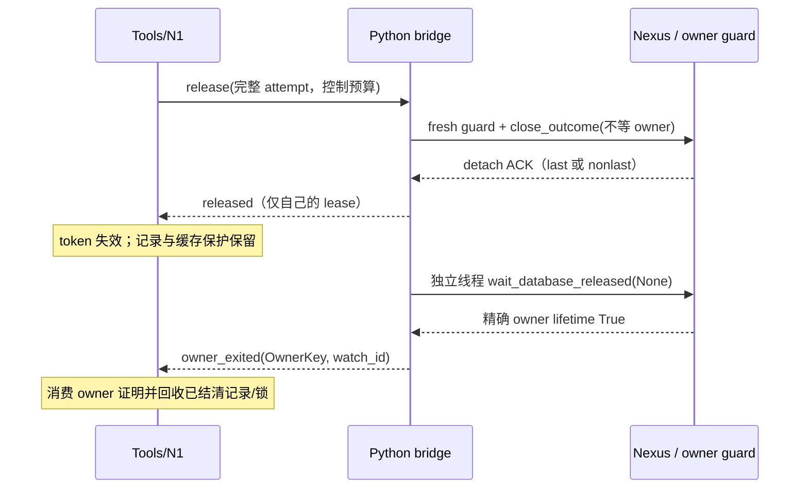

# Nexus 释放与打开协议：N7a-R 设计

状态：第一阶段设计提案，待独立设计评审；本文件不代表实现、测试或 N7 验收通过。
日期：2026-10-17。设计基线：`feat/nexus-backend`，`f47dd2301b096f1c4b6643906f6e8976e8663469`。
第二阶段须另行派单；本阶段只提交本文件及主计划 N7 中的引用。

## 1. 依据、目标与保留边界

依据是 [主计划](nexus-backend.md) 第 5 节、N1–N7 交付约定、全部验收裁定和
[测试约定](../TESTING.md)，以及本轮两份外部报告：

- `/tmp/ida-nexus-run-20261015.98rmfb/n7a-final-audit/report.md` 全文，特别是状态机、不变量、F1–F10、简化方向与存疑项。
- `/tmp/ida-nexus-run-20261015.98rmfb/n7a-rereview8/report.md` 全文，特别是 R8-F1/R8-F2。
- `/tmp/n7audit-repro.5EnFte/{harness/src/main.rs,stub_bridge.py,run.sh}` 及固定 Nexus 源码只读参考。本轮不执行该 run.sh，不改其现场。

目标是把四个事实分开：调用方结果、一次命令的投递、自己的 lease 是否 detach、精确 owner 是否释放数据库。
每个事实有一个权威状态持有者，其余层只消费带身份的证据。现状的关键接缝是：

| 基线入口 | 已核对的行为 | 设计后责任 |
|---|---|---|
| `src/router/nexus_transport.rs` 的控制帧期限 | Release 默认 2000ms | 仅约束本次检查与 detach 请求，不承担保存/退出等待 |
| `nexus_bridge/lifecycle.py` | 最后 ACK 后在同期限等 lifetime，组内传播证明 | 一次性 detach；owner 证明独立观察 |
| `src/router/nexus_bridge.rs::apply_event` | `release_unconfirmed` 删 pending，之后未知事件可使整桥断开 | 命令终态与 owner 事件分流，单事件隔离 |
| `nexus_bridge/bridge.py` 的 open | wait_analysis 完成后才通告 opened | 取得 handle 即登记，准备完成才对外发布 |
| `nexus_bridge/open_recovery.py::Snapshot` | 最终文件直接复制，回滚共用 open 期限 | 完整 staging、逐文件原子发布、journal 恢复门禁 |
| 固定客户端 `handle.py::open` | resolve 后 attach；连接异常还会 resolve/attach 一次 | 公开结构化获取结果与精确 attach 边界，见第 5 节 |

以下已接受语义继续成立：不重放可能已生效的 release；没有相应证明不称已释放；保护无法确认不默认保存或 close。
r9 首次 Root 不可见且未修改时，不保存关闭并在双证明后重开，最多三次；中途丢失永久拒绝写回，保留 TEMP|KILL、savebase/closebase hook、显式 save 前校验。
崩溃恢复继续采用快照、允许 Nexus 内部恢复、事后隔离与还原，不改成禁止恢复。
新代际、跨 router flock、隔离区、宽限期、close 证明补丁、共享 lease 隔离和 N1 停止证明均保留。

不扩大已登记的保证：独立外部 opener 的 FD/注册/隔离路径窗口，guard 安装前 Nexus 恢复保存窗口，脚本或其他客户端直接保存、未订阅通知、受信任代码篡改、native 不可抢占均仍存在。
不声称修复 IDA r9 根因；Linux、GUI、活动 debuggee 与专用输入的未验收范围不由本设计关闭。

## 2. 身份与唯一状态所有权

### 2.1 三类身份

`OwnerKey = (record_id, pid, started_at, canonical_idb_path, backend)`，另带配置 state 根的身份及 bridge/router incarnation。
前三项是 owner 身份，路径/backend 为一致性约束；缺字段不允许按路径或 PID 猜配。
只保存公共 instance 描述中的非敏感字段；不序列化 token，不从 Nexus 私有注册内容重建对象。
重连时用公开发现取得 instance，并逐字段核对；发现遗漏不能作释放证明。

`LeaseKey` 仍是完整 `SessionLease`（client_id、lease_id、instance_id、generation、owner kind）。
`DeliveryAttempt` 仍是完整 target 加单调 sequence；owner-exit 事件不使用 release 的 sequence。
同一个 owner 上所有 lease 可以引用一个 owner 观察记录，但每个物理 handle 保留自己的 detach 结果。

新增 `AcquisitionId = (parent OpenIdentity, purpose, ordinal)` 关联一次物理获取，purpose 为 final、verification 或 initial-root-retry。
同一用户 open 的至多三次 r9 尝试不复用 lease 或 acquisition ID；验证副本有自己的 OwnerKey。
该身份只是 adapter IPC，不是 Nexus 私有 lease_id，也不是新的用户参数。

### 2.2 逐层状态、事件与转移

| 层 / 唯一持有的事实 | 状态 | 事件与转移 | 不再判断什么 |
|---|---|---|---|
| owner guard：是否允许保存/自动关闭写回 | Uninstalled → Healthy；Root 缺失 → PoisonedSafe；查询/标志/hook 不可确认 → ProtectionUnavailable | 每次 before/after、显式 save、fresh close_status、savebase/closebase 重新采样；Poisoned 不恢复 Healthy；只有实际设置并读回 TEMP\|KILL 才为 PoisonedSafe | 不判断 lease 是否释放、不共享 owner-exit 证明 |
| Nexus 服务端：lease 成员与 owner 生命周期 | Live → Detached；最后引用按 keepalive 进入 Draining → 数据库关闭 → lifetime 释放 | 公共 release 或 SSE EOF；detach ACK 可先于保存结束；GUI/其他引用继续存活 | 不改服务端、不新增协议 |
| 客户端 handle：公开调用边界及原始 detach outcome | Connected → CloseIssued → AckDetached / DetachUnknown；连接状态正交 | 调用前锁存一次性请求；有效 last/nonlast ACK 均记录 lease_released；异常保留原始字段；同 handle 不重复发请求 | 不让 status='uncertain' 掩盖已取得的最后 ACK，不把 EOF 当 owner 释放 |
| Python bridge：物理 handle 账本与调用阶段 | Acquired/Preparing → Ready 或 CleanupRequired → DetachIssued → Detached/Uncertain；BlockedBeforeSend 可退回 CleanupRequired | acquired 立即登记；ready 才交付；失败转清理；每个 handle 独立 guard 与一次 detach；保存拒绝累积 | 删除 release_group 证明传播；不自行推断 N1 phase，不用通用 public_started 猜所有命令 |
| Python owner watcher：公共 owner-exit 证据 | Watching → Exited；观察异常 → ObservationFailed → 只读重新观察 | 每 OwnerKey 一个 wait_database_released(instance, timeout=None) 线程；True 才发 owner_exited；异常发 owner_observation_error | 不发 release、不等待控制帧预算、不关闭 sibling/GUI |
| Rust 事件泵：相关性与交付可靠性 | pending command / acquisition custody / owner subscription，三张分开的有界表 | 命令结果只结算对应 attempt；owner_exited 按 watch_id+OwnerKey 投递；重复/未知/迟到消息丢弃并记日志 | 不持有第二套 lease 释放状态，不因未知消息 fail 整桥 |
| N1：逻辑会话、操作、投递及清理责任 | 会话新增 Preparing；Preparing → Active 或 ReleaseRequired → ReleaseRequested → Released；Disconnected 正交保留责任 | opened 登记；open_ready 发布；open_cleanup_required 转 ReleaseRequired；NotSent 恢复原 phase；Uncertain 不重发；匹配 ACK 或 owner 证明确认 detach | 不把 Released 当 owner 已停止；调用方终态、execution_stopped 和投递状态继续分离 |
| Tools：对外记录、owner 保护与文件锁 | PreparingRecord → ActiveRecord → DetachedRetained → Retired；异常为 CleanupBlocked / OwnerObservationFailed / RecoveryBlocked | N1 Released 使 token 失效并退出活动列表，记录迁入 owner 保留表；只有匹配 owner_exited 且无其他本地义务才删除 owner 保护记录和对应缓存 guard | 不用 15s/120s 到时推断释放，不轮询第二套 owner 状态 |

Tools 的 owner 保留表是资源账本；N1 是会话状态的唯一权威。Python 的状态是原始 handle 调用事实，不能直接改 Tools。
Rust 与 Python 的短暂消息延迟由显式 InFlight/CustodyPending 表达，不能出现一边 Active、另一边已丢 handle 的稳定状态。



## 3. 两阶段释放与 owner 观察

### 3.1 阶段一：自己的 lease detach

每次 release 在原控制帧预算内执行 fresh guard、必要的自有分片清理和至多一次 close_outcome(wait_for_database=False)。
检查耗完期限、锁竞争、close_safe 不为 True 且尚未发 detach，终态是 NotSent，携带原保护原因。
根损坏但 TEMP|KILL 已确认时允许不保存 detach，同时将 saving refused 作为独立错误返回。

判定依据是结构化结果的 `lease_released` 和严格校验过的 ACK，不能只看 `status` 字符串：

| 原始证据 | N1 / 控制结果 | 后续责任 |
|---|---|---|
| 有效 nonlast ACK | Released / Confirmed | owner 继续存活；Tools 保留 owner 保护 |
| 有效 last ACK，shutdown_pending=True | Released / Confirmed | 相同结果；最终保存不占控制预算 |
| 请求已可能发出，ACK 丢失/坏 JSON/传输失败 | ReleaseRequested + Uncertain | 不重发；独立 owner 证明到达后可结清 |
| close_outcome 尚未调用 | NotSent，恢复先前 phase | 允许新的 attempt；原保护失败不能自动忽略 |
| owner-exit 先于 detach 结果到达 | 先缓存 owner 证据，命令结果不能降级它 | 仅结清匹配 owner 的旧 lease；保存错误仍要交付 |

一次逻辑 close 涉及 primary 和自有 auxiliary 时，每个物理 handle 都有独立 LeaseKey、N1 清理责任和 release attempt。
auxiliary 在创建时即按第 5 节登记为 cleanup-only acquisition，不能藏在 primary 的私有字典里。
先推进所有可请求成员；每个成员只发自己的一个终态，不再运行“成员等待—寻找 donor—重新协调”的第二轮。
Tools 的逻辑 close 只聚合这些 N1 结果与保存错误，全部成员有 detach 证明才报告本次自有引用释放完成；它没有第二个“组投递状态”。
例如 primary 已 ACK、auxiliary 检查前失败：primary 保持 Released，auxiliary 为 NotSent/ReleaseRequired，可独立新建 attempt；不能把整体锁存成 Uncertain，导致未发送的 auxiliary 永远占住 owner。
若某成员已发但无证明，仅该成员保持 Uncertain、不重发；其他 NotSent 成员仍可独立推进。精确 owner-exit 可结清同 owner 的未知成员，不伪造 ACK。
辅助检查失败必须返回原错误并保留辅助 handle；其阻塞不能被 primary 成功掩盖。

每个 attempt 只有一个命令终态。删除 release_unconfirmed；在证明未到前用 N1 的 Uncertain 和 owner 观察状态表达。
Uncertain 终态之后不再向旧 pending 发送 released；迟到 owner 证明进入独立 owner 通道，由 N1 的精确 proof 转换结清旧责任。
增加本地转换 `owner_released(OwnerKey, proof)`：核对 owner→lease 绑定，确认该 owner 的旧 lease 已不再存活；不需要重发 release，不影响替代 owner。
它可解除 NotSent/Disconnected 但实际 owner 已退出的旧清理责任，原始投递及 ACK 仍原样保留，不能伪称该请求得到 ACK。

### 3.2 阶段二：owner-exit 与缓存保护

每个 acquisition 在继续 owner RPC 前先建立 owner subscription；同 OwnerKey 合并为一个 watcher。
线程只调用现有公共 wait_database_released(instance, timeout=None)，不占 release_pool、业务池或停止证明池。
其无期限仅指观察，不是无期限阻塞用户请求。线程数/保留表按 admission 容量限制，获取 handle 前预留槽位；容量满返回 Busy，不能获取后丢记录。
可用独立 proof helper 进程承载这些 daemon 线程，确保 bridge 业务异常时 Rust 仍能只读补取证明；不新增用户常驻服务。

owner_exited 负载包含 protocol version、router/bridge incarnation、watch_id、完整 OwnerKey、proof=public_owner_lifetime。
Rust 持久接收循环先更新权威 owner 表，再通知 Tools；不能仅用可能 lag 的 broadcast 做资源交接。
每条 subscription 结清前证据锁存；重订阅立即返回已有结果。重复事件幂等；未知 watch、字段变化、旧 incarnation 只记日志。
public discovery 的 absence、进程名消失、SSE EOF 均不替代该证明。

Tools 只在 owner_exited 后释放与该 owner 绑定的缓存根 SH、失败 open 的 content/open EX 及对应记录；
还须确认本地文件发布/回滚任务已真正结束，不能释放其独立持有的 guard。
owner 证明先到时锁存证据，等待本地清理与错误归集完成；不能先删除 pending 的诊断墓碑，使稍后的 saving refused 无处交付。
正常 open 已成功发布时，content/open EX 仍按原契约在发布结束释放；不会为活动 owner 把同库 open EX 长期占住。
活动记录关闭后可迁移为 DetachedRetained；不继续列作活动 opener，不让旧 token 执行业务。
第三方 sibling 或 GUI 长期持有时，只保留内部 owner 记录与根 SH；有效 nonlast ACK 允许本 opener close 成功，且允许新 opener 附加同一健康 owner。
不因保留记录将该路径永久判为“正在释放”。同路径若有未知 detach 或 owner 正在 draining，返回明确 CancelPending/Busy，并消费后台证明后自动解除。

用户 close 仍最多等待现有 15s 外层保险，正常只等控制结果；owner 状态可为 pending。
删除 120s 到期后不再观察的模式，owner 事件消费贯穿 router 生命周期。
owner 真正一直未释放时保留保护是正确状态，不承诺强制收敛；状态和错误须指明 OwnerKey、已等待状态、下一恢复方式，不能只报泛化 unconfirmed。

### 3.3 bridge 断连、观察错误与重启

观察线程异常只置 ObservationFailed，保留 guard，返回明确错误；有界退避重新执行只读观察，不重发 detach。
Rust 在 bridge EOF 后保留 owner 表，并在有界启动预算内建立只读 proof helper：通过公开 discover 的匹配 instance 或仍存活的 proof helper 恢复 watcher。
无法重新发现精确 instance 时保持 RecoveryBlocked；不能用“查无 owner”解锁，也不能要求用户盲目重启 router。
给出需要的操作（恢复同 state 的公开发现/依赖后重试只读观察，或离线人工检查），不杀共享 owner。
原已签收的 owner_exited 证据不因事件泵断开丢失。

router 整体进程退出后 OS 会释放它的 flock；启动时没有旧活动会话可恢复，先通过公共占用检查和第 6 节 journal gate 恢复文件事务。
不在磁盘保存可跨进程复用的 release 授权或 token。原 session/client/attempt 命名空间废弃，不能重放旧命令。

## 4. 精确副作用标记与错误传播

将一个 public_started bool 改为命令各自的结构化事实：BeforeDetach / DetachMayBeSent / AckDetached；
BeforeAttach / AttachMayBeSent / Acquired；execute/cancel/shutdown 继续各自原投递与停止语义。
Bridge 收到控制 grant 仅代表可开始处理，不代表 Nexus 收到 detach。

release 在真正进入 close_outcome 之前才置 DetachMayBeSent，并先锁存一次性标记。
此边界之前的 guard RPC 即使超时，也只证明“detach 没发送”，不会断言 guard RPC 本身没有执行。
guard RPC 或分片清理如可能仍在 owner 队列，另外保留其精确 operation 和停止责任；未证实停止前不能发下一次清理或 detach。
NotSent 的“可重试”只针对目标 release，不能被解释为重放已执行的业务。

| N1 状态 | 重试规则 |
|---|---|
| Active、Preparing 转来的 ReleaseRequired、Disconnected，且 release delivery=NotSent | 可新建 sequence；先复查 guard/操作停止/owner，人工 close 可显式重试 |
| ReleaseRequired 且上次 lane Busy/可证明 NotSent | 后台有界退避，沿用现有自动清理机制；保护不可用进入显式 CleanupBlocked，不做 10ms 热循环 |
| ReleaseRequested 且 Queued/Acknowledged/Uncertain | 不发第二次 release；只等原结果或 owner 观察 |
| Released | 幂等返回记录的结果，不请求远端 |
| ShutdownRequested / 原操作未停止 | 保持 N1 禁止释放，不借 detach ACK 冒充 execution_stopped |

错误结果始终带原 cause、command stage、目标身份、已观察到的 save_guard_error、cleanup 状态。
保存拒绝是 owner guard 的结构化结果或真实公开 RPC 异常产生的独立错误，所有路径均累计，包括 NotSent、Uncertain、成功 detach 和辅助清理失败。
在 detach 前先将本次 fresh guard 的拒绝/保护状态经可靠 release_observation 事件交给 Rust 并签收，再开始可能使 owner 退出的调用；该观察事件不是 detach ACK，也不改变 N1 投递为 Acknowledged。
本地观察签收耗尽控制预算时不发 detach，结果为 NotSent；owner 退出不能清除已收集的拒绝信息。
Tools 不再忽略 Uncertain 的 error，也不以 take 一次后永久清空错误；记录随 token 墓碑/保留记录保存到既有容量边界。
close 已 detach 但保存被拒绝时仍向调用方返回错误，注明 lease 已释放、owner 证明是否 pending、未保存修改已丢弃的已知事实；不把 Released 等同保存成功。

## 5. open 不留孤儿：先登记，再准备与交付

### 5.1 选择及协议

选择委托的第一种方案：取得 handle 先通告 opened，失败由 Rust 的 ReleaseRequired 驱动。
不选“同一 open 线程用独立清理预算后才告知 Rust”，因为保护不可用、第三方 lease、分析停止未知都可能超过任何清理预算；Rust 必须及时持有责任。
这里的 opened 是内部“获取成功”，不是用户 open 成功。为避免过早变成 Active，N1 新增 Preparing 及两个明确事件：

| 事件 | Rust/N1 原子处理 | Python 后续 |
|---|---|---|
| opened(acquisition_id, lease, OwnerKey, preparing=true) | 从已预留 acquisition 槽接管；Preparing 不可执行、不发布 token；登记 owner watcher；回复 custody_ack | 收到 ack 才进入 runtime/Root/分析步骤；未收 ack 原 handle 仍由 Python 保留 |
| open_ready(acquisition_id, 实测 capabilities, recovery) | 仅当前父 open、未取消未超期、所有必需准备成功时 Preparing→Active，交付用户结果 | 不再持有第二份逻辑状态 |
| open_cleanup_required(acquisition_id, 原 cause, stop 信息) | 保留父 open 唯一失败；Preparing→ReleaseRequired，沿现有 release 调度 | 不在 Python except 中使用已耗尽的 open deadline 再直接 close |
| open_failed_no_acquisition(确定未获取的结构化结果) | 父 open 确定失败；释放未绑定 owner 的准备 guard | 新用户请求可重新 open，不重放旧 attempt |

这些事件经可靠 custody 通道及 Rust 权威表处理，不直接放入当前 open_replies 的“第一个 opened 即用户终态”分支。
若 opened/ready 跨取消、超时、客户端 future drop：登记与 abandon 在同一 N1 转换中仲裁，晚到 handle 直接 ReleaseRequired，不能补报成功。
能力未验证的 Preparing 只有清理权限；不能虚构实际 IDA 版本来通过 register。
实现可给 N1 增加 cleanup-only registration，再由 ready 安装实测能力；不改变对 Active 的能力校验。
未知 acquisition 的携 handle 消息先用已预留父 open 记录核对并接管清理，再丢弃用户成功投影；不能机械丢消息造成新孤儿。
真正来自未知命名空间或无预留身份的 payload 不授予执行权，报本桥 custody 错误并保留 Python handle，不使其他会话断开。

每个 parent 在副作用前预留有界 custody/cleanup 名额：final 的至多三次物理获取，legacy verification 另至多三次，断连 auxiliary 至多一个。
这些名额在既有 tenant 上限内计费，不能把容量乘七后悄悄扩大；容量不足在获取前 Busy。已结清子项复用资源槽，但身份墓碑不可复用。
当前 N1 Opening.acquired 只容一个 lease，不能反复调用同一 opened；应增加有界 acquisition 子表，以独立 LeaseKey 复用相同 release/NotSent/Uncertain 转换。
parent 的结果和子 acquisition 的生命周期分离；不是七次用户 open，也不重置 Preparation 期限。

### 5.2 准备失败、分析超时与 r9

从 runtime 查询、guard 安装、首次 Root 检查到 wait_analysis 的任何异常，包括 RemoteError 与 TimeoutError，均先保留已获取 lease；禁止通用 except 把它报成 no acquisition。
准备 RPC 使用精确 operation_id，确认的 RemoteError(operation_timeout) 表示该 RPC 已返回；客户端传输超时不表示停止。
后者复用 N1 UnknownOutcome、独立 cancel/因果停止证明，未停止前不得 detach。分析等待所需 operation_id 见下节客户端扩展。
不得把用户 open 超时或取消自动等价成“分析 worker 已停止”。

r9 首次异常由原 guard 证据判定，仅未业务修改且 managed owner 才自动重开。
失败 acquisition 转 ReleaseRequired；必须取得本 lease detach 和同 OwnerKey 的 owner-exit 双证明后才回滚并尝试下一个 acquisition。
控制 detach 不等待 owner，但父 open 编排可以等待 owner；该等待受原 open deadline 限制。
deadline 用尽只禁止新的 open/重开，不撤销后台清理/已开始回滚责任；最多三次不变。
第三次失败仍完成必要还原；失败原因、重开次数和恢复现场返回调用方。
GUI 首次失败只清理自己的 lease，不重开、不 shutdown GUI。中途 Root 丢失绝不走此重开流程。
verification probe 也必须登记 acquisition，副本 staging 只有它的 owner-exit 后才允许清理。

### 5.3 公开客户端补丁的必要扩展（设计评审项）

现有 Handle.open 的 resolve/attach 都藏在一个调用中，仅在 bridge 进入 Handle.open 前置位无法满足精确边界。
提议新增公开 open_outcome / attach_outcome（名称可在实现时等价调整），沿用原公共方法实现，不在 bridge monkeypatch _open_lease、拼 HTTP 或读取私有锁。
结果结构包括 stage、acquired handle 或 None、resolved public instance 或 None、确定失败类别、是否仍有 startup obligation。
另提供 before_attach / acquired 回调：前者在每次真正 attach 调用前执行，后者在 SSE 成功建立后立即转交 handle，后续 monitor 初始化异常也必须保留它。
参数校验、resolve、快照、probe、worker_cwd 失败均不能置 AttachMayBeSent。
原 Handle.open/attach 的签名与返回/异常契约兼容；原有 resolve 后再 attach 的次数不增加，不把业务请求带入重试。

确定性 DatabaseBusyError、attach 明确 503 拒绝均返回 no acquisition + 原错误，不报 UnknownOutcome。
attach 发出后的传输/解析失败只有公共客户端能证明 SSE 已关闭且没有可存活本地 lease 时才报 no acquisition；否则保留 resolved instance 和只读 owner 观察责任，不伪称 NotSent。
客户端必须保证构造异常路径关闭自己的未交付流；需 probe 验证 SSE detach 和失败后无遗留 lease，而不能按异常类名一刀切。

WorkerStartError / resolving timeout 表示未取得 lease，却不一定证明 worker 已停止：固定 _await_ready 到期抛错并不回收 Popen。
公开结果应交付有限启动跟踪（精确 launch 身份/公共 instance 若已登记），复用现有 startup 跟踪，返回确定 open 失败但暂留启动保护。
保护观察到实际退出或就绪后恢复公共占用管理；到启动观察上限仍未知则显式 startup-unconfirmed，不能无限静默保留或自动杀 worker。
不得拿“没有 handle”释放仍被自己启动任务使用的文件保护；缺少可证实的公共启动身份时，该子项明确 BLOCKED，提请编排者裁定 API 范围。

分析等待及准备 guard 的公共客户端方法须允许传 operation_id，转发既有服务端公共操作字段，不添加服务端 endpoint。
close_outcome 保留原 status/lease_released 字段与一次性请求；只为结构化结果增加 ack_kind/cleanup_failure 等必要非歧义字段，或直接由现有 lease_released 映射。
尤其 parsed ACK 后本地连接清理异常不能覆盖该 ACK；清理失败单独报告，剩余本地清理工作不能无限占控制线程。
需要改动范围限固定客户端 handle.py 的公开接口补丁及 prepare 哈希/探针，loopback 与 cancel 的既有语义保留；本阶段不修改任何补丁。
该扩展涉及此前“不改三个补丁”的裁定，必须由设计评审明确批准后，第二阶段才可实施；不以本设计当作已获实施授权。

## 6. 回滚原子发布与启动恢复

### 6.1 原子性的准确范围

单个文件可原子 rename，任意用户目录中的 packed 与多个解包组件无法一次 rename 成为整组事务。
本设计保证：最终路径从不暴露截断文件；协作 ida-cli opener 在 journal 提交前不能进入 Nexus；崩溃后可继续还原或明确拒绝。
不承诺外部忽略锁的 opener 永远看不到组件间的中间状态。整组目录替换只适合独占新代际，不能移动任意用户父目录或改变其路径身份。

### 6.2 journal 与持锁步骤

继续使用 idb/recovery/<id> 的不可变 snapshot、failed-files-N、quarantine-N 和 recovery.json。
journal v2 增加 canonical target、父目录 device/inode、OwnerKey、acquisition、完整组件清单/内容哈希、staging 身份、每个移动意图与完成证据。
状态为 snapshotting → ready → failed-owner-held → staging → prepared → isolating → publishing → restored → opened；异常为 blocked（含原阶段/原因）。
每次状态更新使用现有 atomic_json 的 temp+fsync+replace+目录 fsync；先记录意图再改目标文件，重启通过实际 inode/哈希消除“rename 成功但完成日志没写”的歧义。

1. 获取根 SH 和同库 recovery-open EX；正常 Rust open 仍持 content/open EX，统一锁序为 root → content（如需）→ open（Rust）→ recovery-open（Python）。恢复 helper 不反向请求已持有的 Rust 锁，GC 只拿根 EX 非阻塞。
2. 在恢复目录创建快照、校验并落盘 ready，之后才允许 Nexus 恢复。snapshotting 未完成时从未授权 Nexus 打开，重启核验现场未动后保留/废弃未完成快照，不能以不完整副本还原。
3. 首次 Root 失败先记失败意图、抓取失败组件；必要清理不依赖原 open 剩余预算。只有 double proof 后进入回滚；被第三方持有时记 failed-owner-held 并拒绝重开。
4. 回滚一开始转交独立恢复 job，自持根 SH/recovery-open EX 与文件描述符。用户 open 到期不取消 job，也不由 drop 解锁。后台 job 有进度/明确 I/O 错误，不承诺任意存储故障的硬完成时限。
5. **先**将所有快照文件复制到目标同一文件系统的私有 sibling staging（0700，文件 O_EXCL/O_NOFOLLOW）；复制完整、核对大小/哈希、原 mode、fsync 后记录 prepared。复制不直接写最终路径。
6. 再验证原目录、当前组件身份与公共占用；按 journal 非覆盖 rename 到 quarantine，记录每步的意图/实际身份并 fsync 双目录。遇到变化停止，不能覆盖外部写入。
7. 从 staging 将完整文件按清单逐项非覆盖原子 rename 到原路径并 fsync；不得用 os.replace 覆盖未知目标。每个完成项记录新 inode。崩溃可留下“部分完整组件”，但 journal gate 阻止 Nexus 读取它们。
8. 全组哈希/mode/目录与公共无占用复核成功，落盘 restored 才解除恢复 gate；原期限仍有余量才准下次 open。只有后续成功 open 才标 opened；三次失败仍留 restored 与原因。

回滚的数据搬运不再调用 remaining(open_deadline)。单次公共占用探测保留有限预算，失败记 blocked；长文件复制跨过 open 期限也继续或因真实 I/O 错误明确停止。
ENOSPC、权限、fsync、校验或身份冲突均保留 journal、snapshot、staging、quarantine；错误带恢复目录和阶段，不只报 open timed out。
所有错误写回 Rust 恢复记录，用户请求已结束时由 status/日志继续可见。

### 6.3 启动及每次 open 的恢复 gate

bridge 启动扫描本产品 recovery 容器，建立 canonical target→未完成事务索引；损坏/未知版本 journal 无法确定 target 时拒绝相关根内的恢复相关 open 并报告路径，不放行猜测。
每次公开 probe/Handle.open **之前**，在 recovery-open EX 下重新读取索引及 journal，覆盖另一 router 在扫描后的写入。
不用仅启动一次的内存扫描代替磁盘门禁；GC 同样保留所有恢复证据。

旧 v1 的 ready/failed-owner-held/rolling-back 不能直接当已完成：核对原快照清单、snapshot hash 与现场，构造 v2 恢复意图后续跑；缺证据就 blocked，绝不重新交给 Nexus 修复残片。
v2 prepared/isolating/publishing 根据每个 intent 的 source/destination identity 幂等续跑；目标已存在且内容不同或来源不明时停止，不能“相同路径就接受”。
failed-owner-held 必须重新取得精确公共 owner proof；仅发现不到 owner 不足以开 gate。新的占用者或不明注册一律否决。
公开发现无法恢复旧 instance 时明确要求离线维护/设计复核；不能私读 Nexus token 文件绕过。
恢复 job 完成与 observer 重连都不自动重放用户 open；调用方收到失败后使用新的请求。

### 6.4 F7：Nexus 自己的 crash 备份

固定上游 database_state._backup_unpacked_database 会生成 `<target>.crash-<UTC>-<pid>-<suffix>/`，目录属于 resolver 进程，不能拿 owner pid 强行匹配。
恢复清单对这个**精确目标**的新目录单独分类：限定格式、同父目录、非 symlink、普通组件文件、内容/名字对应原 unpacked 快照、无额外文件，并记录目录与递归文件身份。
已存在的备份列入 before；本次新增项先登记 journal 再通过 failed 检查。仅按前缀放行不足以授权移动/覆盖。
内容不完整或来源不能证实就保留并报 blocked，不能删除取证目录或将它当用户目标组件还原。
合法备份被保留为恢复证据，不阻断正常 rollback/retry；不自动 GC。增加 packed+crashed 与无 packed 两类红绿用例。

## 7. 接收器隔离与默认目录

Rust apply_event 先分类 command、acquisition、owner 事件，再核对各自身份。
release_observation 属于当前 release 的非终态 sideband，单独签收且不删除 pending；命令终态与 owner-exit 分开消费。
命令未知 attempt、旧 sequence、重复终态、错误 target、未知 event 记录限频日志后丢弃；当前请求可标协议错误并保留清理责任，不能 fail 共享物理连接。
“迟到”不等于“无价值”：已注册 acquisition 的 custody、当前 operation 的停止证明、已登记 OwnerKey 的 owner_exited 仍经各自权威表消费，即便 command pending 已删除。
未知携 handle 消息按第 5 节先处理资源责任，不能用宽松忽略吞掉新 lease。
无法解析的单个完整 JSON 行隔离处理；帧大小/实际 EOF/物理写入失败等连接级故障继续走真实断连，不能吞掉真实 I/O 问题。

lifetime socket 的 accept 与单连接握手分开：recv timeout、EPIPE、OSError、UnicodeDecodeError、无效 ASCII/超长/未知 lease 都只关闭该 connection，清除其临时项，accept 循环继续。
send ok 成功后才安装 lifetimes 条目，替换旧条目时核对精确 lease/incarnation；失败不能留下坏连接或提前关闭健康旧连接。
监听器自身非关闭期间失败可显式设置 lifetime listener unhealthy，报告并恢复该监听器，不触发 Bridge.stopped 释放所有 lease。
N5 owner EOF 清理依旧只对精确 context/incarnation 做公开 attach、串行清理；与新 owner-exit watcher 是两个方向不同的通道，不能混用。

F10 以 Rust idb_store::ida_home 的行为为唯一解析来源：非空 IDA_CLI_HOME 优先，否则 HOME/.ida，HOME 缺失才 /tmp/.ida；不擅自展开显式 `~`。
Rust 启动 bridge/helper 时传递计算好的绝对 `ida_cli_home`（固定启动 CWD 解析相对路径），Python 的 worker_cwd、recovery、cache 都使用它。
独立 Python 测试入口使用同规则解析函数，并与 Rust 表驱动对照：未设置、空、相对、绝对、HOME 缺失及空 HOME；不使用 Path.home() 引入另一套默认值。
这只统一 IDA_CLI_HOME；IDA_NEXUS_STATE_DIR 的公开 get_state_dir 规则保持不变。

## 8. 问题映射与跨层不变量

### 8.1 审查问题逐项映射

| 问题 | 设计消除方式 | 第二阶段的决定性证据 |
|---|---|---|
| F1 / P0 | ACK 与 owner 退出分离，watcher 不因控制期限或 120s 观察结束失效 | last ACK 后 owner 3s/超过旧观察窗释放；无需重启可重开；大 IDB 实测 |
| F2 / P1 | 一个命令终态；删除 release_unconfirmed；owner 事件独立；未知事件不使整桥 fail | 原 56 条事件轨迹回放，A 故障而 B 始终可用 |
| F3 / P1 | close_outcome 边界前 NotSent，N1 可新 attempt；保存/原错误在全部结果返回 | busy guard、锁/期限、辅助保护失败的调用方断言及请求次数 |
| F4 / P1 | acquired 即登记 Preparing；失败进入 ReleaseRequired；分析停止另证 | wait_analysis 两类超时，Python/server/N1 实际 lease 集一致，无 orphan |
| F5 / P1 | 公开分阶段 open 结果；busy/503 确定失败；startup 另跟踪 | 失败后新请求成功，启动慢但无 handle 时也不丢后台写保护 |
| F6 / P1 | 完整 staging+非覆盖 rename+journal gate；回滚脱离 open 期限 | 每次文件操作/日志边界中断重启，最终完整还原或明确 blocked |
| F7 / P2 | 精确登记并验证上游 crash 备份目录 | packed+crashed 首次 Root 失败可回滚、重开，备份原字节保留 |
| F8 / P2 | 生产 bridge 驱动真实 Rust 接收器；不再靠重入旧 release 协调 | 无“测试直接再调 run”或夹具伪造迟到 released 的收敛证据 |
| F9 / P2 | 单连接握手隔离，listener 错误单独恢复 | timeout/EPIPE/非 ASCII 后同桥 A/B/新握手仍正常 |
| F10 / P2 | Rust 统一 home 解析并向 Python 传值 | unset/empty/relative/HOME 缺失矩阵均一致，测试只触及私有 HOME |
| R8-F1 / P2 | 去掉测试对 release_state(errors) 的预填，由真实 guard/RPC 错误产生 sideband | 去预填仍能在真实 CLI/MCP close/save 调用方观察保存拒绝 |
| R8-F2 / P2 | 时序图驱动矩阵；成员动态变化；I5 前提修正 | sibling 中途加入/离开、last ACK 后 owner 仍 held 都真实进入矩阵 |

上述是待实现的修复对应关系，不是本轮关闭这些问题的结论。

### 8.2 I1–I6 的修正定义

| 不变量 | 精确定义 |
|---|---|
| I1 保存保护 | 每个可能引起关闭写回的自有 handle 在一次 detach 前通过 fresh guard；缺 Root 只在 TEMP\|KILL 已确认时不保存释放；保护不可确认不发 detach；显式 save 先采样；中毒不可逆 |
| I2 不重放 | 每个物理 handle 最多调用一次有副作用 release；NotSent 重试只针对确未请求者的独立 attempt，execute 无自动重放；从不重置 requested 来换取收敛 |
| I3 证明充分 | N1 Released 有该 lease 有效 detach ACK，或精确 owner 公共 lifetime proof；Tools owner 保护删除只据 owner_exited；ACK/owner/停止三种证明不混用 |
| I4 错误到调用方 | 生产 guard/RPC 产生的每个保存拒绝到达 close/save 的 CLI、MCP 包装，NotSent/Uncertain/Released 都保留；不能由测试写私有 errors 造证据 |
| I5 有条件收敛 | 前提为 **owner 在期限内真正释放**，事件通道/只读观察健康且调度可推进时，已发请求的保留责任在规定观察断言期内结清；lease 数为零不是前提的替代品。这里期限是测试的 owner 观察期限，不是 2s 控制期限 |
| I6 精确责任 | 仍需 owner 证明的未知 detach 成员保留精确 handle/LeaseKey/OwnerKey/guard；有效 nonlast ACK 的整个本组可报告 lease 已释放，第三方继续使用。本设计额外保留 owner 缓存保护，不能以此否定已释放 lease |

新增跨层约束：

- C1 状态一致：Python 所有返回或仍持有的物理 handle，均有 Rust custody/pending acquisition；稳定点双方 LeaseKey 与 OwnerKey 集相符。Released 后 Python 可保留原始证据，不可继续执行业务。
- C2 无孤儿：handle acquired 到 Rust custody_ack 之间有已预留父 open 和 Python 强引用；所有失败、取消、断连、析构均转清理，不能仅报 failed 丢引用。
- C3 可恢复：每个等待有状态、原原因与下一推进条件；有证据必消费，不会因旧 pending 被删永久卡住。guard 永久不可用/外部 owner 永不退出时明确 blocked，不能承诺强行释放。
- C4 N1 停止语义：detach ACK 不证明业务停止或保存成功；unknown caller 终态不被 owner 退出改为 success；只补精确停止证据。真实 owner-exit 可证明其旧执行不再运行，不能作用新代际。
- C5 故障隔离：一个 lease/attempt/握手错误不改变其他 lease 的 phase、operation 或 bridge 存活状态；物理整桥断连仍诚实报告。
- C6 文件完整性：原路径每个已发布文件均完整校验；未提交 journal 禁止协作 open；无覆盖未知文件、无路径穿越、无 symlink 跟随；快照与现场证据不自动删除。
- C7 容量与交付：获取前预留 custody/owner watcher；不能靠丢证据腾槽。consumer lag、future drop、120s 超时不能撤销清理责任。

## 9. 测试方案与红绿证据

### 9.1 跨层 harness

将终审模式维护进现有 nexus_bridge_regressions 的 support：真实 Rust RouterState/Tools、N1、生产 transport/事件泵和生产 bridge.py；只替换 Nexus HTTP/SSE 传输。
真实固定客户端的 open/attach/close_outcome/异常包装及生产 guard/lifecycle/open_recovery 不替换。
owner 由私有 flock 和真实公共 wait_database_released 模拟，绝不读取/争用用户 Nexus 锁；guard 用生产 save_guard 源码配合公开 IDA stub，或真实 E2E 验证。
每场景用全新短路径 HOME/state/tmp/IPC、样本副本、独立 CARGO_TARGET_DIR；env -i 白名单，记录实际加载源码哈希和补丁版本。

同时记录 commands、原始 ACK、Python events、Rust accepted/dropped events、server lease 集、Python handle 集、N1 phase/delivery/stop、Tools 记录/锁与用户响应。
不能只断言 Python events 列表，也不能 stub N1 的转移、直接塞 release_state、手工把 released 投递给 Rust 来当产品会产生的证明。
旧事件回放只证明接收器健壮性；收敛必须由生产 watcher 的真实公开 proof 导致。

### 9.2 可达轨迹矩阵

生成器从“可执行事件”推进状态图，而非用初始 live 数过滤笛卡尔积。每条边记录前提、实际调用与后继；排除项给协议证据，等价归约给完整观测映射。
基础维度为 primary/auxiliary/sibling/GUI/warm、guard 健康/缺 Root 已保护/查询失败/标志失败、NotSent/last/nonlast/ACK 丢失/坏响应、断连/预算/容量。
owner lifetime 不再是每个 release 成员的证明共享维度；它仍是**独立 owner watcher 状态机**的必测时序，不能从跨层矩阵删掉慢退出。

| 轨迹族 | 必须覆盖的边界与断言 |
|---|---|
| R8 动态成员 | sibling 在两次本组请求间离开：nonlast→last；中途加入：nonlast→nonlast；服务端真实 detach 逻辑推导 ACK，不按期望预填 |
| 零 lease 但 owner held | last ACK 即 N1 Released；Tools guard 留存；owner proof 早于/晚于 ACK、旧 2s/15s/120s 边界后均自动消费 |
| 一次性与原始 ACK | 丢 ACK 不重发；同 owner proof 可结清未知成员而不改 release_acknowledged；第三方持有时仅报自己已释放，不报 owner exited |
| 请求前失败 | guard busy、检查超时、辅助保护失败、lane 满、检查后期限耗尽均有准确的逐成员 NotSent/Uncertain 与原错误；primary ACK 后 auxiliary NotSent 仍能独立重试，新 attempt 不重复已发送者 |
| open custody | 所有准备边界的取消/drop/异常、两种 analysis timeout、opened/断连乱序、custody ACK 丢失、容量预留失败；失败后同路新 open 能推进 |
| 接收器 | 原 189 行的完整 wire 序列及 56 条致命序列、重复终态/未知事件/错身份，B 与控制通道继续工作；不能复用旧单层绿测当充分性 |
| owner watcher | True/异常/bridge EOF/重连/同路径换 owner/PID 复用/字段缺失、全部五字段单变反例；状态表非 broadcast 驱动锁回收 |
| 文件恢复 | 每个 copy/fsync/rename/journal 意图前后注入真实子进程退出、ENOSPC、身份变化、symlink、备份目录；新 router gate 阻止读半组，重复恢复幂等 |

R8-F1 必须先移除预填取得真实红例，再经生产错误收集变绿；保存拒绝用公开执行响应/异常注入，最后从真实 close/save 调用方断言。
I5 前提不成立的 owner-held 场景只检查 I1–I4/I6 和明确 pending；当 barrier 真释放 owner 后继续同一运行，检查 I5，不能启动第二次 release 或新建 router 掩盖问题。
结果 JSON 保留全部可达轨迹、排除理由、每项不变量和原始错误；数量由生成器产生，不预设“189 全绿即完工”。

### 9.3 真实 IDA 与 F1 大库实测

第二阶段按 TESTING 新 prepare 环境运行 lifecycle、contract、concurrency、N6、special_inputs，保留 E03/E05/E06/E07/E20/E21/E22、r9 guard 与恢复专用场景。
GUI attach 释放不退出 GUI；真实 thirdparty/warm lease 隔离、保存拒绝、初开总共三次上限、会话中途不重开均须验证。
自动 savebase/closebase 在实际 close_database(save=True) 写盘前的保护效果需重新取证，不能仅引用 SDK 注释。
WorkerStartError/启动超时需真实 barrier 验证 spawn/grace：失败后 worker 是否仍在写、启动保护何时交还，不能靠 stub 假设停止。

F1 另外使用本机较大 Mach-O 的**只读来源副本**，在私有目录分析生成 i64，实测 packed 大小必须 >100MB。
若未达到门槛，换另一合适测试输入，禁止填充文件伪造“大库”。生成前记录源/副本哈希；不得打开用户已有 IDB。
用同一已分析 seed 的两份完整副本分别跑基线 f47dd23 与候选，不共享 owner/缓存，不更改比较规则。
准备和分析的建议外层 timeout 1800s（大库首次分析与打包），每次流程 600s（保存/关闭/重开及精确清理）；执行前说明理由和实际上限，超时仍为 FAIL/BLOCKED，不能算完成。
记录单调时刻：open 接纳/ready、改一处可读回注释、close 发出/guard/ACK、N1 Released、owner_exited、锁回收、立即 reopen 接纳/ready、修改读回。
大库仅记录此功能时序，无 QPS/TPS/criterion。last ACK 后立刻发新 open；若仍 draining，可有明确 pending/Busy，待同一次 owner 事件推进后在原新请求预算内重开或明确返回可重试失败，不能永久锁死或重放写操作。
候选必须展示实际 detach 一次、owner 关闭可超 2s、无需重启 router、最终同一路径新 owner 与保存修改一致；若大库仍关闭 <2s，真实结果如实记录，并用可控 owner barrier 覆盖慢退出，不声称实测自然触发 F1。

### 9.4 执行门禁与证据

所有编译/检查/测试用 shell timeout，默认 30s；冷构建按 TESTING 事先说明 180s，真实整套按原 210s，S1 两个长观察单用例按 150s 且串行。
保留 12+13 门禁、默认及 nexus-test-support Clippy、lib 三轮、Python test_nexus_*.py 每文件独立及 env -i 两模式、bridge pytest、三个补丁 probe 红 2/绿 0。
既有 just/Makefile 未固化 timeout 或隔离 target，不直接调用无界入口；集成用 cargo test --test 指定 target。只改文档的本阶段不运行这些产品门禁。
未来的新目标命名由实现提交登记；下面只是现有 target 的命令形状，不是本轮运行记录：

```sh
timeout 30s cargo test --locked --test nexus_contract
timeout 30s cargo test --locked --features nexus-test-support --test nexus_bridge_regressions -- --test-threads=1
timeout 150s cargo test --locked --test nexus_n7_fix1 s1_expired_observer_next_open_consumes_exact_proof -- --exact --test-threads=1
```

每条命令记录最终 HEAD、完整 argv、开始/结束 uptime、退出码、实际用例集与数量；exit124/零测试/缺依赖均非 PASS。
基线红例用 git show 归档全部依赖模块和固定客户端，记录哈希，不能以缺模块制造红测。
每轮 finally/独立 cleanup/assert_clean 精确核对登记进程已退出、公开注册及自有 socket 零残留；不得全局 pkill 或清理其他环境。
历史 S1 的 120s 边界保留，但改用生产 owner watcher 产生证明；不通过手工迟到 released 冒充生产行为。

## 10. 迁移、兼容与裁定点

### 10.1 对外变化

| 项目 | 设计后行为 | 不变的部分 |
|---|---|---|
| close 成功时机 | 最后 lease 的有效 ACK 即本会话关闭，owner 可能仍保存；不再把 >2s 保存报永久不确定 | 只释放自己；不 shutdown sibling/GUI；close 成功不新增“owner 已停止”承诺 |
| close 保存错误 | detach 成功仍明确 saving refused；NotSent/Uncertain 均保留原 cause/sideband | 根损坏不保存，未保存编辑丢失的提示与原保护逻辑 |
| 状态投影 | 内部 Preparing、DetachedRetained、owner pending/error、recovery blocked；原活动列表移除已关闭 opener | 既有成功 JSON/CLI/MCP 包装保持；新增诊断进 meta.nexus/现有错误 data，不输出 token |
| 错误码与文案 | busy/attach503 为确定 OperationFailed/Busy cause；请求前失败 NotSent；未知 attach/detach 用 UnknownOutcome；观察/恢复阻塞用 CancelPending 加 stage/cause | 原 -32602/-32601/-32000、NeverReplay 与调用方确定终态规则不变；不以字符串解析错误来决定重试 |
| 再次 open | 已知 detach 后可等 owner 退出或附加健康共享 owner；证明到达自动解锁，不需 router 重启 | 不在 unknown detach 时放行新 owner；总期限不重置 |
| 日志 | 不再有 release_unconfirmed/组内 proof donor；新增 owner watch、custody、restore stage 与已保留原因 | r9 首次取证、自动重开次数、诊断默认 stat-only、显式 forensic hash 均保留 |

新旧 Rust/bridge IPC 不混用：readiness 增加 release/open protocol version 及能力要求，版本不符启动明确失败，不静默回落旧协议。
wire frame v2 可保持，新增消息族单独带版本；客户端补丁哈希和准备脚本清单随实现一起更新。
不迁移活 session；开发验证重启仅限自有测试 router，生产升级仍按离线备份与用户授权操作。

### 10.2 与 master 及 N9

本地 master/origin/master 在本轮只读核对为 `27a54cca29ba56447fe0044b167e7d0ee33a273c`；未访问远程确认“最新已发布版本”，不得把该 ref 等同发行包证据。
相对已发布 master 的兼容基准仍为主计划固定 N0 产物与其哈希：旧 native/idat 的关闭与 Nexus lease/owner 两阶段不同；新增诊断不能破坏成功业务结果、地址/类型、CLI/MCP 包装或严格比较。
N7 已批准的新代际路径/input_file_path/缓存统计差异继续按原表登记，本设计不新增比较字段豁免。

N9 删除 native-linked/idat-compat 普通执行、dev 开关、旧依赖/选择逻辑时，必须保留本协议、r9 guard、startup/recovery gate、owner watcher 与所需客户端补丁。
`IDA_CLI_HOME` 默认值必须在取消 dev 开关前对齐。离线 sbx/idat 准备仍保留；旧版本对照依赖冻结可执行产物而非旧源码。
清理后重跑 E00–E29 与新跨层用例；N8 旧结果不能替代。运行回退依赖旧发行版本及已关闭备份，不能运行时静默切旧后端。

### 10.3 需要设计评审明确的决定

1. 批准“close 只证明本 lease detach；owner-exit 才回收 owner 缓存保护”的对外语义与额外保留：第三方/GUI 长存时根 SH 可能长期阻止整根 GC，必须清楚展示；本设计不擅自放宽为 nonlast ACK 即删 owner guard。
2. 批准第 5.3 节公开客户端结构化 open/attach、准备 operation_id 与 ACK 清理分离扩展；与原不改补丁约定的差异需要显式记录，仍不改服务端或私有协议。
3. 批准 Preparing/acquisition 子表与可靠 custody/owner 事件，按既有总容量计费；不能把现有 opened 提前后立即当 Active。
4. 认可“单文件原子+可恢复 journal+协作 opener gate”的回滚保证及外部 opener 剩余窗口；若要求任意用户目录多文件对外整体原子，需要架构变化，另行裁定。

这些是具体设计的评审项。本阶段提交后停下，不以尚未批准的提案进入实现。

## 11. 第二阶段实施顺序与规模

步骤之间保持协议特性开关/版本联动，只在开发测试环境切换；每步提交应可独立验证，不保留最终产品的双协议 fallback。

| 步骤 | 内容与预计范围 | 红证据 → 绿证据 |
|---|---|---|
| R0 评审与冻结 | 明确第 10.3 节、预算与 custody 容量；冻结 f47dd23 源码/补丁；维护跨层 harness | 原终审场景在冻结完整源码复现，原错误/用例集/请求次数落盘；没有实现前不称已修 |
| R1 边界和错误 | 公开客户端 open/attach outcome、准备 operation_id、close parsed ACK 保护；bridge 分命令事实与调用方错误 | busy/503、guard pre-send timeout、constructor/monitor 错误及 ACK 后 cleanup 错误红 → 分类、无孤儿与原 cause 绿；cancel 三 probe 不回退 |
| R2 两阶段释放 | N1 精确 owner proof 转换、owner subscription/watcher、Rust 可靠 owner 表、Tools 保留记录与断线 proof-only 恢复 | 3s owner、丢 ACK、同路径换代、超过 120s、bridge EOF 红 → 一次 detach、证明后自动收敛、B 不受影响绿 |
| R3 open custody | Preparing/acquisition 子表、opened/custody_ack/ready/cleanup、r9 与 verification 迁移 | analysis-timeout/early、晚 opened、drop/capacity、初开三次红 → 双边 lease 集一致、ReleaseRequired 清理、停止语义绿 |
| R4 回滚事务 | v2 journal、staging/原子发布、启动与每次 open gate、v1 保守恢复、crash 备份 | F6 每步中断/ENOSPC 和 F7 packed 红 → 完整还原或显式 blocked、第二 router 不读残片绿 |
| R5 接收隔离与默认 home | 通用未知/迟到消息隔离、lifetime 单连接错误恢复、Rust home 传递 | 原 56 序列/F9/F10 红 → 同桥 B/控制/新握手仍正常，目录解析完全一致绿 |
| R6 矩阵与清理 | 移除私有错误预填、静态不当排除、旧证明重入及 observer 伪证明；接入状态图 | 保留 R8 反例与旧断言红 → 每条可达轨迹经真实 Rust 检查 I1–I6/C1–C7 绿 |
| R7 最终验收 | 大 IDB F1 时序、真实保存/恢复/shared E2E、全门禁、补丁红绿、独立审查与编排者复验 | 同一最终 SHA 全证据，严格数量/资源审计；环境缺失明确 BLOCKED，不靠重试挑 PASS |

估计改动：生产 Rust 6–9 文件（N1 model/session/delivery、事件泵、Tools/锁协调），Python 5–7 文件（bridge/lifecycle/open_recovery/slices/默认路径）；客户端补丁/prepare/探针约 4–6 文件，支持与测试约 8–12 文件。
量级约生产 1,000–1,700 行新增/重写、300–600 行删除/简化，测试 900–1,500 行；是设计估算，不是工期或已实现统计。
优先拆分文件内独立职责，避免继续向 bridge.py/nexus_tools.rs 堆多套状态；具体新模块由实现评审决定。

预期删除或简化：release_group 的 donor/shared proof 第二轮、release_unconfirmed 事件及 Rust 特判、每 handle 的 owner_proved、通用 public_started 的 open/release 分类、基于 120s 后永久保留且不再观察的分散 observer、Python except 里共用过期期限的 open cleanup、Snapshot.copy 直写最终路径、静态 live/lifetime 排除和测试重入协调。
保留一次性 close 锁存、原始 ACK、保存拒绝累计、N1 停止证据与终态竞争、N5 分片与 EOF 精确清理、N7 锁/代际/隔离/宽限和所有严格业务断言。

## 12. 本阶段验证边界

本轮只核对输入、源码契约与文档结构/链接/whitespace，实际命令、退出码及本地提交写在外部 design-summary.md/progress.md。
没有运行真实 IDA、复现 harness 或产品测试，没有修改产品/测试/客户端补丁。
F1 自然关闭耗时、准备 RPC 停止身份、startup 后台写入、hook 写盘前保护和 journal 故障恢复均是第二阶段必须实证的验收项。
